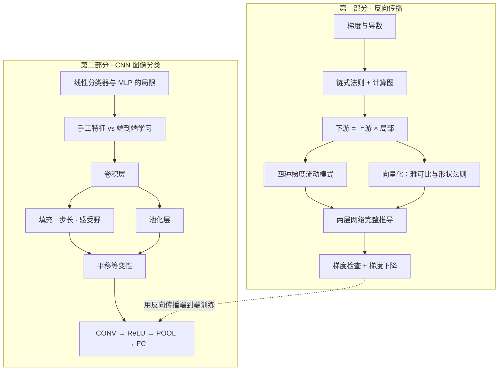
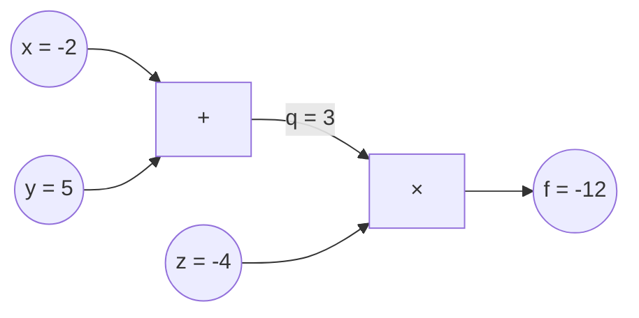
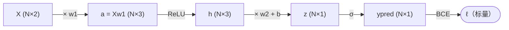
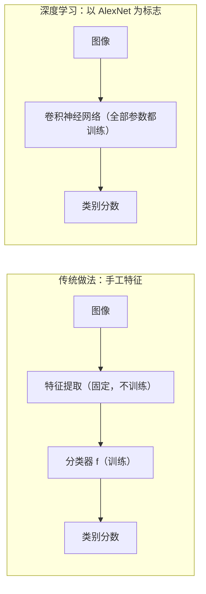

# 🧠 CS231n 学习文档：反向传播练习 × 卷积神经网络图像分类

> 📘 **资料来源**：Stanford CS231n *Deep Learning for Computer Vision* 的两份课件——Section 2《An Exercise in Backpropagation》（Favour Nerrise）与 Lecture 5《Image Classification with CNNs》（Fei-Fei Li、Ehsan Adeli 等，2025-04-14）。本文档在课件基础上，结合 CS231n 官方课程笔记、PyTorch 官方文档与经典论文做了扩展。
>
> 🧭 **阅读建议**：先看「导读」建立全局地图 → 第一部分吃透反向传播 → 第二部分学习 CNN → 第三部分把两者打通。每部分末尾都有**自测题**，建议先独立作答再看答案。
>
> ✅ **可靠性说明**：文中所有数值例子都已用 NumPy 实际运行验证；PyTorch 代码为参考实现。

## 📑 目录

| 部分 | 章节 |
|---|---|
| 📖 导读 | 学习目标 · 知识地图 · 学习路线 · 图标与符号约定 |
| 🔁 第一部分 · 反向传播练习 | 1 梯度回顾 · 2 反向传播是什么 · 3 热身例题 · 4 上游 × 局部 · 5 梯度流动模式 · 6 向量化与雅可比 · 7 两层网络完整推导 · 8 矩阵梯度精讲 · 9 小结与自测 |
| 🖼️ 第二部分 · CNN 图像分类 | 10 课程定位与回顾 · 11 图像特征 · 12 为什么用 CNN · 13 历史脉络 · 14 卷积层 · 15 尺寸、填充、步长与感受野 · 16 计算练习 · 17 卷积总结与 PyTorch · 18 其他维度的卷积 · 19 池化层 · 20 平移等变性 · 21 搭建完整 CNN · 22 小结与自测 |
| 🔗 第三部分 · 融会贯通 | 23 组件与梯度模式对照 · 24 卷积层的反向传播 · 25 完整训练循环 |
| 📚 附录 | A 术语表 · B 参考资料 |

# 📖 导读

## 🎯 学习目标

学完本文档，你应该能够：

- [ ] 用自己的话解释**梯度**、**链式法则**和**计算图**，并说清反向传播为什么高效
- [ ] 熟练运用 **下游梯度 = 上游梯度 × 局部梯度**，手算任意小型计算图的梯度
- [ ] 记住加法门、乘法门、max 门、分支这四种**梯度流动模式**
- [ ] 独立推导"两层网络 + Sigmoid + BCE"的全部梯度，并用代码和**梯度检查**验证
- [ ] 掌握矩阵乘法 $Y=XW$ 的梯度公式，并能用**形状匹配**快速复原
- [ ] 理解线性分类器的局限，以及从**手工特征**到**端到端学习**的范式转变
- [ ] 掌握**卷积层**的工作方式：滤波器、激活图、通道、参数共享
- [ ] 熟练计算卷积与池化的**输出尺寸**、**参数量**、**计算量**和**感受野**
- [ ] 理解**池化**与**平移等变性**，能设计一个简单的 CNN
- [ ] 把两部分打通：说出卷积层、池化层在反向传播中各自的梯度流动规律

## 🗺️ 知识地图



## 🧭 学习路线

| 阶段 | 内容 | 参考用时 | 达标标准 |
|---|---|---|---|
| ① 打基础 | 第 1–5 章：梯度、链式法则、四种门 | 1 小时 | 能独立手算热身题和 Sigmoid 神经元 |
| ② 攻核心 | 第 6–9 章：向量化与两层网络推导 | 1.5–2 小时 | 能默写汇总表，代码梯度检查通过 |
| ③ 学 CNN | 第 10–19 章：卷积、尺寸计算、池化 | 2 小时 | 能快速算出输出尺寸、参数量、感受野 |
| ④ 融会贯通 | 第 20–25 章 | 1 小时 | 能解释卷积层、池化层的反向传播 |

## 🔣 图标与符号约定

| 图标 | 含义 |
|---|---|
| 💡 | 直觉理解、实用技巧 |
| 📌 | 重点结论，建议记住 |
| ⚠️ | 易错点、常见误区 |
| 🔍 | 拓展内容（课件之外的补充） |
| 📝 / 🧪 | 例题 / 动手练习 |
| 🔑 | 参考答案 |

| 符号 | 含义 | 备注 |
|---|---|---|
| $x,\ y,\ z$ | 标量 | |
| $\mathbf{x}$、$X$ | 向量、矩阵 | $X\in\mathbb{R}^{N\times D}$ 表示 $N$ 个样本、每个 $D$ 维 |
| $N$ | batch 大小（一次处理的样本数） | |
| $L$、$\ell$ | 损失（loss） | 永远是**标量** |
| $\frac{\partial L}{\partial x}$ | 损失对 $x$ 的梯度 | 代码中常写作 `dx`，形状与 $x$ 相同 |
| $\odot$ | 逐元素乘法（Hadamard 积） | 即 NumPy 中的 `*` |
| $\mathbb{1}[\cdot]$ | 指示函数：条件成立为 1，否则为 0 | |
| $C_{in}$、$C_{out}$ | 输入、输出通道数 | |
| $H,\ W$ | 特征图的高、宽 | 注意与权重矩阵 $W$ 区分 |
| $K,\ P,\ S$ | 卷积核大小、填充、步长 | |

# 🔁 第一部分 · 反向传播练习（An Exercise in Backpropagation）

> 📌 **本部分主线**：梯度是什么 → 为什么需要反向传播 → 核心规则"上游 × 局部" → 从标量推广到向量与矩阵 → 完整推导一个两层二分类网络。

## 1. 梯度回顾：优化的"指南针"

### 1.1 导数（Derivative）

**导数**描述函数在某一点的**瞬时变化率**——输入发生极小变化时，输出会变化多少：

$$
\frac{df}{dx}=\lim_{h\to 0}\frac{f(x+h)-f(x)}{h}
$$

几何上，它就是函数曲线在该点**切线的斜率**：斜率为正，说明往右走函数变大；斜率为负，说明往右走函数变小。

### 1.2 梯度（Gradient）

当函数有多个输入 $f(x_1,\dots,x_n)$ 时，对每个输入分别求**偏导数**（partial derivative：固定其他变量、只让一个变量变化时的导数），排成向量就是**梯度**：

$$
\nabla f=\left[\frac{\partial f}{\partial x_1},\ \frac{\partial f}{\partial x_2},\ \dots,\ \frac{\partial f}{\partial x_n}\right]^\top
$$

梯度有两个关键性质：

1. **方向**：$\nabla f$ 指向函数**增长最快**的方向，因此 $-\nabla f$ 指向**下降最快**的方向。
2. **大小**：$\lVert\nabla f\rVert$ 表示沿这个方向函数变化得有多陡。

> 💡 **直觉理解**：把损失函数想象成一片山地，等高线图（contour plot）上的每条线代表相同的"海拔"。站在任意一点，梯度指向最陡的上坡；想下山（降低损失），就沿 $-\nabla f$ 走一小步——这就是**梯度下降**（gradient descent）。

### 1.3 在神经网络中，梯度意味着什么？

| 数学中 | 神经网络中 |
|---|---|
| 函数 $f$ | 损失函数 $L$（衡量预测有多差） |
| 输入 $x_1,\dots,x_n$ | 网络的**全部参数**（权重 $W$、偏置 $b$） |
| 梯度 $\nabla f$ | $\nabla_\theta L$：每个参数该往哪个方向调、调多少，才能让损失下降 |

于是，训练就是反复执行这一行公式：

$$
\theta\leftarrow\theta-\alpha\,\nabla_\theta L
$$

其中 $\alpha$ 是**学习率**（learning rate），控制每一步走多远。剩下的唯一问题是：**如何高效地求出 $\nabla_\theta L$**？这正是反向传播要解决的。

### 1.4 🔍 拓展：数值梯度与解析梯度

求梯度有两条路：

| | 数值梯度（numerical gradient） | 解析梯度（analytic gradient） |
|---|---|---|
| 做法 | 按定义给参数加一个很小的 $h$，观察损失的变化 | 用微积分推导公式（反向传播就是系统化地做这件事） |
| 优点 | 实现简单，几乎不会写错 | **精确、极快** |
| 缺点 | 只是近似，而且**极慢**（每个参数都要做两次前向计算） | 推导和实现容易出 bug |
| 用途 | **梯度检查**（gradient check）：验证解析梯度是否写对 | 实际训练 |

实践中常用**中心差分**（centered difference），它的误差是 $O(h^2)$，比单侧差分的 $O(h)$ 小得多：

$$
\frac{df}{dx}\approx\frac{f(x+h)-f(x-h)}{2h},\qquad h\approx 10^{-5}
$$

比较两种梯度时看**相对误差**（relative error）$\dfrac{\lVert g_{num}-g_{ana}\rVert}{\lVert g_{num}\rVert+\lVert g_{ana}\rVert}$，参考 CS231n 笔记的经验标准：

| 相对误差 | 结论 |
|---|---|
| $\gt 10^{-2}$ | 几乎可以肯定梯度写错了 |
| $10^{-4}$ 到 $10^{-2}$ | 很可疑，需要排查 |
| $10^{-7}$ 到 $10^{-4}$ | 若目标函数含"折点"（如 ReLU）通常可以接受；若无折点则偏大 |
| $\lt 10^{-7}$ | 放心，梯度正确 |

## 2. 反向传播：是什么、何时用、为什么

### 2.1 What / When / Why

- **是什么（What）**：一种计算"一串运算的最终输出"对**每个中间量和参数**的梯度的算法。
- **何时用（When）**：几乎所有神经网络的训练都离不开它。
- **为什么（Why）**：手工推导梯度无法规模化；反向传播在**计算图**上**递归地应用链式法则**，既模块化又高效。

> 📌 **一句话定义**：反向传播 = 在计算图上递归地应用链式法则（Backpropagation = recursive chain rule on a computational graph）。梯度下降需要 $\nabla_\theta L$，反向传播负责把它算出来。

两个关键术语：

- **链式法则**（chain rule）：复合函数求导法则。若 $y=f(u)$、$u=g(x)$，则 $\frac{dy}{dx}=\frac{dy}{du}\cdot\frac{du}{dx}$。
- **计算图**（computational graph）：把复杂表达式拆成一系列基本运算（加、乘、max、exp……），每个运算是一个**节点**（node，也叫"门" gate），数据沿边流动的有向图。

### 2.2 手工推导 vs 反向传播

| 维度 | ❌ 手工推导完整梯度表达式 | ✅ 反向传播 |
|---|---|---|
| 工作量 | 繁琐，表达式随网络加深而爆炸式增长 | 每个节点只需知道自己的局部导数 |
| 正确性 | 极易出错 | 模块化，每个模块可以单独测试 |
| 可扩展性 | 网络一改（换损失、加一层）就要全部重推 | 像搭积木一样组合任意网络 |
| 效率 | 大量公共子表达式被重复计算 | 复用前向结果，一次反向就得到所有梯度 |

> 🔍 **拓展：反向传播与自动微分**。PyTorch 的 autograd、JAX、TensorFlow 等框架实现的是**反向模式自动微分**（reverse-mode automatic differentiation）。对于"上百万个输入参数 → 一个标量损失"的函数，反向模式只需**一次前向 + 一次反向**就能得到对全部参数的梯度，总计算量只是一次前向的小常数倍（经验上反向约为前向的 2 倍）。相比之下，数值梯度需要对每个参数分别做前向计算。

## 3. 热身：手算一个小计算图

> 📝 **题目**：$f(x,y,z)=(x+y)\cdot z$，取 $x=-2,\ y=5,\ z=-4$，求 $\frac{\partial f}{\partial x}$、$\frac{\partial f}{\partial y}$、$\frac{\partial f}{\partial z}$。

先引入中间变量把计算拆开：$q=x+y$，$f=q\cdot z$。



### 3.1 前向传播（forward pass）：从左到右算数值

- $q=x+y=-2+5=3$
- $f=q\cdot z=3\times(-4)=-12$

### 3.2 反向传播（backward pass）：从右到左算梯度

| 步骤 | 梯度 | 推导（上游 × 局部） | 数值 |
|---|---|---|---|
| ① 起点 | $\frac{\partial f}{\partial f}$ | 自己对自己求导 | $1$ |
| ② 乘法门 | $\frac{\partial f}{\partial z}$ | 局部梯度 $\frac{\partial(qz)}{\partial z}=q=3$，乘上游 $1$ | $3$ |
| ③ 乘法门 | $\frac{\partial f}{\partial q}$ | 局部梯度 $\frac{\partial(qz)}{\partial q}=z=-4$，乘上游 $1$ | $-4$ |
| ④ 加法门 | $\frac{\partial f}{\partial x}$ | 局部梯度 $\frac{\partial q}{\partial x}=1$，乘上游 $-4$ | $-4$ |
| ⑤ 加法门 | $\frac{\partial f}{\partial y}$ | 局部梯度 $\frac{\partial q}{\partial y}=1$，乘上游 $-4$ | $-4$ |

> ✅ **验证**：把式子展开为 $f=xz+yz$ 后直接求偏导：$\frac{\partial f}{\partial x}=z=-4$，$\frac{\partial f}{\partial y}=z=-4$，$\frac{\partial f}{\partial z}=x+y=3$，与反向传播的结果完全一致。

> 💡 **怎样读懂这些梯度？** $\frac{\partial f}{\partial x}=-4$ 的意思是：$x$ 每增加一个极小量 $\varepsilon$，$f$ 大约**减少** $4\varepsilon$。梯度的符号告诉我们方向，绝对值告诉我们这个变量的"影响力"有多大。

## 4. 核心模式：上游梯度 × 局部梯度

把任意一个节点（门）单独拿出来看：输入 $x$，输出 $z=g(x)$，最终损失为 $L$。


$$
\underbrace{\frac{\partial L}{\partial x}}_{\text{下游梯度}}=\underbrace{\frac{\partial L}{\partial z}}_{\text{上游梯度}}\times\underbrace{\frac{\partial z}{\partial x}}_{\text{局部梯度}}
$$

- **上游梯度**（upstream gradient）：损失对本节点**输出**的梯度，从更靠近损失的一侧传来。
- **局部梯度**（local gradient）：本节点输出对输入的导数，**只取决于这个节点自己的运算**。
- **下游梯度**（downstream gradient）：损失对本节点**输入**的梯度，继续传给更前面的节点。

> 📌 **为什么这让反向传播可模块化、可扩展？** 每个节点完全不需要知道整个网络长什么样，它只需要：① 会算自己的前向；② 会算自己的局部梯度；③ 拿到上游梯度后相乘，再往下传。CS231n 笔记把这称为"反向传播是一个优美的局部过程"。

### 4.1 工程实现：forward / backward + 缓存

在代码中，每个节点通常写成一个带 `forward` 和 `backward` 方法的小模块，前向时把反向需要的值**缓存**（cache）下来：

```python
class Multiply:
    def forward(self, x, y):
        self.x, self.y = x, y          # 缓存输入，反向时要用
        return x * y

    def backward(self, dout):          # dout：上游梯度 ∂L/∂out
        dx = dout * self.y             # 局部梯度 ∂out/∂x = y
        dy = dout * self.x             # 局部梯度 ∂out/∂y = x
        return dx, dy

class Add:
    def forward(self, x, y):
        return x + y

    def backward(self, dout):
        return dout, dout              # 局部梯度都是 1：上游梯度原样分发

# 用它重做热身题 f = (x + y) * z
add, mul = Add(), Multiply()
q = add.forward(-2, 5)                 # q = 3
f = mul.forward(q, -4)                 # f = -12
dq, dz = mul.backward(1.0)             # dq = -4.0, dz = 3.0
dx, dy = add.backward(dq)              # dx = -4.0, dy = -4.0
print(f, dx, dy, dz)                   # -12 -4.0 -4.0 3.0
```

> 💡 **实现小贴士：分阶段计算**（staged computation）。把前向拆成若干个容易求导的小步骤，并给每个中间结果起名字（如 `q`、`dot`）；反向时按相反顺序，为每个变量计算对应的 `d变量名`。这远比推导一个庞大的完整梯度公式可靠。

## 5. 梯度流动的四种模式

| 门（gate） | 前向 | 反向规律 | 一句话记忆 |
|---|---|---|---|
| **加法门** add | $z=a+b$ | $\frac{\partial L}{\partial a}=\frac{\partial L}{\partial b}=\frac{\partial L}{\partial z}$ | **分发器**：上游梯度原样复制给每个输入 |
| **乘法门** mul | $z=a\cdot b$ | $\frac{\partial L}{\partial a}=\frac{\partial L}{\partial z}\cdot b$，$\frac{\partial L}{\partial b}=\frac{\partial L}{\partial z}\cdot a$ | **交换缩放器**：用另一个输入的值缩放上游梯度 |
| **max 门** | $z=\max(a,b)$ | 较大者得到 $\frac{\partial L}{\partial z}$，较小者得到 $0$ | **路由器**：梯度只流向"赢家" |
| **分支 / 复制** copy | 同一个 $a$ 流向多处 | $\frac{\partial L}{\partial a}=\sum_k\frac{\partial L}{\partial z_k}$ | **累加器**：各条支路的梯度相加 |

> ⚠️ **分支处的梯度要累加**：如果一个变量在前向中被用了多次（例如 $f=x\cdot x$，或残差连接 $y=x+F(x)$），反向时来自各条路径的梯度必须**相加**，这是多元链式法则（multivariable chain rule）的直接结果。代码中要写 `dx += ...` 而不是 `dx = ...`，否则会覆盖另一条路径的梯度——这是手写反向传播最常见的 bug 之一。

> 🔍 **拓展：乘法门的"反直觉"效应与数据预处理**。乘法门给每个输入的梯度等于另一个输入的值：如果一个输入很大、另一个很小，那么**小的那个会收到很大的梯度**。在线性分类器 $w^\top x$ 中，这意味着**输入数据的尺度直接决定了权重梯度的大小**——若把所有输入乘以 1000，权重梯度也会放大 1000 倍，学习率就得相应缩小。这正是**数据预处理**（如归一化）如此重要的原因之一。

> 💡 **ReLU 就是 max 门**：$\text{ReLU}(x)=\max(0,x)$ 相当于让输入 $x$ 和常数 0 比大小。$x\gt 0$ 时梯度原样通过，$x\le 0$ 时梯度被截断为 0。后面推导两层网络和 CNN 的最大池化时，会反复用到这个模式。

### 5.1 🧪 练习：带 Sigmoid 的二维神经元

这是 CS231n 官方笔记中的经典例子：

$$
f(w,x)=\frac{1}{1+e^{-(w_0x_0+w_1x_1+w_2)}},\qquad w=[2,\ -3,\ -3],\quad x=[-1,\ -2]
$$

**思路**：

1. 前向：$s=w_0x_0+w_1x_1+w_2=-2+6-3=1$，$f=\sigma(1)\approx0.73$。
2. 把整个 Sigmoid 看成一个门，它的局部梯度是 $\sigma(s)\big(1-\sigma(s)\big)=0.73\times0.27\approx0.20$（推导见 7.4 节）。
3. 加法门把 $0.20$ 原样分给 $w_0x_0$、$w_1x_1$ 和 $w_2$。
4. 乘法门交换缩放：例如 $\frac{\partial f}{\partial w_0}=x_0\times0.20$，$\frac{\partial f}{\partial x_0}=w_0\times0.20$。

请先自己算出全部 5 个梯度，再对照答案。

> 🔑 **参考答案**
>
> | 变量 | $w_0$ | $w_1$ | $w_2$ | $x_0$ | $x_1$ |
> |---|---|---|---|---|---|
> | 梯度 | $-0.20$ | $-0.39$ | $0.20$ | $0.39$ | $-0.59$ |
>
> 计算过程：$\frac{\partial f}{\partial w}=[x_0,\ x_1,\ 1]\times0.197$，$\frac{\partial f}{\partial x}=[w_0,\ w_1]\times0.197$。

## 6. 从标量到向量、矩阵：雅可比与形状法则

### 6.1 三种情形

| 输入 → 输出 | 导数叫什么 | 形状 | 含义 |
|---|---|---|---|
| 标量 → 标量（$x\in\mathbb{R}\to y\in\mathbb{R}$） | 导数（derivative） | 一个数 | $x$ 变一点，$y$ 变多少 |
| 向量 → 标量（$\mathbf{x}\in\mathbb{R}^n\to y\in\mathbb{R}$） | 梯度（gradient） | $n$，与 $\mathbf{x}$ 相同 | 每个分量各自对 $y$ 的影响 |
| 向量 → 向量（$\mathbf{x}\in\mathbb{R}^n\to\mathbf{y}\in\mathbb{R}^m$） | **雅可比矩阵**（Jacobian） | $m\times n$ | 每个输入分量对每个输出分量的影响 |

**雅可比矩阵**就是把所有偏导数排成的表：

$$
J=\frac{\partial\mathbf{y}}{\partial\mathbf{x}}=\begin{bmatrix}\frac{\partial y_1}{\partial x_1} & \cdots & \frac{\partial y_1}{\partial x_n}\\ \vdots & \ddots & \vdots\\ \frac{\partial y_m}{\partial x_1} & \cdots & \frac{\partial y_m}{\partial x_n}\end{bmatrix}\in\mathbb{R}^{m\times n}
$$

这时链式法则变成"矩阵 × 向量"：$\frac{\partial L}{\partial\mathbf{x}}=J^\top\frac{\partial L}{\partial\mathbf{y}}$。若输入输出是更高维的张量，雅可比的形状就是"（输入元素总数）×（输出元素总数）"。

### 6.2 黄金法则：梯度与变量同形

> 📌 **形状法则**（shape rule）：损失 $L$ 永远是一个**标量**，所以 $\frac{\partial L}{\partial X}$ 的形状**永远和 $X$ 完全相同**。$X$ 是 $N\times3$，梯度就是 $N\times3$；$w_1$ 是 $2\times3$，梯度就是 $2\times3$。

这条法则是推导和调试反向传播时最好的"安检门"：形状对不上，就一定有错。

### 6.3 🔍 拓展：为什么实践中从不显式构造雅可比矩阵？

雅可比矩阵往往**巨大而稀疏**。例如对 4096 维向量逐元素做 ReLU，雅可比矩阵是 $4096\times4096$（约 1678 万个元素），但只有对角线非零：

$$
\frac{\partial\,\text{ReLU}(\mathbf{x})}{\partial\mathbf{x}}=\text{diag}\big(\mathbb{1}[x_1\gt 0],\ \dots,\ \mathbb{1}[x_n\gt 0]\big)
$$

于是"雅可比 × 上游梯度"等价于一次**逐元素乘法**：$\frac{\partial L}{\partial\mathbf{x}}=\frac{\partial L}{\partial\mathbf{y}}\odot\mathbb{1}[\mathbf{x}\gt 0]$。如果再考虑 batch（例如 $N=100$），雅可比将达到 $409600\times409600$，根本存不下。因此框架只实现**向量-雅可比积**（vector-Jacobian product, VJP），直接算出结果而不构造矩阵。

## 7. 主线案例：两层神经网络做二分类

### 7.1 问题定义

- **数据**：$X\in\mathbb{R}^{N\times2}$（$N$ 个样本，每个样本 2 个特征），标签 $y\in\{0,1\}^N$。
- **模型**：$f_\theta:\mathbb{R}^2\to[0,1]$，输出样本属于类别 1 的概率。
- **激活函数**（activation function：为网络引入非线性的逐元素函数）：
  - **ReLU**（修正线性单元，Rectified Linear Unit）：$x_+=\max(0,x)$
  - **Sigmoid**（S 型函数）：$\sigma(x)=\frac{1}{1+e^{-x}}$，把任意实数压缩到 $(0,1)$，可以解释为概率
- **损失函数**：**二元交叉熵**（Binary Cross-Entropy, BCE）

$$
\ell_i=-\big(y_i\log p_i+(1-y_i)\log(1-p_i)\big),\qquad \ell=\frac{1}{N}\sum_{i=1}^{N}\ell_i
$$

> 💡 **BCE 的直觉**：真实标签 $y_i=1$ 时损失为 $-\log p_i$：预测概率 $p_i$ 越接近 1，损失越接近 0；越接近 0，损失趋向无穷大。$y_i=0$ 时情况对称。它会**重罚"自信地犯错"**。从概率角度看，最小化 BCE 等价于对伯努利分布做**极大似然估计**（maximum likelihood estimation, MLE）。

### 7.2 网络结构

$$
f_\theta(x)=\sigma\big(\max(0,\ xw_1)\,w_2+b\big)
$$

| 参数 | 形状 | 作用 |
|---|---|---|
| $w_1$ | $2\times3$ | 输入层（2 个特征）→ 隐藏层（3 个神经元） |
| $w_2$ | $3\times1$ | 隐藏层 → 输出 |
| $b$ | 标量 | 输出层的偏置（bias） |

计算图共 5 个节点，前向从左到右，反向从右到左：



> 📝 **记号**：为书写方便，记 $a=Xw_1$（隐藏层的**预激活值** pre-activation），$h=\max(0,a)$，$z=hw_2+b$（输出的 **logit**，即 Sigmoid 之前的原始分数），$p=y_{pred}=\sigma(z)$。反向传播的顺序是：BCE → Sigmoid → 线性层 2 → ReLU → 线性层 1。

### 7.3 Step 1：BCE 节点

损失 $\ell$ 是计算图的终点，上游梯度为 $\frac{\partial\ell}{\partial\ell}=1$。对每个样本的预测求导：

$$
\frac{\partial\ell}{\partial p_i}=\frac{1}{N}\left(-\frac{y_i}{p_i}+\frac{1-y_i}{1-p_i}\right),\qquad \frac{\partial\ell}{\partial p}\in\mathbb{R}^{N}
$$

> ⚠️ **别忘了 $\frac{1}{N}$**：损失是所有样本的**平均值**，每个样本只贡献 $1/N$ 的份额。

### 7.4 Step 2：Sigmoid 节点

Sigmoid 的导数有一个漂亮的形式：

$$
\frac{d\sigma}{dz}=\sigma(z)\big(1-\sigma(z)\big)
$$

推导：$\sigma(z)=(1+e^{-z})^{-1}$，所以

$$
\sigma'(z)=\frac{e^{-z}}{(1+e^{-z})^2}=\frac{1}{1+e^{-z}}\cdot\frac{e^{-z}}{1+e^{-z}}=\sigma(z)\big(1-\sigma(z)\big)
$$

因此（逐元素）：

$$
\frac{\partial\ell}{\partial z}=\frac{\partial\ell}{\partial p}\odot p\odot(1-p)
$$

> 💡 **Sigmoid 技巧**：局部梯度只用到前向时已经算好的输出 $p$，**不必重新计算指数**——这就是缓存前向结果的价值。

#### ⭐ 关键化简：BCE + Sigmoid 的梯度就是 $(p-y)/N$

把 Step 1 和 Step 2 乘起来：

$$
\frac{\partial\ell}{\partial z_i}=\frac{1}{N}\left(-\frac{y_i}{p_i}+\frac{1-y_i}{1-p_i}\right)p_i(1-p_i)=\frac{1}{N}\big(-y_i(1-p_i)+(1-y_i)p_i\big)=\frac{p_i-y_i}{N}
$$

> 📌 **重要结论**：Sigmoid 与 BCE 组合后，对 logit 的梯度就是**预测减真实**（再除以 $N$）。预测偏高时梯度为正，梯度下降会把 $z$ 往下推；预测偏低时梯度为负，会把 $z$ 往上拉。Softmax + 交叉熵也有完全同构的结论：$\frac{\partial L}{\partial s}=\text{softmax}(s)-\text{onehot}(y)$。

> 🔍 **拓展：数值稳定性**。当 $p$ 非常接近 0 或 1 时，单独计算 $\log p$ 或 $\frac{y}{p}$ 可能溢出或得到 `nan`。因此框架提供了把两者合并的接口，例如 PyTorch 的 `nn.BCEWithLogitsLoss`（直接输入 logit $z$），官方文档说明它借助 log-sum-exp 技巧，比"Sigmoid + `BCELoss`"更稳定。实践中应**优先使用合并版本**。

> ⚠️ **Sigmoid 与梯度消失**（vanishing gradient）：$\sigma(1-\sigma)$ 的最大值只有 $0.25$（在 $z=0$ 处取到），当 $\lvert z\rvert$ 很大（饱和区）时几乎为 0。反向传播每经过一个 Sigmoid，梯度都要乘上一个不超过 0.25 的因子；层数一多，连乘的结果迅速趋近于 0，前面几层几乎学不到东西。这是隐藏层普遍改用 ReLU 的重要原因。

### 7.5 Step 3：线性层 2（$z=hw_2+b$）

上游梯度 $\frac{\partial\ell}{\partial z}\in\mathbb{R}^{N\times1}$。三个梯度分别为：

$$
\frac{\partial\ell}{\partial w_2}=h^\top\frac{\partial\ell}{\partial z}\qquad(3\times1)=(3\times N)(N\times1)
$$

$$
\frac{\partial\ell}{\partial b}=\sum_{i=1}^{N}\frac{\partial\ell}{\partial z_i}\qquad\text{（标量）}
$$

$$
\frac{\partial\ell}{\partial h}=\frac{\partial\ell}{\partial z}\,w_2^\top\qquad(N\times3)=(N\times1)(1\times3)
$$

> 💡 **为什么偏置的梯度要求和？** 同一个 $b$ 被**广播**（broadcast：自动复制以匹配形状）加到了全部 $N$ 个样本上，相当于被复制了 $N$ 份。根据分支累加规则，$N$ 条路径的梯度要加起来。

> 💡 **这就是乘法门的矩阵版**：标量乘法门 $z=ab$ 中，$a$ 的梯度是"上游 × $b$"；矩阵版 $z=hw_2$ 中，$w_2$ 的梯度是"$h^\top$ × 上游"，$h$ 的梯度是"上游 × $w_2^\top$"。转置和左右顺序由**形状匹配**唯一确定。

### 7.6 Step 4：ReLU 节点（$h=\max(0,a)$）

局部梯度是逐元素的 0/1 开关：

$$
\frac{\partial h_{ij}}{\partial a_{ij}}=\begin{cases}1, & a_{ij}\gt 0\\ 0, & a_{ij}\le 0\end{cases}\qquad\Longrightarrow\qquad\frac{\partial\ell}{\partial a}=\frac{\partial\ell}{\partial h}\odot\mathbb{1}[a\gt 0]
$$

> 💡 **ReLU 是一个 max 门**：前向时输入为正的位置，梯度**原样通过**；输入 ≤ 0 的位置，梯度被**截断为 0**。

> ⚠️ **两个细节**
>
> - **0 点不可导**：ReLU 在 $a=0$ 处没有导数，惯例取 0（取 0 到 1 之间的任意值都是合法的**次梯度** subgradient），实践中几乎没有影响。
> - **死亡 ReLU**（dying ReLU）：如果某个神经元对所有样本的输入都 ≤ 0，它的梯度就永远是 0，参数再也不会更新，这个神经元就"死"了。学习率过大、初始化不当都可能导致这一问题；**Leaky ReLU**（$\max(0.01x,\ x)$）、ELU、GELU 等变体可以缓解。

### 7.7 Step 5：线性层 1（$a=Xw_1$）

$$
\frac{\partial\ell}{\partial w_1}=X^\top\frac{\partial\ell}{\partial a}\qquad(2\times3)=(2\times N)(N\times3)
$$

$X$ 是数据而不是参数，通常不需要求它的梯度；但如果 $X$ 是上一层的输出，它的梯度 $\frac{\partial\ell}{\partial a}\,w_1^\top$ 还要继续往前传。

> 📌 **矩阵乘法的梯度公式（必背）**：若 $Y=XW$，则
>
> - $\frac{\partial\ell}{\partial W}=X^\top\frac{\partial\ell}{\partial Y}$
> - $\frac{\partial\ell}{\partial X}=\frac{\partial\ell}{\partial Y}W^\top$
>
> 这就是乘法门"交换并缩放"规律在矩阵上的推广，完整推导见第 8 章。

最后，用梯度下降更新全部参数（$\alpha$ 为学习率）：

$$
w_1\leftarrow w_1-\alpha\frac{\partial\ell}{\partial w_1},\qquad w_2\leftarrow w_2-\alpha\frac{\partial\ell}{\partial w_2},\qquad b\leftarrow b-\alpha\frac{\partial\ell}{\partial b}
$$

### 7.8 全流程汇总表

| 步骤 | 节点 | 前向 | 反向（下游 = 上游 × 局部） | 梯度形状 |
|---|---|---|---|---|
| 1 | BCE | $\ell=\frac{1}{N}\sum_i\ell_i$ | $\frac{\partial\ell}{\partial p}=\frac{1}{N}\left(-\frac{y}{p}+\frac{1-y}{1-p}\right)$ | $N\times1$ |
| 2 | Sigmoid | $p=\sigma(z)$ | $\frac{\partial\ell}{\partial z}=\frac{\partial\ell}{\partial p}\odot p\odot(1-p)=\frac{p-y}{N}$ | $N\times1$ |
| 3 | 线性层 2 | $z=hw_2+b$ | $\frac{\partial\ell}{\partial w_2}=h^\top\frac{\partial\ell}{\partial z}$；$\frac{\partial\ell}{\partial b}=\sum_i\frac{\partial\ell}{\partial z_i}$；$\frac{\partial\ell}{\partial h}=\frac{\partial\ell}{\partial z}w_2^\top$ | $3\times1$；标量；$N\times3$ |
| 4 | ReLU | $h=\max(0,a)$ | $\frac{\partial\ell}{\partial a}=\frac{\partial\ell}{\partial h}\odot\mathbb{1}[a\gt 0]$ | $N\times3$ |
| 5 | 线性层 1 | $a=Xw_1$ | $\frac{\partial\ell}{\partial w_1}=X^\top\frac{\partial\ell}{\partial a}$ | $2\times3$ |

### 7.9 ✍️ 手算一遍（N = 1）

取一个样本：$X=[1,\ 2]$，$y=1$，参数为

$$
w_1=\begin{bmatrix}1 & -1 & 0.5\\ 0.5 & 1 & -1\end{bmatrix},\qquad w_2=\begin{bmatrix}1\\ -1\\ 2\end{bmatrix},\qquad b=0
$$

**前向传播**

| 量 | 计算 | 结果 |
|---|---|---|
| $a=Xw_1$ | $[1\cdot1+2\cdot0.5,\ \ 1\cdot(-1)+2\cdot1,\ \ 1\cdot0.5+2\cdot(-1)]$ | $[2,\ 1,\ -1.5]$ |
| $h=\max(0,a)$ | 负数置 0 | $[2,\ 1,\ 0]$ |
| $z=hw_2+b$ | $2\cdot1+1\cdot(-1)+0\cdot2+0$ | $1$ |
| $p=\sigma(z)$ | $1/(1+e^{-1})$ | $0.7311$ |
| $\ell$ | $-\log0.7311$ | $0.3133$ |

**反向传播**

| 量 | 计算 | 结果 |
|---|---|---|
| $\frac{\partial\ell}{\partial z}$ | $p-y=0.7311-1$ | $-0.2689$ |
| $\frac{\partial\ell}{\partial w_2}$ | $h^\top\times(-0.2689)$ | $[-0.5379,\ -0.2689,\ 0]^\top$ |
| $\frac{\partial\ell}{\partial b}$ | 只有一个样本，直接等于 $\frac{\partial\ell}{\partial z}$ | $-0.2689$ |
| $\frac{\partial\ell}{\partial h}$ | $-0.2689\times[1,\ -1,\ 2]$ | $[-0.2689,\ 0.2689,\ -0.5379]$ |
| $\frac{\partial\ell}{\partial a}$ | 乘以掩码 $\mathbb{1}[a\gt 0]=[1,\ 1,\ 0]$ | $[-0.2689,\ 0.2689,\ 0]$ |
| $\frac{\partial\ell}{\partial w_1}$ | $X^\top\frac{\partial\ell}{\partial a}$（$2\times1$ 与 $1\times3$ 的外积） | 第 1 行 $[-0.2689,\ 0.2689,\ 0]$；第 2 行 $[-0.5379,\ 0.5379,\ 0]$ |

> 💡 **读懂结果**
>
> - 第 3 个隐藏神经元的前向输出为 0（被 ReLU 关闭），所以 $w_1$ 的第 3 列、$w_2$ 的第 3 个分量梯度都是 0——**被关闭的神经元不参与这一次学习**。
> - $\frac{\partial\ell}{\partial z}\lt 0$，说明增大 $z$ 能降低损失（让 $p$ 更接近真实标签 1），梯度下降会把 $z$ 往上推。
> - 取 $\alpha=0.1$ 更新一步后重新前向计算，损失从 $0.3133$ 降到 $0.2138$ ✅。

### 7.10 💻 NumPy 实现 + 梯度检查

下面的代码把汇总表逐行翻译成 NumPy，并用中心差分做梯度检查：

```python
import numpy as np

def sigmoid(x):
    return 1.0 / (1.0 + np.exp(-x))

def forward_backward(X, y, w1, w2, b):
    """X:(N,2)  y:(N,1)  w1:(2,3)  w2:(3,1)  b:标量"""
    N = X.shape[0]
    # ---------- 前向传播：逐级计算，并缓存反向要用的中间结果 ----------
    a = X @ w1                          # (N,3)  线性层 1
    h = np.maximum(0, a)                # (N,3)  ReLU
    z = h @ w2 + b                      # (N,1)  线性层 2（b 被广播到每个样本）
    p = sigmoid(z)                      # (N,1)  预测概率 ypred
    loss = -np.mean(y * np.log(p) + (1 - y) * np.log(1 - p))

    # ---------- 反向传播：下游梯度 = 上游梯度 × 局部梯度 ----------
    dp = (-y / p + (1 - y) / (1 - p)) / N    # Step 1  BCE 节点
    dz = dp * p * (1 - p)                    # Step 2  Sigmoid 节点（化简后正是 (p - y) / N）
    dw2 = h.T @ dz                           # Step 3  (3,N)@(N,1) -> (3,1)
    db = dz.sum()                            #         b 被广播 -> 沿 batch 求和
    dh = dz @ w2.T                           #         (N,1)@(1,3) -> (N,3)
    da = dh * (a > 0)                        # Step 4  ReLU：正区间放行，其余清零
    dw1 = X.T @ da                           # Step 5  (2,N)@(N,3) -> (2,3)
    return loss, {"w1": dw1, "w2": dw2, "b": db}


def numerical_grad(f, param, h=1e-5):
    """中心差分：逐元素计算 (f(θ+h) - f(θ-h)) / 2h"""
    grad = np.zeros_like(param)
    it = np.nditer(param, flags=["multi_index"])
    while not it.finished:
        idx = it.multi_index
        old = param[idx]
        param[idx] = old + h; f_plus = f()
        param[idx] = old - h; f_minus = f()
        param[idx] = old                     # 一定要还原参数！
        grad[idx] = (f_plus - f_minus) / (2 * h)
        it.iternext()
    return grad

def rel_error(a, b):
    return np.linalg.norm(a - b) / (np.linalg.norm(a) + np.linalg.norm(b) + 1e-12)

rng = np.random.default_rng(0)
X  = rng.normal(size=(8, 2))
y  = rng.integers(0, 2, size=(8, 1)).astype(float)
w1 = rng.normal(size=(2, 3))
w2 = rng.normal(size=(3, 1))
b  = np.array(0.1)                           # 0 维数组，方便原地修改

loss, grads = forward_backward(X, y, w1, w2, b)
f = lambda: forward_backward(X, y, w1, w2, b)[0]
for name, param in [("w1", w1), ("w2", w2), ("b", b)]:
    num = numerical_grad(f, param)
    print(f"{name}: 相对误差 = {rel_error(num, grads[name]):.2e}")
```

运行输出：

```text
w1: 相对误差 = 1.37e-11
w2: 相对误差 = 1.33e-11
b: 相对误差 = 2.24e-11
```

相对误差在 $10^{-11}$ 量级，说明解析梯度完全正确。把 7.9 节的手算数据代入 `forward_backward`，也会得到与表格一致的结果。

### 7.11 🔧 用 PyTorch autograd 对照（参考代码）

```python
# 需要先安装 PyTorch：pip install torch
import torch

X  = torch.tensor([[1., 2.]])
y  = torch.tensor([[1.]])
w1 = torch.tensor([[1., -1., 0.5], [0.5, 1., -1.]], requires_grad=True)
w2 = torch.tensor([[1.], [-1.], [2.]], requires_grad=True)
b  = torch.tensor(0., requires_grad=True)

z = torch.relu(X @ w1) @ w2 + b
loss = torch.nn.functional.binary_cross_entropy_with_logits(z, y)  # 数值稳定的 Sigmoid + BCE
loss.backward()                  # 一行完成整个反向传播

print(loss.item())               # 0.3133
print(w1.grad)                   # [[-0.2689, 0.2689, 0.], [-0.5379, 0.5379, 0.]]
print(w2.grad.T, b.grad)         # [[-0.5379, -0.2689, 0.]]  -0.2689
```

> 💡 框架自动完成了我们手推的每一步：前向时记录计算图，调用 `backward()` 时从损失出发，按"上游 × 局部"逆序遍历。**亲手推一遍的意义在于**：训练出问题（梯度爆炸或消失、出现 `nan`、不收敛）时，你知道该去哪里找原因。

## 8. 附录精讲：批量矩阵乘法 $Y=XW$ 的梯度推导

设 $Y=XW$，其中 $X\in\mathbb{R}^{N\times D_x}$，$W\in\mathbb{R}^{D_x\times D_y}$，$Y\in\mathbb{R}^{N\times D_y}$。逐元素写开：

$$
Y_{ij}=\sum_{k=1}^{D_x}X_{ik}W_{kj}
$$

### 8.1 对 $W$ 的梯度

$W_{kj}$ 只出现在 $Y$ **第 $j$ 列**的元素 $Y_{1j},\dots,Y_{Nj}$ 中，且 $\frac{\partial Y_{ij}}{\partial W_{kj}}=X_{ik}$。也就是说，$\frac{\partial Y}{\partial W_{kj}}$ 是一个 $N\times D_y$ 的矩阵，除第 $j$ 列为 $[X_{1k},\dots,X_{Nk}]^\top$ 外全为 0。由链式法则：

$$
\frac{\partial\ell}{\partial W_{kj}}=\sum_{i=1}^{N}\frac{\partial\ell}{\partial Y_{ij}}\frac{\partial Y_{ij}}{\partial W_{kj}}=\sum_{i=1}^{N}X_{ik}\frac{\partial\ell}{\partial Y_{ij}}=\left(X^\top\frac{\partial\ell}{\partial Y}\right)_{kj}
$$

> 💡 **含义**：权重被所有样本共享，所以**权重梯度要在整个 batch 上累加**（对 $i$ 求和），这又是"分支处梯度相加"。

### 8.2 对 $X$ 的梯度

$X_{ik}$ 只影响 $Y$ 的**第 $i$ 行**，且 $\frac{\partial Y_{ij}}{\partial X_{ik}}=W_{kj}$，所以 $\frac{\partial Y}{\partial X_{ik}}$ 除第 $i$ 行为 $[W_{k1},\dots,W_{kD_y}]$ 外全为 0：

$$
\frac{\partial\ell}{\partial X_{ik}}=\sum_{j=1}^{D_y}\frac{\partial\ell}{\partial Y_{ij}}W_{kj}=\left(\frac{\partial\ell}{\partial Y}W^\top\right)_{ik}
$$

> 💡 **含义**：样本 $i$ 第 $k$ 个特征的梯度取决于权重矩阵的第 $k$ 行 $W_{k,:}$，它把这个特征连接到的所有输出的梯度汇总起来。每个样本只影响自己那一行输出，所以对 $X$ 的梯度**不跨样本求和**。

### 8.3 🧠 记忆法：形状匹配（dimension analysis）

不必死记公式，只要记住两点：① 梯度和变量同形；② 结果一定是"另一个矩阵"与 $\frac{\partial\ell}{\partial Y}$ 的乘积。在形状上**只有唯一一种拼法**能对上：

| 想求 | 需要的形状 | 可用材料 | 唯一拼法 |
|---|---|---|---|
| $\frac{\partial\ell}{\partial W}$ | $D_x\times D_y$ | $X$：$N\times D_x$；$\frac{\partial\ell}{\partial Y}$：$N\times D_y$ | $X^\top\frac{\partial\ell}{\partial Y}$ |
| $\frac{\partial\ell}{\partial X}$ | $N\times D_x$ | $\frac{\partial\ell}{\partial Y}$：$N\times D_y$；$W$：$D_x\times D_y$ | $\frac{\partial\ell}{\partial Y}W^\top$ |

## 9. 第一部分小结与自测

### 9.1 核心要点

1. **梯度**指向函数增长最快的方向；训练就是沿负梯度反复更新参数。
2. **反向传播** = 计算图 + 递归链式法则，每个节点只做一件事：**下游 = 上游 × 局部**。
3. 四种模式：**加法分发、乘法交换缩放、max 路由、分支累加**。
4. **形状法则**：$\frac{\partial L}{\partial X}$ 与 $X$ 同形；实践中用逐元素运算和矩阵乘法代替显式雅可比。
5. **Sigmoid + BCE** 对 logit 的梯度化简为 $(p-y)/N$；**ReLU** 是梯度的开关。
6. $Y=XW$：$\frac{\partial\ell}{\partial W}=X^\top\frac{\partial\ell}{\partial Y}$，$\frac{\partial\ell}{\partial X}=\frac{\partial\ell}{\partial Y}W^\top$。
7. 写完反向传播，一定要做**梯度检查**。

### 9.2 📝 自测题

1. 对 $f(x,y)=\max(x,y)\cdot x$，求在 $x=3,\ y=1$ 处的 $\frac{\partial f}{\partial x}$ 和 $\frac{\partial f}{\partial y}$。（提示：$x$ 有分支！）
2. 为什么偏置 $b$ 的梯度要沿 batch 维度求和？
3. 若 $X\in\mathbb{R}^{64\times100}$，$W\in\mathbb{R}^{100\times10}$，$Y=XW$，那么 $\frac{\partial\ell}{\partial W}$ 和 $\frac{\partial\ell}{\partial X}$ 的形状各是什么？怎么计算？
4. 网络最后一层是 Sigmoid + BCE，某个样本 $y=0$、预测 $p=0.9$，$N=1$。求 $\frac{\partial\ell}{\partial z}$，并判断梯度下降会让 $z$ 变大还是变小。
5. 如果一个隐藏神经元对整个训练集的预激活值都是负数，会发生什么？如何缓解？
6. 梯度检查为什么用中心差分？相对误差为 $10^{-2}$ 说明什么？

> 🔑 **参考答案**
>
> 1. 前向：$m=\max(3,1)=3$，$f=m\cdot x=9$。乘法门：$m$ 得到 $x=3$，$x$ 的直接路径得到 $m=3$；max 门把 $m$ 的梯度 3 路由给较大的 $x$，$y$ 得 0。$x$ 有两条路径，梯度相加：$\frac{\partial f}{\partial x}=3+3=6$，$\frac{\partial f}{\partial y}=0$。（验证：$x\gt y$ 时 $f=x^2$，导数 $2x=6$ ✓）
> 2. $b$ 被广播到每个样本，相当于复制了 $N$ 份参与计算；根据分支累加规则，$N$ 条路径的梯度要相加。
> 3. $\frac{\partial\ell}{\partial Y}$ 为 $64\times10$；$\frac{\partial\ell}{\partial W}=X^\top\frac{\partial\ell}{\partial Y}$，形状 $100\times10$；$\frac{\partial\ell}{\partial X}=\frac{\partial\ell}{\partial Y}W^\top$，形状 $64\times100$。
> 4. $\frac{\partial\ell}{\partial z}=p-y=0.9\gt 0$；梯度下降沿负梯度方向更新，$z$ 会变小，$p$ 随之下降，更接近真实标签 0。
> 5. 它成了"死亡 ReLU"：梯度恒为 0，参数不再更新。可以调小学习率、改进初始化，或改用 Leaky ReLU、ELU、GELU 等变体。
> 6. 中心差分的误差是 $O(h^2)$，比单侧差分的 $O(h)$ 精确得多；相对误差达到 $10^{-2}$，基本说明解析梯度写错了。

# 🖼️ 第二部分 · 用卷积神经网络做图像分类（Lecture 5）

> 📌 **本部分主线**：回顾线性分类器与全连接网络 → 认识它们的局限 → 从手工特征到端到端学习 → 卷积层（核心）→ 尺寸、填充、步长与感受野 → 池化层 → 平移等变性 → 搭建完整的 CNN。

## 10. 课程定位与知识回顾

### 10.1 课程地图

| 模块 | 讲次 | 内容 |
|---|---|---|
| 深度学习基础 | L2–L4 | 图像分类、线性分类器、损失函数与优化、神经网络与反向传播 |
| **感知与理解视觉世界** | **L5–L12** | **本讲：用 CNN 做图像分类**；下一讲 CNN 架构；第 8 讲 Transformer 等 |
| 生成式与交互式视觉智能 | L13–L16 | Generative and Interactive Visual Intelligence |
| 以人为本的应用与影响 | L17–L18 | Human-Centered Applications and Implications |

### 10.2 回顾 1：线性分类器

$$
f(x,W)=Wx+b
$$

一张 $32\times32\times3$ 的 CIFAR-10 图像被拉平成 $3072$ 维向量 $x$，$W\in\mathbb{R}^{10\times3072}$，输出 10 个类别分数。三种理解视角：

| 视角 | 理解 |
|---|---|
| **代数视角** | $f=Wx+b$，就是一次矩阵乘法 |
| **视觉视角** | $W$ 的每一行都能还原成一张图——**每个类别一个模板**（template），分数就是图像与模板的匹配程度 |
| **几何视角** | 每个类别对应高维空间中的一个**超平面**（hyperplane），把空间切分成不同区域 |

### 10.3 回顾 2：损失函数与优化器

**Softmax 损失**（多分类交叉熵）：

$$
L_i=-\log\frac{e^{s_{y_i}}}{\sum_j e^{s_j}},\qquad L=\frac{1}{N}\sum_{i=1}^{N}L_i+R(W)
$$

其中 $s=f(x;W)$ 是类别分数，$R(W)$ 是**正则化项**（regularization：惩罚过大的权重，防止过拟合）。

常见的**优化器**（optimizer）一览（$g$ 为当前梯度，$\alpha$ 为学习率）：

| 优化器 | 核心更新 | 直觉 |
|---|---|---|
| SGD | $\theta\leftarrow\theta-\alpha g$ | 每次用一个 mini-batch 的梯度走一步 |
| SGD + Momentum | $v\leftarrow\rho v+g$，$\theta\leftarrow\theta-\alpha v$ | 像小球滚下山，积累"速度"，冲过平坦区、抑制震荡 |
| RMSProp | $s\leftarrow\beta s+(1-\beta)g^2$，$\theta\leftarrow\theta-\alpha\frac{g}{\sqrt{s}+\epsilon}$ | 按每个参数历史梯度的大小**自适应**调整步长 |
| Adam | 一阶矩 $m$ + 二阶矩 $v$ + 偏差修正 | Momentum 与 RMSProp 的结合，常用 $\beta_1=0.9,\ \beta_2=0.999$ |

### 10.4 回顾 3：线性分类器的局限与全连接网络

线性分类器有两大局限：

1. **每类只有一个模板**：无法表示同一类别的多种形态（例如头朝左和头朝右的马）。
2. **只能画直线（超平面）边界**：例如红点在中间、蓝点围成一圈，任何一条直线都分不开它们。

**两层全连接网络**（fully-connected network，也叫多层感知机 MLP）通过加入非线性来解决：

$$
f=W_2\max(0,\ W_1x),\qquad x\in\mathbb{R}^{3072}\xrightarrow{W_1}h\in\mathbb{R}^{100}\xrightarrow{W_2}s\in\mathbb{R}^{10}
$$

第一层可以学到 100 个模板，第二层再把它们组合成类别分数。网络用**计算图 + 反向传播**训练（见第一部分）：$\frac{\partial L}{\partial x}$ 始终与 $x$ 同形，损失 $L$ 始终是标量。

### 10.5 本讲要补上的拼图

目前我们手里的积木是**全连接层**和**激活函数**。本讲新增两种**专门为图像设计**的算子：

- **卷积层**（convolution layer）：在保持空间结构的前提下提取局部特征。
- **池化层**（pooling layer）：对特征图做下采样，例如 $64\times224\times224\to64\times112\times112$。

## 11. 图像特征：从手工设计到端到端学习

### 11.1 图像分类任务

给定一张图像和一组固定的类别标签（如 {狗, 猫, 卡车, 飞机, …}），输出图像所属的类别。有两种做法：

- **直接在像素空间分类**：$f(x)=Wx$，$x$ 为原始像素。
- **先提取特征再分类**：图像 → **特征表示**（feature representation）→ $f(x)=Wx$。

### 11.2 经典的手工特征

**① 颜色直方图**（color histogram）：把色调（hue）划分为若干区间（bin），统计每个区间内的像素数——每个像素给它所在的颜色区间"+1"。

- 优点：简单，对物体的位置和旋转不敏感。
- 缺点：**完全丢失空间和形状信息**（一辆红色的车和一丛红色的花，直方图可能很像）。

**② 方向梯度直方图**（Histogram of Oriented Gradients, HoG）：

1. 把图像划分成 $8\times8$ 像素的小区域（cell）；
2. 在每个区域内统计边缘方向的直方图，方向量化为 **9 个 bin**；
3. 例如 $320\times240$ 的图像 → $40\times30$ 个区域 × 9 个方向 = **10,800 维特征**。

- 优点：刻画了局部的**形状和边缘**结构，对光照变化较鲁棒。HoG 曾是行人检测的经典方法（Dalal & Triggs, CVPR 2005），相关思想也见于 SIFT（Lowe, ICCV 1999）。
- 实践中常把多种特征**拼接**（concatenate）成一个长向量，再送入分类器。

### 11.3 范式转变：从特征工程到端到端学习



| | 手工特征 + 分类器 | 卷积神经网络（ConvNet） |
|---|---|---|
| 特征从哪来 | 专家设计（颜色直方图、HoG、SIFT……） | **从数据中自动学习** |
| 训练什么 | 只训练最后的分类器 | **整个系统端到端训练** |
| 性能上限 | 受限于人类对"好特征"的理解 | 随数据和算力增长持续提升 |

> 💡 **端到端**（end-to-end）：从原始输入（像素）到最终输出（类别）的所有环节都由同一个损失函数驱动，用反向传播统一优化，中间没有人为固定的步骤。

## 12. 为什么需要卷积神经网络？

### 12.1 全连接层"看不懂"图像

全连接层要求先把图像拉平：$32\times32\times3\to3072$ 维向量。这带来两个问题：

1. **破坏空间结构**：相邻的像素拉平后可能相隔很远，网络失去了"哪些像素彼此相邻"这个关键信息。
2. **参数爆炸**：对于 $224\times224\times3$ 的图像（150,528 维），隐藏层只要有 1000 个神经元，第一层就需要约 **1.5 亿**个权重。

### 12.2 CNN 的思路

以 **LeNet**（LeCun et al., 1998）为代表的 CNN 结构：

```text
输入图像 → [卷积 → 特征图 → 下采样（池化）] × 若干次 → 全连接层 → 输出
```

- **卷积层 + 池化层**：在**尊重图像二维结构**的前提下提取特征。
- **全连接层**：在网络末端构成一个 MLP，根据特征预测类别分数。
- **训练方式不变**：整个网络仍用**反向传播 + 梯度下降**端到端训练，第一部分的知识可以直接迁移。

## 13. 历史脉络：CNN 的兴起与 Transformer 的崛起

| 年份 | 里程碑 | 意义 |
|---|---|---|
| 1998 | **LeNet-5**（LeCun, Bottou, Bengio, Haffner），*Gradient-based learning applied to document recognition* | 用 CNN 识别手写数字，约 6 万个参数，奠定"卷积-池化-全连接"范式 |
| 2012 | **AlexNet**（Krizhevsky, Sutskever, Hinton） | ILSVRC-2012 竞赛 top-5 错误率 **15.3%**，远低于第二名的 26.2%，引爆深度学习浪潮 |
| 2012–2020 | ConvNet 统治计算机视觉 | 检测（Faster R-CNN, 2015）、分割（Farabet et al., 2012）、图像描述（Vinyals et al., 2015；Karpathy & Fei-Fei, 2015）、文生图（Latent Diffusion，Rombach et al., CVPR 2022，其 U-Net 主干大量使用卷积） |
| 2017 | **Transformer**（Vaswani et al.） | 最初用于语言任务（*Attention Is All You Need*） |
| 2021 | **ViT**（Dosovitskiy et al., ICLR 2021） | 把 Transformer 用于视觉，此后逐渐成为主流（第 8 讲详述） |

> 💡 **为什么还要学 CNN？** 课件坦言"这门课过去以 ConvNet 为中心"，如今 Transformer 已成为许多任务的主流。但卷积蕴含的**局部性、参数共享、平移等变性、层级特征**等思想依然无处不在：混合架构、扩散模型的 U-Net、移动端和边缘设备上的高效模型都大量使用卷积。理解 CNN 也有助于理解 ViT 为什么通常需要更多数据——它缺少这些内置的假设。

**归纳偏置**（inductive bias）：模型在看到数据之前就内置的"假设"。CNN 假设"局部像素彼此相关、同一特征可能出现在任何位置"，这让它在数据较少时也能学得不错。ViT 论文就指出，Transformer 缺少 CNN 固有的平移等变性和局部性等归纳偏置，训练数据不足时泛化较差。

## 14. 卷积层详解（核心）

### 14.1 先回顾全连接层

$32\times32\times3$ 的图像 → 拉平为 $3072\times1$ 的向量 → 乘以 $10\times3072$ 的权重 → 得到 $10\times1$ 的输出。每个输出都是**权重的一行**与**整个输入**的 3072 维点积，也就是说每个输出神经元都"看"整张图。

### 14.2 卷积层：保留空间结构

- **输入**保持三维形状：$3\times32\times32$（通道 × 高 × 宽）。
- **滤波器**（filter，也叫**卷积核** kernel）：一个小的权重块，例如 $3\times5\times5$。
- **卷积操作**：让滤波器在图像上**滑动**（slide），在每个空间位置计算滤波器与对应图像小块的**点积**：

$$
\text{输出}(i,j)=w^\top x_{(i,j)}+b
$$

其中 $x_{(i,j)}$ 是位置 $(i,j)$ 处的 $3\times5\times5$ 图像块，拉平后是 $3\times5\times5=75$ 维；$w$ 也是 75 维；$b$ 是偏置。

> ⚠️ **滤波器总是贯穿输入的全部深度**：输入有 3 个通道，滤波器就是 $3\times K\times K$；输入有 64 个通道，滤波器就是 $64\times K\times K$。卷积只在**空间维度（高、宽）上滑动**，不在通道维度上滑动。

### 14.3 激活图与多个滤波器

- 一个 $3\times5\times5$ 的滤波器滑过 $32\times32$ 输入的所有位置，得到一张 $1\times28\times28$ 的**激活图**（activation map，也叫**特征图** feature map），表示这个滤波器检测的模式在各个位置的响应强度。
- 再用一个权重不同的滤波器，就得到第二张激活图。
- **6 个滤波器**（权重形状 $6\times3\times5\times5$，偏置为 6 维向量）→ 6 张激活图，堆叠成 $6\times28\times28$ 的输出。

为什么是 28？宽为 5 的滤波器在宽为 32 的输入上，能放下的位置数是 $32-5+1=28$。

> 💡 **看待输出的两种方式**：① 6 张 $28\times28$ 的激活图；② 一个 $28\times28$ 的网格，**每个位置上有一个 6 维特征向量**，描述该位置附近的局部外观。

### 14.4 批处理与通用形状

| 张量 | 形状 | 例子 |
|---|---|---|
| 输入（一个 batch） | $N\times C_{in}\times H\times W$ | $2\times3\times32\times32$ |
| 滤波器权重 | $C_{out}\times C_{in}\times K_h\times K_w$ | $6\times3\times5\times5$ |
| 偏置 | $C_{out}$ | $6$ |
| 输出 | $N\times C_{out}\times H'\times W'$ | $2\times6\times28\times28$ |

### 14.5 堆叠卷积层：ConvNet

卷积本身是线性运算，所以层与层之间要插入**激活函数**（如 ReLU）：

```text
输入 3×32×32
  → CONV（6 个 3×5×5 滤波器）+ ReLU   → 6×28×28
  → CONV（10 个 6×5×5 滤波器）+ ReLU  → 10×24×24
  → ……
```

> ⚠️ **为什么必须加非线性？** 两个卷积层直接相连，仍然等价于一个（更大的）卷积层。没有激活函数，堆再多层也只相当于一层——这和"多个线性层相连仍是线性层"是同一个道理。

### 14.6 滤波器学到了什么？

| 模型 | 学到的"模板" |
|---|---|
| 线性分类器 | 每个类别一个**整图模板** |
| MLP | 第一层是一组**整图模板**（bank of whole-image templates） |
| ConvNet 第一层 | 一组**局部模板**，常见的是**不同方向的边缘**和**对立颜色**（opposing colors）的斑块 |
| ConvNet 深层 | 难以直接可视化，但会对更大、更抽象的结构（眼睛、字母、物体部件……）产生响应 |

课件展示了 AlexNet 第一层的 64 个 $3\times11\times11$ 滤波器（原论文为 96 个，分布在两块 GPU 上），以及第 6 层神经元响应最强的图像块（Springenberg et al., ICLR 2015）。

> 💡 **层级特征**（hierarchical features）：浅层检测边缘和颜色 → 中层组合成纹理和局部形状 → 深层组合成物体部件乃至整个物体。这与 Hubel 和 Wiesel 在视觉皮层中发现的"从简单细胞到复杂细胞"的层级处理颇为相似。

### 14.7 🔍 拓展：卷积层的两大设计思想

**① 局部连接**（local connectivity）：每个输出神经元只与输入的一个局部区域相连，这个区域就是它的**感受野**（receptive field）；但在深度方向上总是连接全部通道。

**② 参数共享**（parameter sharing）：同一张激活图上的所有神经元**使用同一组权重**。背后的假设是：如果某个特征（如竖直边缘）在位置 $(x,y)$ 有用，那么它在 $(x_2,y_2)$ 也有用。

以 AlexNet 第一层为例（输入 $227\times227\times3$，96 个 $11\times11$ 滤波器，步长 4，输出 $55\times55\times96$）：

| 方案 | 参数量 |
|---|---|
| 只做局部连接、不共享参数 | $55\times55\times96=290{,}400$ 个神经元，每个 $11\times11\times3+1=364$ 个参数，共 **105,705,600** |
| 局部连接 + 参数共享（真正的卷积） | $96\times11\times11\times3=34{,}848$ 个权重 + 96 个偏置 = **34,944** |

参数量减少到约 **1/3000**！反向传播时，同一张激活图上的每个位置都会为共享权重算出一份梯度，这些梯度要**全部累加**后才更新这组权重——又是"分支累加"规则。

### 14.8 🔍 拓展："卷积"其实是互相关

数学上的**卷积**（convolution）要先把卷积核翻转 180° 再滑动相乘；而深度学习框架实现的其实是**互相关**（cross-correlation）：不翻转，直接滑动做点积。PyTorch 文档就明确说明 `Conv2d` 公式中的 $\star$ 是"有效的二维互相关算子"。由于卷积核的权重是学出来的，翻不翻转并不影响模型的表达能力，所以大家沿用了"卷积"这个名字。

### 14.9 🔍 拓展：卷积 = 一次大矩阵乘法（im2col）

高效实现通常把卷积转化为矩阵乘法（以 AlexNet 第一层为例）：

1. **im2col**：把输入中每个感受野（$11\times11\times3$）拉成一列，即 363 维。共有 $55\times55=3025$ 个位置，得到矩阵 $X_{col}\in\mathbb{R}^{363\times3025}$。
2. 把 96 个滤波器各拉成一行：$W_{row}\in\mathbb{R}^{96\times363}$。
3. 计算 $W_{row}X_{col}\in\mathbb{R}^{96\times3025}$，再 reshape 成 $96\times55\times55$。

代价是感受野互相重叠，输入中的同一个数会被复制到多列，**更占内存**；好处是可以直接调用高度优化的矩阵乘法库（BLAS、GPU kernel）。这也意味着：**卷积的反向传播本质上就是矩阵乘法的反向传播**，第一部分的 $Y=XW$ 公式可以直接复用。

## 15. 空间尺寸：填充、步长与感受野

### 15.1 基本情形

一维情形足以说明问题：输入宽 $W$，滤波器宽 $K$，滤波器能放下的位置数为

$$
W'=W-K+1
$$

例如 $7\times7$ 的输入配 $3\times3$ 的滤波器，输出为 $5\times5$。

**问题**：每经过一层，特征图都会缩小 $K-1$。网络稍微深一点，图就"缩没了"，边缘像素参与的计算也更少。

### 15.2 零填充（zero padding）

在输入四周补上 $P$ 圈 0：

$$
W'=W-K+1+2P
$$

最常见的设置是 $P=\frac{K-1}{2}$（$K$ 为奇数），这时 $W'=W$，输出与输入**一样大**，称为 **"same" 填充**。例如 $K=3$ 配 $P=1$，$K=5$ 配 $P=2$。

### 15.3 感受野（receptive field）

**感受野**：输出中的一个神经元能"看到"的输入区域的大小。

- 一层 $K\times K$ 卷积：每个输出看到输入中 $K\times K$ 的区域。
- 每多叠一层（步长为 1），感受野增加 $K-1$。
- $L$ 层之后，感受野为 $1+L(K-1)$。

> ⚠️ **区分两个概念**："相对于**上一层**的感受野"永远是 $K\times K$；"相对于**原始输入**的感受野"随层数增长。通常我们关心的是后者。

**问题**：对于大图像，要让输出看到整张图，需要非常多层。**解决办法**：在网络内部做**下采样**（downsampling），即使用步长大于 1 的卷积或池化。

### 15.4 步长（stride）

**步长** $S$：滤波器每次滑动的距离。例如 $7\times7$ 的输入、$3\times3$ 的滤波器、步长 2，输出为 $3\times3$。

**输出尺寸通用公式（必背）**：

$$
W'=\frac{W-K+2P}{S}+1
$$

> ⚠️ **结果不是整数怎么办？** 说明这组超参数"放不下"。PyTorch 的做法是向下取整（丢弃最右、最下多出来的部分），它的完整公式还包含**空洞率** $d$（dilation）：$H_{out}=\left\lfloor\frac{H_{in}+2P-d(K-1)-1}{S}+1\right\rfloor$，当 $d=1$ 时与上式一致。

### 15.5 🔍 拓展：有步长时感受野怎么算？

网络中有下采样时，深层每移动一格，对应到输入上就移动好几格。设第 $l$ 层的核大小为 $k_l$、步长为 $s_l$，$j_l$ 为第 $l$ 层相邻两个输出在原始输入上的间距（jump），$r_l$ 为感受野，初始 $r_0=1,\ j_0=1$：

$$
r_l=r_{l-1}+(k_l-1)\,j_{l-1},\qquad j_l=j_{l-1}\cdot s_l
$$

例：三层 $3\times3$ 卷积，步长依次为 1、2、1：$r_1=3$；$r_2=3+2\times1=5$，$j_2=2$；$r_3=5+2\times2=9$。可见下采样之后，感受野增长得更快。

### 15.6 🔍 拓展：为什么现代网络偏爱堆叠 3×3 小卷积？

三层 $3\times3$ 卷积（步长 1）的感受野是 $1+3\times2=7$，与一层 $7\times7$ 卷积相同，但：

| 对比项 | 1 层 7×7 | 3 层 3×3 |
|---|---|---|
| 感受野 | $7\times7$ | $7\times7$ |
| 参数量（输入输出均为 $C$ 通道，忽略偏置） | $C\times(7\times7\times C)=49C^2$ | $3\times C\times(3\times3\times C)=27C^2$ |
| 非线性层数 | 1 | 3（表达能力更强） |
| 代价 | — | 反向传播时需要存储更多中间激活 |

这正是 VGG 等网络的核心设计思想（下一讲会讲到）。

## 16. 计算实例与练习

### 16.1 课件例题

> 📝 **题目**：输入 $3\times32\times32$，10 个 $5\times5$ 滤波器，步长 1，填充 2。求输出尺寸、参数量和乘加运算次数。

| 问题 | 计算 | 答案 |
|---|---|---|
| 输出尺寸 | $(32+2\times2-5)/1+1=32$ | $10\times32\times32$ |
| 参数量 | 每个滤波器 $3\times5\times5+1=76$（含偏置），共 $10\times76$ | **760** |
| 乘加次数 | 输出共 $10\times32\times32=10{,}240$ 个数，每个需要 $3\times5\times5=75$ 次乘加 | **768,000** |

> 💡 **乘加运算**（multiply-add，MAC）：一次乘法加一次加法，是衡量卷积计算量的常用单位。卷积层的计算量 = 输出元素个数 × 每个输出的点积长度。注意：**参数量**只由滤波器决定，与输入图像大小无关；**计算量**则随输出尺寸增长。

### 16.2 🧪 动手练习

1. **AlexNet 第一层**：输入 $3\times227\times227$，96 个 $11\times11$ 滤波器，步长 4，无填充。输出尺寸和参数量各是多少？之后接一个 $3\times3$、步长 2 的最大池化，输出尺寸是多少？
2. **ResNet 风格的入口层（stem）**：输入 $3\times224\times224$，64 个 $7\times7$ 滤波器，步长 2，填充 3。求输出尺寸、参数量和乘加次数。
3. 三层 $3\times3$ 卷积，步长依次为 1、2、1，最后一层输出的感受野是多少？
4. 一个为 CIFAR-10 设计的小型 CNN：Conv(3→32, K3, P1) → ReLU → MaxPool(2) → Conv(32→64, K3, P1) → ReLU → MaxPool(2) → FC(→10)。总参数量是多少？和 3072→100→10 的两层 MLP 相比如何？

> 🔑 **参考答案**
>
> 1. $(227-11)/4+1=55$，输出 $96\times55\times55$；参数 $96\times(11\times11\times3+1)=34{,}944$；池化后 $(55-3)/2+1=27$，输出 $96\times27\times27$。
> 2. $\lfloor(224+6-7)/2\rfloor+1=112$，输出 $64\times112\times112$；参数 $64\times(3\times7\times7+1)=9{,}472$；乘加 $64\times112\times112\times147=118{,}013{,}952$（约 1.18 亿次）。
> 3. $r=3\to5\to9$，即 $9\times9$。
> 4. Conv1：$32\times(3\times9+1)=896$；Conv2：$64\times(32\times9+1)=18{,}496$；两次池化后特征图为 $64\times8\times8=4096$ 维，FC：$4096\times10+10=40{,}970$；**合计 60,362**。两层 MLP：$3072\times100+100+100\times10+10=308{,}310$。CNN 的参数量只有 MLP 的约 1/5，还保留了空间结构，在图像任务上通常表现好得多。

## 17. 卷积层总结与 PyTorch 接口

### 17.1 一张表记住卷积层

| 项目 | 内容 |
|---|---|
| 输入 | $C_{in}\times H\times W$ |
| 超参数（hyperparameter：训练前人为设定、不通过梯度学习的参数） | 核大小 $K_H\times K_W$、滤波器个数 $C_{out}$、填充 $P$、步长 $S$ |
| 权重 | $C_{out}\times C_{in}\times K_H\times K_W$ |
| 偏置 | $C_{out}$ |
| 输出 | $C_{out}\times H'\times W'$，其中 $H'=(H-K+2P)/S+1$，$W'=(W-K+2P)/S+1$ |
| 参数量 | $C_{out}\times(C_{in}\times K_H\times K_W+1)$ |

### 17.2 常用设置

- 正方形卷积核：$K_H=K_W=K$
- "same" 填充：$P=(K-1)/2$
- 通道数常取 2 的幂：$C_{in},\ C_{out}\in\{32,64,128,256\}$

| 配置 | 效果 |
|---|---|
| $K=3,\ P=1,\ S=1$ | 最常用的 $3\times3$ 卷积，尺寸不变 |
| $K=5,\ P=2,\ S=1$ | $5\times5$ 卷积，尺寸不变 |
| $K=1,\ P=0,\ S=1$ | $1\times1$ 卷积，只混合通道，尺寸不变 |
| $K=3,\ P=1,\ S=2$ | 下采样 2 倍 |

### 17.3 PyTorch 中的 `Conv2d`

```python
torch.nn.Conv2d(in_channels, out_channels, kernel_size, stride=1, padding=0,
                dilation=1, groups=1, bias=True, padding_mode='zeros',
                device=None, dtype=None)
```

它的计算可以精确地写成：

$$
\text{out}(N_i,C_{out_j})=\text{bias}(C_{out_j})+\sum_{k=0}^{C_{in}-1}\text{weight}(C_{out_j},k)\star\text{input}(N_i,k)
$$

| 参数 | 含义 |
|---|---|
| `in_channels`、`out_channels` | 输入、输出通道数 $C_{in}$、$C_{out}$ |
| `kernel_size` | 卷积核大小 $K$（整数或元组） |
| `stride` | 步长 $S$ |
| `padding` | 填充 $P$，也可以写 `'same'` 或 `'valid'` |
| `dilation` | 空洞率 $d$：卷积核元素之间的间隔（课件未展开，见下） |
| `groups` | 分组数：把通道分成若干组分别卷积（课件未展开，见下） |
| `padding_mode` | 填充方式：`'zeros'`、`'reflect'`、`'replicate'`、`'circular'` |

> 🔍 **拓展：`dilation` 与 `groups`**
>
> - **空洞卷积**（dilated / atrous convolution）：在卷积核元素之间插入间隔，等效核大小变为 $d(K-1)+1$。例如 $3\times3$ 的核取 $d=2$ 时覆盖 $5\times5$ 的区域，参数却仍只有 9 个。它能在不增加参数、不下采样的情况下扩大感受野，常用于语义分割。
> - **分组卷积**（grouped convolution）：`groups=2` 相当于两个并排的卷积层，各看一半输入通道、各产生一半输出通道，再拼接起来。当 `groups` 等于 `in_channels` 时，每个输入通道单独卷积，称为**逐通道卷积**（depthwise convolution），它是 MobileNet 等轻量网络的基础。

🔧 形状验证（参考代码）：

```python
import torch
import torch.nn as nn

x = torch.randn(2, 3, 32, 32)                      # 2 张 3 通道的 32×32 图像
conv = nn.Conv2d(3, 10, kernel_size=5, padding=2)  # 10 个 5×5 滤波器，same 填充
pool = nn.MaxPool2d(kernel_size=2, stride=2)

y = conv(x)
print(y.shape)                                     # torch.Size([2, 10, 32, 32])
print(sum(p.numel() for p in conv.parameters()))   # 760 = 10×3×5×5 + 10
print(pool(y).shape)                               # torch.Size([2, 10, 16, 16])
```

## 18. 其他维度的卷积

| 类型 | 输入形状 | 权重形状 | 滑动方向 | 典型应用 |
|---|---|---|---|---|
| **1D 卷积** | $C_{in}\times W$ | $C_{out}\times C_{in}\times K$ | 一个维度 | 音频波形、文本序列、传感器时间序列 |
| **2D 卷积** | $C_{in}\times H\times W$ | $C_{out}\times C_{in}\times K\times K$ | 高、宽 | 图像（本讲重点） |
| **3D 卷积** | $C_{in}\times H\times W\times D$ | $C_{out}\times C_{in}\times K\times K\times K$ | 三个维度 | 视频（时间作为第三维）、CT 和 MRI 等医学体数据 |

3D 卷积的输入可以理解为：三维网格中**每个点上都有一个 $C_{in}$ 维的向量**。

> 🔍 **拓展：$1\times1$ 卷积有什么用？** 它在空间上不看邻居，只在**每个位置上对通道做全连接**，相当于逐像素的线性层。常用于**改变通道数**（例如把 256 个通道压缩到 64 个以减少计算量，GoogLeNet 的 Inception 模块、ResNet 的瓶颈结构都用到了它），后接激活函数时还能**增加非线性**。

## 19. 池化层（Pooling Layer）

### 19.1 作用与方式

**池化**是另一种**下采样**方式，例如 $64\times224\times224\to64\times112\times112$。

- **对每个通道（$1\times H\times W$ 平面）独立进行**，因此不改变通道数。
- 超参数：核大小 $K$、步长 $S$、池化函数（max 或 avg）。
- **没有可学习的参数**。

### 19.2 最大池化（max pooling）示例

用 $2\times2$ 的窗口、步长 2，对单通道的 $4\times4$ 输入做最大池化：

```text
 1  1 | 2  4
 5  6 | 7  8          6 | 8
------+------   ==>  ---+---
 3  2 | 1  0          3 | 4
 1  2 | 3  4
```

每个 $2\times2$ 区块只保留最大值：左上 6、右上 8、左下 3、右下 4。若改用**平均池化**（average pooling），输出为 $[[3.25,\ 5.25],\ [2,\ 2]]$。

> 💡 **为什么要池化？**
>
> - **降低计算量和内存**：$2\times2$、步长 2 的池化让特征图面积变为 1/4，丢弃了 75% 的激活值。
> - **扩大后续层的感受野**：下采样之后，同样大小的卷积核能覆盖原图更大的区域。
> - **对微小平移的不变性**（invariance）：物体平移一两个像素时，窗口内的最大值往往不变。
> - **零参数**：不增加模型的参数量。

### 19.3 池化层总结

| 项目 | 内容 |
|---|---|
| 输入 | $C\times H\times W$ |
| 超参数 | 核大小 $K$、步长 $S$、池化函数（max 或 avg） |
| 输出 | $C\times H'\times W'$，$H'=(H-K)/S+1$，$W'=(W-K)/S+1$ |
| 可学习参数 | **无** |
| 常用设置 | max，$K=2$，$S=2$（下采样 2 倍） |

### 19.4 🔍 拓展：池化层的反向传播

- **最大池化**：前向时记住每个窗口中最大值的位置，反向时**把上游梯度完整地交给这个位置，其余位置的梯度为 0**——这正是第一部分的 **max 门**！
- **平均池化**：输出是 $K^2$ 个数的平均，所以每个输入位置分到上游梯度的 $\frac{1}{K^2}$——相当于"加法门 + 乘以常数"。

下面用 NumPy 从零实现卷积和最大池化（含反向），并验证课件中的例子和平移等变性（第 20 章）：

```python
import numpy as np

def conv2d_naive(x, w, b, stride=1, pad=0):
    """x:(N,C,H,W)  w:(F,C,KH,KW)  b:(F,)  ->  out:(N,F,H',W')"""
    N, C, H, W = x.shape
    F, _, KH, KW = w.shape
    Ho = (H + 2 * pad - KH) // stride + 1
    Wo = (W + 2 * pad - KW) // stride + 1
    xp = np.pad(x, ((0, 0), (0, 0), (pad, pad), (pad, pad)))   # 零填充
    out = np.zeros((N, F, Ho, Wo))
    for i in range(Ho):
        for j in range(Wo):
            hs, ws = i * stride, j * stride
            patch = xp[:, :, hs:hs + KH, ws:ws + KW]          # (N,C,KH,KW) 当前窗口
            # 每个滤波器与窗口做点积：沿 C、KH、KW 三个维度求和，再加偏置
            out[:, :, i, j] = np.tensordot(patch, w, axes=([1, 2, 3], [1, 2, 3])) + b
    return out

def maxpool_forward(x, k=2, s=2):
    N, C, H, W = x.shape
    Ho, Wo = (H - k) // s + 1, (W - k) // s + 1
    out = np.zeros((N, C, Ho, Wo))
    for i in range(Ho):
        for j in range(Wo):
            out[:, :, i, j] = x[:, :, i*s:i*s+k, j*s:j*s+k].max(axis=(2, 3))
    return out

def maxpool_backward(dout, x, k=2, s=2):
    """梯度只路由给前向时窗口内的最大值位置（和 max 门的规律完全一致）"""
    dx = np.zeros_like(x)
    N, C, Ho, Wo = dout.shape
    for i in range(Ho):
        for j in range(Wo):
            win = x[:, :, i*s:i*s+k, j*s:j*s+k]
            mask = (win == win.max(axis=(2, 3), keepdims=True))   # 并列最大时会都给，框架通常只取一个
            dx[:, :, i*s:i*s+k, j*s:j*s+k] += mask * dout[:, :, i, j][:, :, None, None]
    return dx

rng = np.random.default_rng(0)

# —— 验证 1：形状、参数量与课件一致 ——
x = rng.normal(size=(2, 3, 32, 32))
w = rng.normal(size=(10, 3, 5, 5)); b = np.zeros(10)
print(conv2d_naive(x, w, b, stride=1, pad=2).shape)       # (2, 10, 32, 32)
print(w.size + b.size)                                     # 760

# —— 验证 2：课件中的 2×2 max pooling 例子 ——
A = np.array([[1, 1, 2, 4],
              [5, 6, 7, 8],
              [3, 2, 1, 0],
              [1, 2, 3, 4]], dtype=float)[None, None]      # 变成 (1,1,4,4)
print(maxpool_forward(A)[0, 0])                            # [[6. 8.] [3. 4.]]
print(maxpool_backward(np.ones((1, 1, 2, 2)), A)[0, 0])    # 只有 6、8、3、4 所在位置为 1

# —— 验证 3：平移等变性 Conv(Shift(X)) == Shift(Conv(X)) ——
img = np.zeros((1, 1, 12, 12)); img[..., 3:7, 3:7] = rng.normal(size=(4, 4))
k3 = rng.normal(size=(1, 1, 3, 3))
shift = lambda t: np.roll(t, 2, axis=3)                    # 向右平移 2 个像素
print(np.allclose(conv2d_naive(shift(img), k3, np.zeros(1), pad=1),
                  shift(conv2d_naive(img, k3, np.zeros(1), pad=1))))   # True
```

运行输出：

```text
(2, 10, 32, 32)
760
[[6. 8.]
 [3. 4.]]
[[0. 0. 0. 0.]
 [0. 1. 0. 1.]
 [1. 0. 0. 0.]
 [0. 0. 0. 1.]]
True
```

### 19.5 🔍 拓展：池化层还是必需的吗？

- *Striving for Simplicity: The All Convolutional Net*（Springenberg et al., 2015）提出**用步长更大的卷积代替池化**，同样能下采样，而且下采样的方式本身也是可学习的。CS231n 笔记还提到，去掉池化层对训练好的生成模型（如 VAE、GAN）也很重要。
- 现代架构（如 ResNet）主要用步长为 2 的卷积下采样，只在入口处保留一个最大池化；网络末端常用**全局平均池化**（global average pooling, GAP）：把每个通道的整张特征图平均成一个数（$C\times H\times W\to C$），再接分类层，大幅减少全连接层的参数。

## 20. 平移等变性（Translation Equivariance）

**定义**：先平移再卷积，等于先卷积再平移：

$$
\text{Conv}(\text{Translate}(X))=\text{Translate}(\text{Conv}(X))
$$

课件指出，卷积和池化都具有这一性质（池化是近似成立）。

**直觉**：图像中的特征（如"猫耳朵"）**与它出现在图像中的位置无关**。同一个滤波器在所有位置共享，所以猫耳朵无论在左上角还是右下角，都会被同一个滤波器检测到，只是响应出现在激活图的不同位置。

| 概念 | 含义 | 由谁提供 |
|---|---|---|
| **等变性**（equivariance） | 输入平移，输出**跟着平移** | 卷积层（来自参数共享） |
| **不变性**（invariance） | 输入平移，输出**保持不变** | 池化提供局部、近似的不变性；全局池化 + 分类头让最终类别近似不变 |

> ⚠️ **"近似"二字很重要**：严格的等变性只在无限大的图像、步长为 1 的理想情况下成立。图像边界的零填充、步长大于 1 的卷积和池化（平移 1 个像素时，下采样的网格会"错位"）都会破坏严格的等变性。研究发现，现代 CNN 有时对 1 个像素的平移都相当敏感（参见 Zhang, *Making Convolutional Networks Shift-Invariant Again*, ICML 2019）。

## 21. 搭建完整的 CNN

### 21.1 本讲的四种积木

| 积木 | 作用 | 可学习参数 |
|---|---|---|
| 全连接层（FC） | 全局组合特征，输出类别分数 | 有：$W$、$b$ |
| 激活函数（如 ReLU） | 引入非线性 | 无 |
| 卷积层（CONV） | 保持空间结构，提取局部特征，参数共享 | 有：滤波器、偏置 |
| 池化层（POOL） | 下采样，带来局部平移不变性 | 无 |

### 21.2 经典的层排列模式

CS231n 笔记总结的常见模式：

```text
INPUT → [[CONV → RELU] × N → POOL?] × M → [FC → RELU] × K → FC
```

其中 `POOL?` 表示池化层可选，通常 $0\le N\le3$，$M\ge0$，$0\le K\lt 3$。例如：

- `INPUT → FC`：就是线性分类器
- `INPUT → CONV → RELU → FC`
- `INPUT → [CONV → RELU → POOL] × 2 → FC → RELU → FC`：每个卷积层后都接池化
- `INPUT → [CONV → RELU → CONV → RELU → POOL] × 3 → [FC → RELU] × 2 → FC`：池化前叠两层卷积，适合更大更深的网络

以 16.2 节练习 4 的小型 CNN 为例，形状变化如下：


对应的 PyTorch 写法（参考代码）：

```python
import torch.nn as nn

model = nn.Sequential(
    nn.Conv2d(3, 32, kernel_size=3, padding=1), nn.ReLU(),   # 32×32×32
    nn.MaxPool2d(2),                                         # 32×16×16
    nn.Conv2d(32, 64, kernel_size=3, padding=1), nn.ReLU(),  # 64×16×16
    nn.MaxPool2d(2),                                         # 64×8×8
    nn.Flatten(),                                            # 4096
    nn.Linear(64 * 8 * 8, 10),                               # 10 类分数
)
print(sum(p.numel() for p in model.parameters()))            # 60362
```

> 💡 **整体趋势**：网络越深，**空间尺寸越小**（32 → 16 → 8），**通道数越多**（3 → 32 → 64）——用更少的位置、更丰富的特征来描述图像内容。

### 21.3 下一讲预告

**CNN 架构**：LeNet、AlexNet、Inception（GoogLeNet）、ResNet 等经典网络是如何组合这些积木的。

## 22. 第二部分小结与自测

### 22.1 核心要点

1. 线性分类器每类只有一个模板、只能线性划分；MLP 引入了非线性，但拉平图像会**破坏空间结构**。
2. 从**手工特征 + 分类器**走向**端到端学习**，是 2012 年 AlexNet 以来的范式转变。
3. **卷积层**：滤波器贯穿全部输入通道，在空间上滑动做点积；$C_{out}$ 个滤波器产生 $C_{out}$ 张激活图。核心思想是**局部连接 + 参数共享**。
4. **输出尺寸** $W'=(W-K+2P)/S+1$；**参数量** $C_{out}(C_{in}K^2+1)$；**计算量** = 输出元素数 × $C_{in}K^2$。
5. **填充**保持尺寸，**步长和池化**负责下采样；感受野随深度线性增长，下采样能让它增长得更快。
6. **池化**没有参数，逐通道下采样，提供局部平移不变性；最大池化的反向传播就是 max 门。
7. 卷积具有**平移等变性**，体现了"特征与位置无关"的先验，这是 CNN 高效的根源（但边界和步长让它只是近似成立）。

### 22.2 📝 自测题

1. 输入 $16\times64\times64$，用 32 个 $3\times3$ 滤波器，$P=1$，$S=2$。输出形状和参数量各是多少？
2. 为什么说卷积层的参数量与输入图像大小无关？计算量呢？
3. 一个 $3\times3$ 的卷积核作用在 64 通道的输入上，单个滤波器的真实形状是什么？
4. 最大池化层有多少个可学习参数？它在反向传播中如何分配梯度？
5. 等变性和不变性有什么区别？卷积层和池化层分别提供哪一种？
6. 一个只由卷积层和全连接层组成的网络，如果删掉所有 ReLU，会退化成什么？
7. 用三层 $3\times3$ 卷积代替一层 $7\times7$ 卷积，有哪些好处和代价？

> 🔑 **参考答案**
>
> 1. $\lfloor(64+2-3)/2\rfloor+1=32$，输出 $32\times32\times32$；参数 $32\times(16\times3\times3+1)=4{,}640$。
> 2. 参数只由滤波器决定（$C_{out}\times C_{in}\times K\times K$ 再加偏置），在多大的图上滑动都复用同一组权重；计算量 = 输出位置数 × 每次点积的长度，会随图像尺寸增长。
> 3. $64\times3\times3$：滤波器总是贯穿输入的全部深度。
> 4. 0 个。前向时记录每个窗口最大值的位置，反向时把上游梯度全部交给该位置，其余位置为 0。
> 5. 等变：输入平移，输出随之平移（卷积层）；不变：输入平移，输出不变（池化提供局部、近似的不变性，全局池化 + 分类头使最终预测近似不变）。
> 6. 多个线性运算的复合仍是线性运算，整个网络等价于一个线性分类器，表达能力大打折扣。（注意：最大池化本身是非线性的，如果网络里有最大池化，就还保留一点非线性。）
> 7. 好处：感受野相同（$7\times7$），参数更少（$27C^2$ 对 $49C^2$），中间多了非线性，表达能力更强。代价：反向传播时要存储更多中间激活，更占内存。

# 🔗 第三部分 · 融会贯通：CNN 中的反向传播

> 📌 **核心观点**：CNN 并没有发明新的训练方法，它只是把第一部分的规则用在了新的"门"上。

## 23. CNN 组件与梯度模式对照

| CNN 组件 | 对应的梯度模式 | 反向传播要点 |
|---|---|---|
| 全连接层 | 矩阵乘法 $Y=XW$ | $\frac{\partial\ell}{\partial W}=X^\top\frac{\partial\ell}{\partial Y}$，$\frac{\partial\ell}{\partial X}=\frac{\partial\ell}{\partial Y}W^\top$ |
| ReLU | max 门 | 正区间放行，其余清零 |
| 最大池化 | max 门 | 梯度路由给窗口内最大值的位置 |
| 平均池化 | 加法门 × 常数 | 梯度均分，每个位置得到 $1/K^2$ |
| 卷积层的权重 | 参数共享 → 分支累加 | 每个位置算出的权重梯度全部相加 |
| 卷积层（im2col 视角） | 矩阵乘法 | 复用 $Y=XW$ 的公式，再把 $X_{col}$ 的梯度累加回原始位置（col2im） |
| 偏置 $b$ | 广播 → 分支累加 | 沿 batch 和所有空间位置求和 |

## 24. 卷积层的反向传播（一维推导）

设一维卷积（互相关）为 $y_i=\sum_{k=0}^{K-1}w_k\,x_{i+k}+b$，上游梯度为 $\frac{\partial\ell}{\partial y}$。由于每个 $w_k$ 被所有输出位置共享、每个 $x_j$ 会进入多个输出窗口，按分支累加规则可得：

$$
\frac{\partial\ell}{\partial w_k}=\sum_i\frac{\partial\ell}{\partial y_i}\,x_{i+k},\qquad \frac{\partial\ell}{\partial b}=\sum_i\frac{\partial\ell}{\partial y_i},\qquad \frac{\partial\ell}{\partial x_j}=\sum_k\frac{\partial\ell}{\partial y_{j-k}}\,w_k
$$

（求和只取下标有效的项。）

> 📌 **漂亮的结论**
>
> - **对权重的梯度** = 输入 $x$ 与上游梯度 $\frac{\partial\ell}{\partial y}$ 做**互相关**：共享权重，所有位置的贡献累加。
> - **对输入的梯度** = 补零后的上游梯度与**翻转 180° 的卷积核**做互相关，也就是一次"真正的"卷积（也称转置卷积）。
>
> 也就是说，**卷积的反向传播还是卷积**，前向和反向可以用同一套高效算子实现。（以上三个公式都已用数值梯度验证。）

## 25. 训练 CNN 的完整循环


> 💡 **一句话串起全文**：CNN 决定了"计算图长什么样"（用卷积和池化尊重图像结构），反向传播决定了"如何沿着这张图求梯度"，优化器决定了"拿到梯度后怎么走"。三者合在一起，就是端到端训练的深度视觉模型。

# 📚 附录

## A. 术语表（中英对照）

| 术语 | 英文 | 解释 |
|---|---|---|
| 梯度 | gradient | 多元函数对各输入偏导数组成的向量，指向函数增长最快的方向 |
| 偏导数 | partial derivative | 固定其他变量、只让一个变量变化时的导数 |
| 链式法则 | chain rule | 复合函数求导：外层导数 × 内层导数 |
| 计算图 | computational graph | 把表达式拆成基本运算节点的有向图 |
| 前向传播 | forward pass | 沿计算图从输入一路算到损失 |
| 反向传播 | backpropagation | 从损失出发沿计算图反向、递归应用链式法则，求出所有梯度 |
| 上游 / 局部 / 下游梯度 | upstream / local / downstream gradient | 损失对节点输出的梯度 / 节点自身的导数 / 二者之积，即损失对节点输入的梯度 |
| 雅可比矩阵 | Jacobian matrix | 向量函数的所有输出对所有输入的偏导数组成的矩阵 |
| 向量-雅可比积 | vector-Jacobian product (VJP) | 直接计算"上游梯度 × 雅可比"而不显式构造雅可比，是框架反向传播的基本操作 |
| 自动微分 | automatic differentiation | 由程序按计算图自动求导的技术，反向传播是它的反向模式 |
| 数值梯度 / 解析梯度 | numerical / analytic gradient | 用有限差分近似得到的梯度 / 用公式精确计算的梯度 |
| 梯度检查 | gradient check | 用数值梯度验证解析梯度是否正确 |
| 学习率 | learning rate | 梯度下降每一步的步长 |
| 梯度下降 | gradient descent | 沿负梯度方向迭代更新参数 |
| 激活函数 | activation function | 为网络引入非线性的逐元素函数，如 ReLU、Sigmoid |
| 修正线性单元 | ReLU (Rectified Linear Unit) | $\max(0,x)$ |
| S 型函数 | sigmoid | $1/(1+e^{-x})$，把实数映射到 $(0,1)$ |
| logit | logit | Sigmoid 或 Softmax 之前的原始分数 |
| 二元交叉熵 | binary cross-entropy (BCE) | 二分类常用损失 $-[y\log p+(1-y)\log(1-p)]$ |
| 梯度消失 | vanishing gradient | 梯度在反向传播中逐层连乘而趋近于 0 |
| 死亡 ReLU | dying ReLU | 神经元输入恒为负、梯度恒为 0、参数不再更新的现象 |
| 广播 | broadcasting | 自动复制张量以匹配形状的机制 |
| 正则化 | regularization | 在损失中加入惩罚项，防止过拟合 |
| 优化器 | optimizer | 根据梯度更新参数的算法，如 SGD、Adam |
| 全连接层 | fully-connected (FC) layer | 每个输出都与所有输入相连的线性层 |
| 多层感知机 | multilayer perceptron (MLP) | 由全连接层和激活函数堆叠而成的网络 |
| 特征表示 | feature representation | 把原始数据转换成更利于分类的向量 |
| 颜色直方图 | color histogram | 统计各颜色区间像素数的特征 |
| 方向梯度直方图 | histogram of oriented gradients (HoG) | 统计局部边缘方向分布的特征 |
| 端到端学习 | end-to-end learning | 从原始输入到最终输出，整个系统统一训练 |
| 卷积神经网络 | convolutional neural network (CNN / ConvNet) | 以卷积层为核心、专为网格状数据设计的网络 |
| 卷积层 | convolution layer | 用滑动的滤波器做局部点积的层 |
| 滤波器 / 卷积核 | filter / kernel | 卷积层中的小权重块 |
| 激活图 / 特征图 | activation map / feature map | 一个滤波器在所有位置的响应组成的二维图 |
| 通道 | channel | 张量的深度维度，如 RGB 图像的 3 个通道 |
| 局部连接 | local connectivity | 每个输出只连接输入的一个局部区域 |
| 参数共享 | parameter sharing | 同一激活图上所有位置使用同一组权重 |
| 互相关 | cross-correlation | 不翻转卷积核的滑动点积，深度学习中的"卷积"实际上就是它 |
| 填充 | padding | 在输入边缘补值（通常补 0） |
| 步长 | stride | 滤波器每次滑动的距离 |
| 感受野 | receptive field | 一个输出神经元能"看到"的输入区域 |
| 下采样 | downsampling | 降低特征图的空间分辨率 |
| 空洞卷积 | dilated / atrous convolution | 卷积核元素之间留有间隔的卷积，用于扩大感受野 |
| 分组卷积 / 逐通道卷积 | grouped / depthwise convolution | 把通道分组分别卷积；每组只有一个通道时即逐通道卷积 |
| 1×1 卷积 | 1×1 convolution | 只混合通道、不看空间邻居的卷积 |
| 池化层 | pooling layer | 无参数的下采样层，如最大池化、平均池化 |
| 全局平均池化 | global average pooling (GAP) | 把每个通道的整张特征图平均成一个数 |
| 平移等变性 | translation equivariance | 输入平移，输出随之平移 |
| 平移不变性 | translation invariance | 输入平移，输出保持不变 |
| 归纳偏置 | inductive bias | 模型结构中内置的先验假设 |
| im2col | image to column | 把卷积转化为矩阵乘法的实现技巧 |
| 乘加运算 | multiply-accumulate (MAC) | 一次乘法加一次加法，衡量计算量的单位 |
| 超参数 | hyperparameter | 训练前人为设定、不通过梯度学习的参数 |

## B. 参考资料与延伸阅读

**课程官方资料**

- [CS231n 课程主页](https://cs231n.stanford.edu/)
- [CS231n 笔记：Backpropagation, Intuitions（反向传播直觉）](https://cs231n.github.io/optimization-2/)
- [CS231n 笔记：Convolutional Neural Networks（卷积神经网络）](https://cs231n.github.io/convolutional-networks/)
- [CS231n 笔记：Neural Networks Part 3（含梯度检查）](https://cs231n.github.io/neural-networks-3/)
- [Justin Johnson：Backpropagation for a Linear Layer（线性层反向传播推导）](http://cs231n.stanford.edu/handouts/linear-backprop.pdf)
- [Justin Johnson：Derivatives, Backpropagation, and Vectorization](http://cs231n.stanford.edu/handouts/derivatives.pdf)

**数学工具**

- [Erik Learned-Miller：Vector, Matrix, and Tensor Derivatives](http://cs231n.stanford.edu/vecDerivs.pdf)
- [The Matrix Cookbook](https://www.math.uwaterloo.ca/~hwolkowi/matrixcookbook.pdf)

**延伸阅读**

- [Distill：Why Momentum Really Works](https://distill.pub/2017/momentum/)
- Gregory Gundersen：The Reparameterization Trick（博客文章）
- [PyTorch 文档：torch.nn.Conv2d](https://docs.pytorch.org/docs/stable/generated/torch.nn.Conv2d.html)
- [PyTorch 文档：torch.nn.BCEWithLogitsLoss](https://docs.pytorch.org/docs/stable/generated/torch.nn.BCEWithLogitsLoss.html)

**经典论文**

- LeCun, Bottou, Bengio, Haffner. *Gradient-Based Learning Applied to Document Recognition*. Proceedings of the IEEE, 1998.
- Krizhevsky, Sutskever, Hinton. *ImageNet Classification with Deep Convolutional Neural Networks*. NIPS 2012.
- Dalal, Triggs. *Histograms of Oriented Gradients for Human Detection*. CVPR 2005.
- Springenberg et al. *Striving for Simplicity: The All Convolutional Net*. ICLR 2015 Workshop.
- Vaswani et al. *Attention Is All You Need*. NIPS 2017.
- Dosovitskiy et al. *An Image is Worth 16x16 Words: Transformers for Image Recognition at Scale*. ICLR 2021.
- Zhang. *Making Convolutional Networks Shift-Invariant Again*. ICML 2019.

---

*本文档根据 CS231n Section 2 与 Lecture 5 课件整理扩展，适合配合原课件与官方笔记一起学习。*
