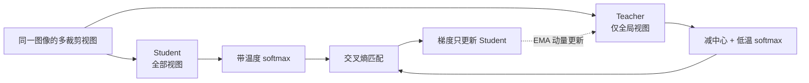

# CS231n 第 12 讲：自监督学习与 DINO

> **课程**：Stanford CS231n · Lecture 12 — Self-Supervised Learning  
> **讲义日期**：2026-05-07，共 104 页  
> **核心论文**：Caron et al., *Emerging Properties in Self-Supervised Vision Transformers*, ICCV 2021  
> **适合读者**：已学完 CLIP，掌握基本的神经网络、ViT、softmax 与交叉熵，希望系统理解视觉自监督学习的初学者  
> **内容依据**：课程讲义与官网推荐阅读为主，结合 DINO、MAE、SimCLR、MoCo 原论文补充公式和背景

---

## 学习目标

读完本笔记，你应能够：

1. 用一句话说明**自监督学习如何从数据本身构造监督信号**；
2. 区分代理任务、下游任务、线性探测、微调与零样本分类；
3. 解释旋转预测、拼图、图像修复、着色为什么能帮助模型学习视觉特征；
4. 说明 MAE 为什么采用高掩码率和非对称编码器—解码器；
5. 手写 InfoNCE，并解释正样本、负样本、温度系数和表示坍塌；
6. 对比 SimCLR 与 MoCo 获得负样本的不同方式；
7. 完整复述 DINO 的多裁剪、学生—教师网络、EMA、centering 与 sharpening；
8. 说清 DINO 与 CLIP 的监督来源、训练目标和下游使用方式有何不同。

---

## 目录

- [一、全局认识：没有人工标签，模型向谁学习？](#一全局认识没有人工标签模型向谁学习)
- [二、自监督学习的标准流程与评价方法](#二自监督学习的标准流程与评价方法)
- [三、人工设计的代理任务](#三人工设计的代理任务)
- [四、MAE：遮住大部分图像，再重建](#四mae遮住大部分图像再重建)
- [五、对比学习与 InfoNCE](#五对比学习与-infonce)
- [六、SimCLR：用批内样本构造对比任务](#六simclr用批内样本构造对比任务)
- [七、MoCo：用动量编码器和队列扩充字典](#七moco用动量编码器和队列扩充字典)
- [八、CPC：在序列中预测未来](#八cpc在序列中预测未来)
- [九、DINO：无标签自蒸馏](#九dino无标签自蒸馏)
- [十、从 CLIP 回望本讲：两种监督路线](#十从-clip-回望本讲两种监督路线)
- [十一、统一对比与学习路线](#十一统一对比与学习路线)
- [十二、常见误区与自测](#十二常见误区与自测)
- [参考资料](#参考资料)

---

# 一、全局认识：没有人工标签，模型向谁学习？

## 1.1 问题的起点

图像分类、目标检测和语义分割通常需要大量人工标注：

- 分类需要“这张图是猫”；
- 检测需要框出每个目标并标明类别；
- 分割需要逐像素标记类别。

标注昂贵、缓慢，而且难以覆盖真实世界的全部类别。但无标签图像和视频却大量存在。因此，本讲关注：

> **能否只利用数据内部天然存在的结构，先学习一个通用视觉编码器，再把它迁移到具体任务？**

这就是自监督学习（Self-Supervised Learning, SSL）要解决的核心问题。

## 1.2 自监督学习的定义

**自监督学习**：不依赖人工语义标签，而是从数据本身自动生成训练目标，再使用分类、回归或重建等监督式优化方法训练模型。

例如，把一张图旋转 90°，模型需要判断旋转角度。这里：

- 输入是旋转后的图像；
- 标签是 `90°`；
- 标签由程序自动生成，不需要人判断图像类别。

“自监督”并不表示没有监督信号，也不表示没有损失函数；它表示**监督信号来自数据及其变换，而非人工语义标注**。

## 1.3 与相关范式的区别

| 范式 | 训练时使用的监督 | 典型例子 |
|---|---|---|
| 监督学习（Supervised Learning） | 人工标签 | 用 ImageNet 类别标签训练分类器 |
| 无监督学习（Unsupervised Learning） | 通常没有逐样本标签，关注数据结构 | 聚类、密度估计 |
| **自监督学习** | 从数据本身自动构造标签或目标 | 旋转预测、MAE、SimCLR、DINO |
| 半监督学习（Semi-supervised Learning） | 少量人工标签 + 大量无标签数据 | 自监督预训练后，用少量标签微调 |
| 弱监督 / 多模态监督 | 噪声较大或较粗粒度的配对信号 | CLIP 使用图文配对 |

> **边界提醒**：自监督学习常被放在广义无监督表示学习中讨论，但其训练过程仍可以有明确的预测目标和损失函数。CLIP 使用天然存在或收集得到的图文配对，不属于“只从单张图像构造目标”的狭义纯视觉自监督方法。

## 1.4 表示、编码器与下游任务

- **编码器（Encoder）**：把输入图像映射为特征向量的网络，例如 ResNet 或 ViT。
- **表示 / 特征（Representation / Feature）**：编码器输出的向量。好的表示应保留对下游任务有用的信息。
- **代理任务（Pretext Task）**：预训练阶段人为构造的任务，如旋转预测。它通常不是最终应用。
- **下游任务（Downstream Task）**：真正关心的应用，如分类、检测、分割和检索。
- **迁移学习（Transfer Learning）**：把在代理任务上学到的编码器用于下游任务。

关键思想是：**代理任务只是促使模型观察世界的手段，表示质量才是预训练阶段真正关心的产物。**

---

# 二、自监督学习的标准流程与评价方法

## 2.1 两阶段流程

### 阶段一：自监督预训练

在无标签数据上训练：

$$
x \xrightarrow{\text{编码器 } f_\theta} h \xrightarrow{\text{预训练头 } g_\phi} \text{代理任务预测}
$$

其中 $h$ 是保留给下游任务使用的表示，$g_\phi$ 可以是为旋转分类、对比学习或像素重建服务的临时模块。

### 阶段二：迁移到下游任务

保留编码器，接上与具体任务匹配的分类器、检测器或分割器，再根据设定冻结或更新编码器。

## 2.2 三种常见评价协议

| 协议 | 编码器是否更新 | 额外训练 | 主要回答的问题 |
|---|---|---|---|
| **k-NN 评价** | 否 | 不训练分类器 | 同类图像在特征空间中是否天然靠近？ |
| **线性探测（Linear Probing）** | 否 | 只训练线性分类器 | 特征是否已能被简单线性边界区分？ |
| **完整微调（Fine-tuning）** | 是 | 更新编码器和任务头 | 预训练初始化在目标任务上的实际潜力有多大？ |

### k-NN：最近邻分类

**k 近邻（k-Nearest Neighbors, k-NN）**将测试图像的特征与训练集特征比较，由最近的 $k$ 个训练样本投票决定类别。它直接考查特征空间的几何结构，但不能充分利用标签训练任务头。

### 线性探测：冻结骨干，只训练一层

若表示为 $h\in\mathbb{R}^d$，分类器为：

$$
\hat y=\operatorname{softmax}(Wh+b)
$$

只学习 $W,b$。线性探测是衡量表示质量的受控实验，不等同于模型在下游任务上的最高性能。

### 微调：全部或部分参数继续训练

微调通常能达到更高的任务性能，但结果同时受预训练表示、初始化、优化器、训练轮数等影响，因此不能像线性探测那样单独衡量原表示的线性可分性。

## 2.3 其他评价维度

- **聚类与检索**：检查语义相近样本是否聚集。
- **t-SNE 可视化**：把高维特征降到二维辅助观察。它适合定性分析，不能单独证明特征优劣；不同参数可能产生不同视觉结果。
- **跨数据集泛化**：迁移到 PASCAL VOC、COCO 等任务。
- **鲁棒性**：面对遮挡、域偏移和图像变化是否稳定。
- **计算效率**：预训练时间、显存、推理吞吐量同样重要。

> **最重要的评价原则**：代理任务准确率高，不必然意味着下游表示好。模型可能利用了只对代理任务有用的捷径。

---

# 三、人工设计的代理任务

早期视觉自监督方法通常先提出一个“需要一定视觉常识才能解决”的任务，再期望模型在解决任务时学到物体结构和语义。

## 3.1 旋转预测

将原图分别旋转 $0^\circ、90^\circ、180^\circ、270^\circ$，让模型进行四分类。

**为什么可能有效？** 要判断一只动物是否倒置，模型需要认识头、身体和四肢通常的空间关系，而不能只识别局部纹理。

**局限**：对称物体、没有固定方向的纹理，以及旋转造成的边界伪影，都可能让任务变得含糊或产生捷径。

## 3.2 相对位置与拼图

- **相对位置预测**：给出两个图像块，预测它们的相对方位。
- **拼图任务（Jigsaw Puzzle）**：打乱多个图像块，预测正确排列。

这些任务希望模型学习部件之间的空间关系，例如眼睛通常在鼻子之上。不过，模型也可能依赖图像块边缘、色差或压缩伪影，而不是真正理解语义。

## 3.3 图像修复（Inpainting）

遮住图像的一部分，要求模型根据上下文补全缺失像素。

- **重建损失（Reconstruction Loss）**：衡量预测像素与真实像素的差异；
- **对抗损失（Adversarial Loss）**：鼓励补全结果更像真实图像，讲义中的 Context Encoders 将两者结合。

修复任务迫使模型利用周围环境推断结构，但低层像素重建并不保证学到适合分类的高层语义。

## 3.4 图像与视频着色

**着色（Colorization）**：由灰度图预测颜色。模型需要知道天空、草地、皮肤等对象的常见颜色。

**Split-Brain Autoencoder** 进一步把通道分成两组，让一组通道预测另一组，形成跨通道预测。

**视频着色**则利用时间一致性：给定参考彩色帧，为后续灰度帧着色。为持续复制正确颜色，模型需要跨帧定位相同区域，因此可以涌现出一定的跟踪能力，并用于传播分割掩码或姿态关键点。

## 3.5 这一类方法的共同局限

1. 每种任务都依赖人工设计，任务选择较繁琐；
2. 表示可能过度适配特定代理任务；
3. 模型可能利用低层捷径，而非学习通用语义；
4. 像素级目标与语义级下游任务之间可能存在差距。

因此，后续方法转向更通用的目标：**让同一内容的不同视图表示一致，让不同内容可区分，或从局部预测全局。**

---

# 四、MAE：遮住大部分图像，再重建

**掩码自编码器（Masked Autoencoder, MAE）**把类似语言模型“遮住词再预测”的思想用于 ViT 图像块。

## 4.1 从图像到 patch

**Patch（图像块）**是把图像切分得到的固定大小方格。ViT 将每个 patch 投影为一个 token，再交给 Transformer。

MAE 的流程是：

1. 将图像切成不重叠 patch；
2. 随机遮住约 **75%** 的 patch；
3. 编码器只处理剩余约 25% 的可见 patch；
4. 轻量解码器把编码结果与 mask token 合并，恢复原 patch 排列；
5. 只在被遮住的 patch 上计算像素重建损失。

## 4.2 非对称编码器—解码器

- **编码器较大**：负责学习可迁移的视觉表示，只处理少量可见 token；
- **解码器较轻**：只负责预训练时的像素重建，预训练结束后通常丢弃；
- **mask token**：表示“此处被遮住”的可学习向量，在解码阶段补回缺失位置，并加入位置编码。

这种**非对称设计（Asymmetric Design）**让昂贵的大编码器无需处理全部 token。原论文报告训练可加速 3 倍或以上，同时高掩码率使任务不能仅靠邻近像素插值轻易完成。

## 4.3 损失函数

设被遮 patch 的集合为 $\mathcal M$，第 $i$ 个 patch 的原始像素为 $x_i$，重建结果为 $\hat x_i$，则：

$$
\mathcal L_{\mathrm{MAE}}
=\frac{1}{|\mathcal M|}
\sum_{i\in\mathcal M}\left\|x_i-\hat x_i\right\|_2^2
$$

**均方误差（Mean Squared Error, MSE）**惩罚预测像素与真实像素的平方差。只在掩码区域计算损失，使训练目标明确聚焦于“根据可见上下文推断缺失内容”。

## 4.4 MAE 与其他方法的本质区别

MAE 不需要显式负样本，也不直接要求两个视图的特征相同。它通过学习**上下文到缺失内容的条件预测**获得表示。

还应注意：MAE 的线性探测成绩与完整微调表现可能呈现不同排序，这正说明“冻结特征是否线性可分”和“作为初始化继续训练有多好”是两个不同问题。

---

# 五、对比学习与 InfoNCE

## 5.1 三种样本角色

- **参考样本（Reference / Anchor）** $x$：当前作为比较起点的样本；
- **正样本（Positive）** $x^+$：与参考样本语义相同或内容对应的样本；
- **负样本（Negative）** $x^-$：希望与参考样本区分开的其他样本。

纯视觉方法常把**同一图像的两次不同增强**作为正样本对。随机裁剪、颜色扰动和模糊改变了像素，却通常保留主体语义。

对比学习的目标：

> **拉近正样本的表示，推远负样本的表示。**

## 5.2 分数函数与余弦相似度

设编码表示经过归一化为 $u,v$，**余弦相似度（Cosine Similarity）**为：

$$
\operatorname{sim}(u,v)=\frac{u^\top v}{\|u\|_2\|v\|_2}
$$

若向量已做 L2 归一化，分母为 1。余弦相似度主要比较方向，而不直接比较向量长度。

## 5.3 InfoNCE：把“找出正样本”写成分类问题

设一个参考样本有 1 个正样本和 $N-1$ 个负样本，分数函数为 $s(x,x')$，常用 $s=\operatorname{sim}(f(x),f(x'))/\tau$。InfoNCE 损失为：

$$
\mathcal L_{\mathrm{InfoNCE}}
=-\log
\frac{\exp(s(x,x^+))}
{\exp(s(x,x^+))+\sum_{j=1}^{N-1}\exp(s(x,x_j^-))}
$$

它等价于一个 $N$ 分类交叉熵：在全部候选中，正确类别就是正样本。

- 正样本分数越高，损失越小；
- 负样本分数越高，分母越大，损失越大；
- $\tau$ 是**温度系数（Temperature）**，控制分布尖锐程度，必须大于 0；
- 更多有区分性的负样本通常能提供更强的学习信号。

从信息论角度，InfoNCE 与正样本对之间的**互信息（Mutual Information）**下界有关。互信息衡量知道一个变量后，对另一个变量不确定性的减少量。初学者可先抓住“跨视图保留共享信息”的直觉，不必在第一次学习时推导该下界。

## 5.4 正、负样本定义了模型学什么

数据增强不仅是训练技巧，也在定义“哪些变化不应改变语义”：

- 裁剪使模型更关注跨尺度的一致性；
- 颜色扰动鼓励模型减少对颜色的依赖；
- 但若颜色恰好是下游任务的关键，例如区分某些花朵，过强扰动也可能损害有用信息。

同样，把批内其他图像全部当负样本可能产生**假负样本（False Negative）**：两张都是狗的图被要求互相推远。实例对比并不等价于完美的类别对比。

## 5.5 表示坍塌

**坍塌（Collapse）**指模型退化为缺乏区分度的解，例如无论输入什么都输出同一个向量。若所有输出完全相同，只“拉近正样本”的目标会被轻易满足，但表示毫无用处。

InfoNCE 通过负样本提供排斥力；MoCo、SimCLR 都利用这一机制。DINO 不使用显式负样本，因此需要另一套防坍塌设计。

---

# 六、SimCLR：用批内样本构造对比任务

**SimCLR（A Simple Framework for Contrastive Learning of Visual Representations）**用简单组合展示了对比学习的三个关键要素：强数据增强、非线性投影头和大批量。

## 6.1 前向流程

对 batch 中每张图生成两个增强视图：

$$
x \rightarrow (x_i,x_j)
$$

然后：

$$
h_i=f_\theta(x_i),\qquad z_i=g_\phi(h_i)
$$

- $f_\theta$：视觉编码器；
- $h_i$：供下游任务使用的表示；
- $g_\phi$：投影头（Projection Head），通常是非线性 MLP；
- $z_i$：实际用于对比损失的投影表示。

一个 batch 原有 $N$ 张图，增强后得到 $2N$ 个视图。每张图的两个视图互为正样本，其余 $2N-2$ 个视图作为负样本。对全部 $2N$ 个参考视图计算损失并取平均，形成对称的 **NT-Xent（Normalized Temperature-scaled Cross Entropy）**损失。

## 6.2 为什么需要投影头？

对比损失要求 $z$ 对增强保持不变，可能丢弃颜色、方向等对某些下游任务有用的信息。让 $h$ 先经过独立投影头，可以把“保持通用信息”和“满足对比不变性”分配给两个空间。

下游任务通常使用 **projection head 之前的 $h$**，而不是 $z$。原论文通过系统实验说明非线性投影头显著改善表示质量。

## 6.3 为什么需要大 batch？

SimCLR 的负样本主要来自当前 batch。batch 越大，候选负样本通常越多，对比任务越充分；但反向传播需要同时保存大量中间激活，因此显存和分布式训练成本较高。

---

# 七、MoCo：用动量编码器和队列扩充字典

**动量对比（Momentum Contrast, MoCo）**把对比学习理解为字典查询：query 应在字典中找到匹配的 key，并区别于其他 key。

## 7.1 两个编码器

- **查询编码器（Query Encoder）**：通过反向传播正常更新；
- **键编码器（Key Encoder）**：不直接接收梯度，由查询编码器的动量平均更新。

设两者参数为 $\theta_q,\theta_k$：

$$
\theta_k\leftarrow m\theta_k+(1-m)\theta_q
$$

其中 $m$ 是接近 1 的动量系数。键编码器变化缓慢，从而使不同时间进入字典的 key 具有较一致的编码标准。

## 7.2 队列：把负样本数量与 batch 解耦

MoCo 维护一个**先进先出队列（FIFO Queue）**：

1. 当前 batch 的 key 入队；
2. 最旧的一批 key 出队；
3. 队列中大量历史 key 充当负样本。

因此，即使当前 batch 较小，字典也可以很大。这里的“字典”不是 Python 数据结构，而是“一组可供匹配的 key 表示”。

## 7.3 与 SimCLR 的核心差异

| 方面 | SimCLR | MoCo |
|---|---|---|
| 负样本来源 | 当前大 batch | 历史 key 队列 |
| 两侧编码器更新 | 都通过梯度端到端更新 | query 梯度更新，key 动量更新 |
| batch 与负样本数 | 紧密绑定 | 解耦 |
| 主要工程压力 | 大 batch 的显存与通信 | 队列与动量编码器的一致性 |

**MoCo v2**进一步吸收 SimCLR 的非线性投影头和更强数据增强。讲义强调：负样本数量不再完全受 mini-batch 限制，因此可在较小 batch 下取得有竞争力的结果。

---

# 八、CPC：在序列中预测未来

**对比预测编码（Contrastive Predictive Coding, CPC）**把对比学习用于序列：利用当前上下文预测未来表示，同时区分真实未来与错误候选。

给定序列 $x_1,x_2,\ldots$：

1. 编码每个时刻：$z_t=g_{\mathrm{enc}}(x_t)$；
2. 用自回归模型总结历史，得到上下文 $c_t$；
3. 用 $c_t$ 预测未来 $z_{t+k}$；
4. 真实 $z_{t+k}$ 是正样本，其他候选是负样本；
5. 用 InfoNCE 训练。

一种打分函数为：

$$
s_k(c_t,z_{t+k})=z_{t+k}^{\top}W_kc_t
$$

其中 $W_k$ 是针对预测步长 $k$ 的可学习矩阵。

**自回归（Autoregressive）**指只利用当前及过去信息预测未来。CPC 可用于音频，也可把图像 patch 按行组织为序列，用上方区域预测下方区域。与实例级方法相比，它更突出时间或顺序结构。

---

# 九、DINO：无标签自蒸馏

## 9.1 研究问题与名称

DINO 是 **Self-Distillation with NO Labels** 的缩写，即“无标签自蒸馏”。论文研究：自监督训练能否让 ViT 获得不同于监督 ViT 和卷积网络的有用性质？

**知识蒸馏（Knowledge Distillation）**通常指让学生网络模仿教师网络的输出。DINO 的“自”体现在：教师不是另一个预先训练好的大模型，而是学生自身历史参数的滑动平均；训练不需要类别标签。

DINO 最引人注目的两个涌现性质是：

1. 特征适合最近邻分类；
2. ViT 的自注意力图在没有分割标签的情况下呈现较清晰的物体边界和场景布局。

**涌现性质（Emerging Properties）**指这些能力没有被显式训练，却随着表示学习出现。

## 9.2 整体结构：学生与教师

DINO 使用结构相同、参数不同的两个网络：

- **学生网络（Student）** $g_{\theta_s}$：通过梯度下降更新；
- **教师网络（Teacher）** $g_{\theta_t}$：不接收梯度，由学生的指数滑动平均更新。

每个网络都可写为：

$$
g=h\circ f
$$

其中 $f$ 是 ViT 或 ResNet 骨干，$h$ 是预训练投影头。下游任务使用骨干 $f$ 的特征，而不是把投影输出当作人工类别。

## 9.3 Multi-crop：从局部预测全局

对每张图构造多个视图：

- **全局视图（Global Crops）**：覆盖图像较大区域，分辨率较高；原论文使用两个 $224\times224$ 全局视图；
- **局部视图（Local Crops）**：覆盖较小区域，分辨率较低；原论文使用多个 $96\times96$ 局部视图。

教师只看全局视图，学生看全部视图。学生需要让局部视图的输出匹配教师的全局视图输出，从而学习**局部到全局的一致性**。

这一设计也在定义模型应保留什么：即使只看到主体的一部分，也应推断出与整体一致的语义。

## 9.4 把网络输出变成概率分布

设网络输出为 $K$ 维 logits。**Logits** 是 softmax 之前未经归一化的分数，不直接等于类别概率，更不是人工类别标签。

学生输出的第 $i$ 维为：

$$
P_s(x)^{(i)}=
\frac{\exp(g_{\theta_s}(x)^{(i)}/\tau_s)}
{\sum_{k=1}^{K}\exp(g_{\theta_s}(x)^{(k)}/\tau_s)}
$$

教师使用 $\theta_t,\tau_t$，并在 softmax 前减去中心向量 $c$：

$$
P_t(x)^{(i)}=
\frac{\exp((g_{\theta_t}(x)^{(i)}-c^{(i)})/\tau_t)}
{\sum_{k=1}^{K}\exp((g_{\theta_t}(x)^{(k)}-c^{(k)})/\tau_t)}
$$

温度越低，softmax 分布越尖锐；温度越高，分布越平滑。原论文中学生温度固定为 $\tau_s=0.1$，教师温度更低，并在训练初期 warmup 到 $0.07$。

## 9.5 学生如何匹配教师？

对一个教师视图 $x$ 和不同的学生视图 $x'$，最小化交叉熵：

$$
H(P_t(x),P_s(x'))
=-\sum_{i=1}^{K}P_t(x)^{(i)}\log P_s(x')^{(i)}
$$

对所有教师全局视图和除自身外的学生视图求和：

$$
\min_{\theta_s}
\sum_{x\in\{x_1^g,x_2^g\}}
\sum_{\substack{x'\in V\\x'\ne x}}
H(P_t(x),P_s(x'))
$$

**停止梯度（Stop-gradient）**用于教师分支：损失只更新学生，不会沿着教师输出反向传播。

直观地说，教师对每个视图给出一个“软目标分布”，学生学习在不同裁剪下产生一致预测。这个 $K$ 维空间是训练时自动构造的，不对应 $K$ 个人工命名类别。

## 9.6 教师如何更新？EMA

教师参数通过**指数滑动平均（Exponential Moving Average, EMA）**更新：

$$
\theta_t\leftarrow\lambda\theta_t+(1-\lambda)\theta_s
$$

其中 $\lambda$ 接近 1。教师因此像学生训练历史的平滑版本，而不是每一步完全复制学生。

原论文将 $\lambda$ 从 0.996 按余弦 schedule 增至 1。消融实验显示，直接复制当前学生或使用上一 iteration 的学生会导致严重退化，而动量教师对训练稳定性至关重要。

## 9.7 不用负样本，如何避免坍塌？

DINO 主要防范两种退化：

1. **单维支配**：无论输入是什么，总由某个输出维度占主导；
2. **均匀输出**：所有输入都输出接近均匀的分布，缺乏区分度。

### Centering：中心化

先按 batch 估计教师原始输出的均值，并用动量更新中心：

$$
c\leftarrow mc+(1-m)\frac1B\sum_{i=1}^{B}g_{\theta_t}(x_i)
$$

教师 softmax 前减去 $c$，避免某些维度长期偏大。**Centering 防止单维支配，但单独使用容易让输出趋于均匀。**

### Sharpening：锐化

教师使用较低温度，使目标分布更尖锐。**Sharpening 防止所有输出过于均匀，但单独使用容易强化单维支配。**

> 两者像方向相反、相互制衡的力：中心化抑制固定维度垄断，低温锐化抑制无差别均匀输出。配合动量教师，DINO 无需显式负样本也能稳定训练。

## 9.8 一次训练迭代的完整顺序

1. 对每张图采样两个全局视图和多个局部视图；
2. 教师处理全局视图，学生处理全部视图；
3. 教师输出减中心并用较低温度 softmax，学生用自身温度 softmax；
4. 计算跨视图交叉熵，教师分支停止梯度；
5. 优化器只更新学生；
6. 用 EMA 更新教师参数；
7. 更新教师中心向量 $c$；
8. 预训练结束后，通常取教师或学生骨干特征用于 k-NN、线性探测、微调或密集任务。

## 9.9 DINO 的“涌现”到底体现在哪里？

### 特征空间天然适合 k-NN

论文在 ImageNet 上的部分结果如下。不同模型与训练设置不能只凭单个数字判断全部优劣，这里用于理解论文结论：

| 模型 | Linear Top-1 | k-NN Top-1 |
|---|---:|---:|
| DINO ViT-S/16 | 77.0% | 74.5% |
| DINO ViT-S/8 | 79.7% | **78.3%** |
| DINO ViT-B/8 | **80.1%** | 77.4% |

`S/B` 表示 Small/Base，`/8、/16` 表示 patch 边长。patch 更小，空间 token 更多，通常有利于细粒度与密集预测，但注意力计算和显存开销也会增加；它不是“免费变强”。

### 自注意力包含场景布局信息

论文观察最后一个 Transformer block 中 **[CLS] token 对不同 patch 的自注意力**。不同 head 会关注不同物体或区域，注意力图呈现较清晰的边界，尽管训练时没有使用分割标注。

这不等于 DINO 已经训练出一个完整的语义分割器：注意力图不是逐像素类别预测，仍需阈值、最近邻传播或额外任务头才能形成具体分割结果。

## 9.10 DINO 与前面方法的联系

- 与 SimCLR / MoCo 相同：使用同一图像的多个视图，学习视图一致性；
- 与它们不同：DINO 没有显式负样本，也不使用 InfoNCE；
- 与 MoCo 相似：都有动量更新的目标编码器；
- 与 MoCo 不同：DINO 匹配概率分布，没有负样本队列；
- 与 MAE 不同：DINO 预测教师的语义分布，MAE 重建缺失像素。

讲义第 99 页还列出了 DINOv2，可把它视为后续扩展入口；本讲的核心仍是理解 2021 年 DINO 的基本机制。

---

# 十、从 CLIP 回望本讲：两种监督路线

你已经学过 CLIP，可以用“监督从哪里来”把两类方法串起来。

| 维度 | CLIP | DINO / SimCLR 等纯视觉 SSL |
|---|---|---|
| 数据来源 | 图文配对 | 通常只需图像 |
| 监督信号 | 对应文本提供跨模态监督 | 数据增强、掩码、顺序或教师输出自动构造目标 |
| 正样本 | 正确图文对 | 同一图像的不同视图等 |
| 负样本 | 批内错误图文对 | SimCLR 使用其他视图；DINO 不使用显式负样本 |
| 主要目标 | 图像与文本在共享空间对齐 | 学习视觉内部一致、可迁移的表示 |
| 分类方式 | 文本提示可直接支持零样本分类 | k-NN、线性探测、微调或接任务头 |
| 是否直接理解语言概念 | 是 | 通常否 |

## 10.1 CLIP 与 SimCLR 的相似之处

二者都用对比目标，让配对样本相似度更高、非配对样本相似度更低。差别在于“配对”的含义：

- SimCLR：同一图像的两个增强视图；
- CLIP：一张图像与对应文本。

因此，可以把 CLIP 看作把“同图跨视图一致性”扩展为“跨模态语义一致性”，但这只是帮助理解的类比，不表示两者训练数据和目标完全相同。

## 10.2 DINO 为什么不能直接做 CLIP 式零样本分类？

CLIP 的文字编码器把类别名称映射到共享空间，图像特征可与文本特征直接比较。DINO 没有文本编码器和共享语义空间，因此不能仅凭类别名称进行同样的零样本分类。

DINO 的典型使用方式是：

- 有少量标注训练图像：使用 k-NN；
- 有足够标签训练简单分类器：线性探测；
- 希望最大化具体任务性能：微调；
- 做分割或检索：利用 patch 特征和任务适配模块。

> **一句话总结**：CLIP 借助语言学习“视觉内容如何与概念名称对齐”；DINO 借助视觉视图一致性学习“图像自身如何组织成有意义的结构”。

---

# 十一、统一对比与学习路线

## 11.1 一张表串起本讲

| 方法 | 自动构造的任务 | 需要显式负样本 | 主要输出 / 目标 | 关键机制 |
|---|---|---:|---|---|
| 旋转预测 | 判断旋转角度 | 否 | 四分类 | 视觉方向常识 |
| 拼图 / 相对位置 | 恢复空间排列 | 否 | 位置或排列预测 | 部件空间关系 |
| 图像修复 / 着色 | 恢复缺失信息 | 否 | 像素或颜色 | 上下文推断 |
| **MAE** | 重建被遮 patch | 否 | 像素 MSE | 75% 掩码、非对称架构 |
| **SimCLR** | 从批内候选找出同图视图 | 是 | InfoNCE / NT-Xent | 强增强、投影头、大 batch |
| **MoCo** | 在动态字典中匹配 key | 是 | InfoNCE | 动量编码器、FIFO 队列 |
| **CPC** | 从候选中识别真实未来 | 是 | 序列 InfoNCE | 自回归上下文、未来预测 |
| **DINO** | 学生匹配教师跨视图分布 | 否 | 跨视图交叉熵 | Multi-crop、EMA、中心化、锐化 |
| **CLIP** | 找出正确图文配对 | 是 | 多模态对比损失 | 图文共享表示空间 |

## 11.2 推荐的三遍学习法

### 第一遍：只抓问题与直觉

回答四件事：

1. 标签为什么昂贵？
2. 每种方法如何自动制造训练目标？
3. 为什么代理任务能产生可迁移表示？
4. 如何评价表示是否真的好？

### 第二遍：抓住三个公式

1. InfoNCE：在候选中找出正样本；
2. MoCo / DINO 的 EMA：缓慢更新目标编码器；
3. DINO 的交叉熵：学生匹配教师跨视图分布。

### 第三遍：围绕“坍塌与不变性”复盘

- SimCLR / MoCo 靠负样本避免所有表示挤成一点；
- DINO 靠动量教师、中心化和锐化稳定训练；
- 数据增强决定模型应对哪些变化保持不变；
- 过强的不变性也可能删掉下游任务需要的信息。

## 11.3 最小实践建议

不建议初学者直接从零在 ImageNet 上复现 DINO，其训练成本和多卡工程会掩盖核心概念。更合适的顺序是：

1. 在 CIFAR-10 上实现两次随机增强和简化 InfoNCE；
2. 冻结编码器，比较随机初始化与预训练特征的 k-NN / 线性探测；
3. 给 SimCLR 加投影头，观察下游使用 $h$ 与 $z$ 的差别；
4. 阅读 DINO 官方的 `main_dino.py`，定位 multi-crop、EMA、centering、sharpening；
5. 使用官方预训练 DINO ViT，可视化最后一层 [CLS] 对 patch 的注意力。

---

# 十二、常见误区与自测

## 12.1 常见误区

### 误区 1：自监督就是完全没有标签

不准确。它没有人工语义标签，但可以有程序自动生成的标签、重建目标或教师软目标。

### 误区 2：代理任务越准确越好

不一定。最终目标是下游表示质量；模型可能通过低层捷径在代理任务上得高分。

### 误区 3：对比学习中的负样本一定属于不同类别

不一定。实例对比通常把其他实例当负样本，其中可能有同类样本，即假负样本。

### 误区 4：SimCLR 下游使用投影头输出 $z$

通常不使用。下游一般使用投影头之前的编码器表示 $h$。

### 误区 5：DINO 的教师是人工训练好的另一个模型

不是。教师是学生参数的 EMA，训练中没有预先固定的人工监督教师。

### 误区 6：DINO 的输出维度 $K$ 等于数据集类别数

不是。它是投影头输出分布的维度，不对应人工命名类别。

### 误区 7：DINO 注意力图等于完整分割结果

不是。它说明特征含有场景布局信息，但要完成语义分割仍需相应任务设计与评价协议。

### 误区 8：线性探测和微调结果应当一致

不一定。线性探测衡量冻结表示的线性可分性；微调还衡量预训练初始化和整体适配能力。

## 12.2 自测题

1. 为什么旋转预测需要视觉常识？它可能利用什么捷径？
2. MAE 为什么能使用很高的掩码率？编码器为什么只处理可见 patch？
3. InfoNCE 中增大负样本分数，损失如何变化？为什么？
4. SimCLR 为什么需要大 batch？MoCo 如何缓解这一问题？
5. 投影头为什么可能保护下游表示？
6. DINO 的教师为什么只处理全局视图？这样带来了什么学习目标？
7. DINO 没有负样本，依靠哪些机制避免坍塌？center 与低温度为什么需要配合？
8. DINO 与 MoCo 都使用动量编码器，它们的训练目标有何不同？
9. 为什么 DINO 不能直接进行 CLIP 式文本零样本分类？
10. 如果一个小型自监督模型的代理任务准确率很高，但线性探测很差，你会从哪些方面分析？

## 12.3 简短答案提示

1. 需要理解物体正常朝向；可能利用边界、对称性或数据伪影。  
2. 高掩码率减少简单插值捷径；减少编码 token 数可降低计算。  
3. 分母增大，负对数损失增大。  
4. 负样本来自当前 batch；MoCo 用历史 key 队列解耦。  
5. 让对比不变性主要作用于 $z$，使 $h$ 保留更多通用信息。  
6. 迫使学生从局部预测教师的全局语义。  
7. 动量教师、中心化、锐化；二者分别抑制不同坍塌方向。  
8. MoCo 做带负样本的字典对比，DINO 做无显式负样本的分布匹配。  
9. 没有文本编码器与图文共享空间。  
10. 检查任务捷径、增强策略、表示坍塌、评价协议及预训练头与骨干特征的选择。

---

# 参考资料

1. **CS231n Lecture 12: Self-Supervised Learning**，2026-05-07，课程讲义。
2. Caron et al. **Emerging Properties in Self-Supervised Vision Transformers (DINO)**. ICCV 2021. [arXiv:2104.14294](https://arxiv.org/abs/2104.14294)；[官方代码](https://github.com/facebookresearch/dino)。
3. He et al. **Masked Autoencoders Are Scalable Vision Learners (MAE)**. [arXiv:2111.06377](https://arxiv.org/abs/2111.06377)。
4. Chen et al. **A Simple Framework for Contrastive Learning of Visual Representations (SimCLR)**. ICML 2020. [arXiv:2002.05709](https://arxiv.org/abs/2002.05709)。
5. He et al. **Momentum Contrast for Unsupervised Visual Representation Learning (MoCo)**. CVPR 2020. [arXiv:1911.05722](https://arxiv.org/abs/1911.05722)。
6. van den Oord et al. **Representation Learning with Contrastive Predictive Coding (CPC)**. 2018. [arXiv:1807.03748](https://arxiv.org/abs/1807.03748)。
7. Gidaris et al. **Unsupervised Representation Learning by Predicting Image Rotations**. ICLR 2018。
8. Noroozi & Favaro. **Unsupervised Learning of Visual Representations by Solving Jigsaw Puzzles**. ECCV 2016。
9. Pathak et al. **Context Encoders: Feature Learning by Inpainting**. CVPR 2016。
10. Zhang et al. **Split-Brain Autoencoders: Unsupervised Learning by Cross-Channel Prediction**. CVPR 2017。

---

> **复习时只需记住这条主线**：  
> 从人工设计视觉常识任务，到通用的重建与跨视图一致性，再到 DINO 的无标签自蒸馏，方法在不断减少对手工任务、人工标签和显式负样本的依赖；但评价始终要回到同一个问题——**学到的表示是否真正有助于下游任务？**
