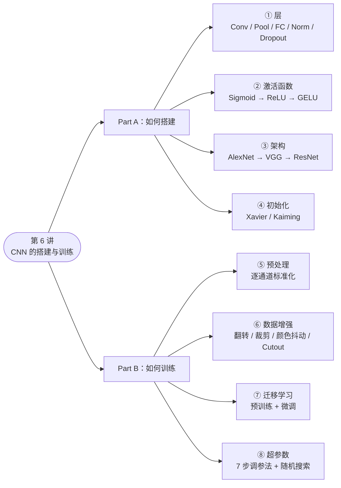
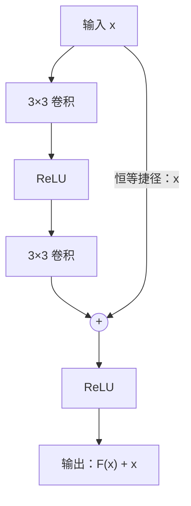
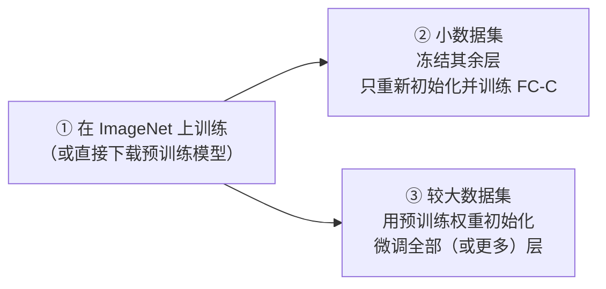
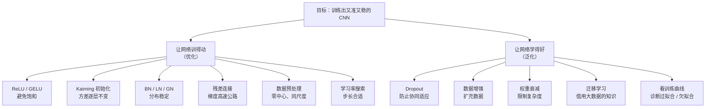

# 🧠 CS231n 第 6 讲学习笔记：CNN 的搭建与训练

> **课程**：Stanford CS231n *Deep Learning for Computer Vision* · Lecture 6 *Training CNNs and CNN Architectures*（2026-04-16）
> **配套精读**：AlexNet（NIPS 2012）· VGGNet（ICLR 2015）· ResNet（CVPR 2016）
> **适合读者**：了解全连接网络、反向传播和卷积的基本概念，想系统掌握"CNN 怎么搭、怎么训"的同学
> **使用建议**：每章先看 🎯 学习目标和 💡 一句话理解，再看公式和代码，最后用 📝 思考题自测

**图例**：💡 直觉 / 提示　⚠️ 易错点 / 勘误　🔍 深入拓展　📄 论文原文要点　📝 思考题　✅ 本章小结

---

## 📑 目录

- 第 0 章　导读：这一讲在解决什么问题
- 📚 术语速查表
- **第一部分 · 如何搭建 CNN**
  - 第 1 章　CNN 的基本组件：卷积、池化、全连接、归一化、Dropout
  - 第 2 章　激活函数：从 Sigmoid 到 GELU
  - 第 3 章　经典架构精读：AlexNet → VGG → ResNet
  - 第 4 章　权重初始化：让信号既不消失也不爆炸
- **第二部分 · 如何训练 CNN**
  - 第 5 章　数据预处理
  - 第 6 章　正则化范式与数据增强
  - 第 7 章　迁移学习
  - 第 8 章　超参数选择
- **拓展与复习**
  - 第 9 章　🚀 拓展：2015 年之后的现代训练技巧
  - 第 10 章　🗺️ 全讲总结与知识图谱
  - 第 11 章　🧪 综合自测题
  - 第 12 章　📖 参考文献与延伸阅读

---

## 0. 导读：这一讲在解决什么问题

前几讲我们已经知道了**卷积神经网络**（Convolutional Neural Network，CNN）"是什么"。这一讲回答两个更实际的问题：

1. **怎么搭（Part A）**：用哪些层？选什么激活函数？参考哪些经典架构？权重怎么初始化？
2. **怎么训（Part B）**：数据怎么预处理和增强？数据不够怎么办？超参数怎么调？

### 0.1 一张图看懂本讲



> 💡 **一个比喻**：搭 CNN 像**盖楼**——层是砖块，激活函数是让结构"能弯曲"的关节，架构是图纸，初始化是打地基；训 CNN 像**培养一个学生**——预处理是把教材整理规范，数据增强是变着花样出练习题，迁移学习是"站在巨人的肩膀上"，调参是找到最合适的学习节奏。

### 0.2 学习目标

学完本讲，你应该能够：

- [ ] 计算卷积层、池化层的输出尺寸和参数量
- [ ] 说清 BN / LN / IN / GN 分别在哪些维度上计算统计量，以及各自适合的场景
- [ ] 解释 Dropout 为什么有效，并写出 Inverted Dropout
- [ ] 比较 Sigmoid、ReLU、GELU 等激活函数的优缺点
- [ ] 复述 AlexNet → VGG → ResNet 的核心创新和背后的动机
- [ ] 推导 Kaiming 初始化中 $\sqrt{2/D_{in}}$ 的来历
- [ ] 设计一套完整的"预处理 + 数据增强"流水线
- [ ] 根据"数据量 × 数据相似度"选择迁移学习策略
- [ ] 按 7 步法系统地调参，并能读懂训练曲线

### 0.3 前置知识

| 知识点 | 需要掌握到什么程度 |
|---|---|
| 线性分类器、Softmax 与交叉熵损失 | 知道得分和损失是怎么算出来的 |
| 反向传播（Backpropagation）与链式法则 | 理解"梯度要逐层相乘" |
| 随机梯度下降（SGD）及动量（Momentum） | 知道学习率、batch、迭代的含义 |
| 卷积的基本运算 | 知道卷积核如何在图像上滑动 |
| Python / NumPy（PyTorch 更好） | 能读懂文中的代码片段 |

---

## 📚 术语速查表

> 正文中的专业名词第一次出现时会写成"中文（English）"并给出解释；这里集中列出，方便随时查阅。

| 中文 | 英文 | 一句话解释 |
|---|---|---|
| 卷积层 | Convolutional Layer | 用可学习的小卷积核在输入上滑动做加权求和，提取局部特征 |
| 卷积核 / 滤波器 | Kernel / Filter | 卷积层里的小权重张量（如 3×5×5），每个核产生一张激活图 |
| 激活图 / 特征图 | Activation Map / Feature Map | 一个卷积核扫过整张输入后得到的二维响应图 |
| 步长 / 填充 | Stride / Padding | 卷积核每次移动的像素数 / 在输入边缘补零以控制输出尺寸 |
| 感受野 | Receptive Field | 某个输出神经元在原始输入上"能看到"的区域大小 |
| 池化层 | Pooling Layer | 在局部窗口内取最大值或平均值做下采样，没有可学习参数 |
| 全连接层 | Fully-Connected（FC）Layer | 每个输出都与所有输入相连，本质是矩阵乘法 $Wx+b$ |
| 批归一化 | Batch Normalization（BN） | 用一个 batch 的统计量把每个通道标准化成零均值、单位方差 |
| 层归一化 | Layer Normalization（LN） | 对每个样本自身的全部特征做标准化，与 batch 无关 |
| 实例归一化 | Instance Normalization（IN） | 对每个样本的每个通道分别标准化，常用于风格迁移 |
| 组归一化 | Group Normalization（GN） | 把通道分组，在每个样本的每组内标准化，适合小 batch |
| 随机失活 | Dropout | 训练时随机把部分神经元的输出置零，是一种正则化方法 |
| 协同适应 | Co-adaptation | 神经元之间过度依赖、只在特定组合下才起作用的现象 |
| 激活函数 | Activation Function | 逐元素作用的非线性函数，让网络能拟合非线性关系 |
| 饱和 | Saturation | 激活函数在输入很大或很小时曲线变平、梯度趋近 0 |
| 梯度消失 / 梯度爆炸 | Vanishing / Exploding Gradient | 反向传播中梯度连乘后变得极小 / 极大，导致训练停滞或发散 |
| 死亡 ReLU | Dead ReLU | 输入总为负，输出和梯度恒为 0、从此不再更新的 ReLU 神经元 |
| 残差连接 / 捷径连接 | Residual / Shortcut / Skip Connection | 把输入直接加到若干层的输出上：$H(x)=F(x)+x$ |
| 恒等映射 | Identity Mapping | 输出等于输入的映射 $f(x)=x$ |
| 退化问题 | Degradation Problem | 网络加深后**训练误差**反而上升的现象，并非过拟合 |
| 瓶颈块 | Bottleneck Block | "1×1 降维 → 3×3 → 1×1 升维"的残差块，用来节省计算 |
| 权重初始化 | Weight Initialization | 训练开始前给权重赋初值的策略 |
| Xavier / Kaiming 初始化 | Xavier / Kaiming（He、MSRA）Init | 按输入维度缩放初始权重的方差，让各层激活分布保持稳定 |
| 数据预处理 | Data Preprocessing | 送入网络前对数据做的固定变换，如减均值、除标准差 |
| 数据增强 | Data Augmentation | 对训练样本做"不改变标签"的随机变换，相当于扩充数据 |
| 测试时增强 | Test-Time Augmentation（TTA） | 测试时对同一张图的多个变换版本分别预测，再取平均 |
| 正则化 | Regularization | 抑制过拟合、提升泛化能力的各类手段的统称 |
| 迁移学习 | Transfer Learning | 把在大数据集上学到的知识迁移到新任务上 |
| 预训练 / 微调 | Pre-training / Fine-tuning | 先在大数据集上训练 / 以预训练权重为起点，在新数据上继续训练 |
| 线性探测 | Linear Probing | 冻结骨干网络，只训练最后的线性分类器 |
| 骨干网络 | Backbone | 负责提取特征的主体网络（如去掉分类头的 ResNet） |
| 超参数 | Hyperparameter | 训练前人为设定、不通过梯度学习的量，如学习率、正则强度 |
| 学习率 | Learning Rate | 每次参数更新的步长，最重要的超参数 |
| 权重衰减 | Weight Decay | 每步把权重按比例缩小一点；对 SGD 而言等价于 L2 正则 |
| 过拟合 / 欠拟合 | Overfitting / Underfitting | 训练好、验证差 / 训练和验证都不好 |
| Top-1 / Top-5 错误率 | Top-1 / Top-5 Error | 概率最高的 1 个 / 前 5 个预测类别中都不含正确答案的样本比例 |
| 模型集成 | Ensemble | 训练多个模型，把它们的预测取平均 |
| Epoch / 迭代 | Epoch / Iteration | 完整遍历一遍训练集 / 完成一次参数更新 |

---

# 🏗️ 第一部分 · 如何搭建 CNN

> 第 1–4 章：选什么层 → 用什么激活函数 → 参考什么架构 → 权重怎么初始化

## 1. CNN 的基本组件 🧱

> 🎯 **学习目标**：掌握卷积、池化、全连接、归一化和 Dropout 五类"积木"的计算方式、参数量与作用。

一个 CNN 由下面几类组件拼成：

| 组件 | 作用 | 有可学习参数吗？ |
|---|---|---|
| 卷积层（Conv） | 提取局部特征 | ✅ 卷积核 + 偏置 |
| 池化层（Pool） | 下采样，缩小特征图 | ❌ |
| 全连接层（FC） | 把特征映射为类别得分 | ✅ 权重矩阵 + 偏置 |
| 归一化层（Norm） | 稳定各层输入的分布 | ✅ 缩放 γ、平移 β |
| Dropout | 正则化，防止过拟合（课件："有时使用"） | ❌ |
| 激活函数 | 引入非线性 | 通常 ❌（PReLU 等例外） |

### 1.1 卷积层（Convolutional Layer）回顾

> 💡 **一句话理解**：卷积核是一个可学习的"小模板"，在图像上逐位置滑动，计算"这里有多像我要找的图案"。

**课件中的例子**：

| 项目 | 数值 |
|---|---|
| 输入 | 3×32×32 的图像（通道 C × 高 H × 宽 W） |
| 卷积核 | 6 个，每个形状为 3×5×5（**核的深度必须等于输入通道数**），合起来是 6×3×5×5 |
| 偏置 | 6 维向量，每个核一个 |
| 输出 | 6 张 1×28×28 的激活图，堆叠成 6×28×28，随后接 ReLU |
| 参数量 | $6 \times (3\times5\times5) + 6 = 456$ |

**输出尺寸公式**（必背）：

$$
H_{out} = \left\lfloor \frac{H_{in} - K + 2P}{S} \right\rfloor + 1
$$

其中 $K$ 是卷积核大小，$P$ 是填充（Padding），$S$ 是步长（Stride）。代入例子：$(32 - 5 + 0)/1 + 1 = 28$。

**卷积为什么比全连接好用？两个关键性质**：

- **局部连接（Local Connectivity）**：每个输出只看输入的一小块（这里是 5×5），契合图像"相邻像素关系密切"的特点。
- **权值共享（Weight Sharing）**：同一个卷积核在所有位置共用一套参数，参数量与图像尺寸无关；同时带来**平移等变性**（Translation Equivariance）——物体在图中平移，特征图上的响应也跟着平移。

> 💡 **直观对比**：如果用全连接层把 3×32×32（3072 维）映射到 6×28×28（4704 维），需要 $3072 \times 4704 \approx 1445$ 万个权重；卷积层只要 456 个，相差 3 万多倍。

### 1.2 池化层（Pooling Layer）回顾

> 💡 **一句话理解**：池化是给特征图做"缩略图"，保留每个小区域里最显著（或平均）的信息。

**课件例子**：单个深度切片 4×4，用 2×2 窗口、步长 2 做池化：

```text
输入（4×4，按 2×2 窗口划分）
  1  1 | 2  4
  5  6 | 7  8
 ------+------
  3  2 | 1  0
  1  2 | 3  4

最大池化 → [[6, 8],          平均池化 → [[3.25, 5.25],
            [3, 4]]                      [2.00, 2.00]]
```

用 NumPy 验证：

```python
import numpy as np

x = np.array([[1, 1, 2, 4],
              [5, 6, 7, 8],
              [3, 2, 1, 0],
              [1, 2, 3, 4]], dtype=float)
blocks = x.reshape(2, 2, 2, 2).swapaxes(1, 2)  # 切成 2×2 个不重叠的 2×2 小块
print(blocks.max(axis=(2, 3)))   # [[6. 8.] [3. 4.]]
print(blocks.mean(axis=(2, 3)))  # [[3.25 5.25] [2.   2.  ]]
```

**池化的特点**：

- **没有可学习参数**，只有窗口大小和步长两个超参数；
- 对每个深度切片**独立**操作，所以**通道数不变**：224×224×64 → 112×112×64；
- 带来一定的**平移不变性**（Translation Invariance）：物体移动一两个像素，窗口内的最大值往往不变；
- 🔍 **现代趋势**：很多网络改用"步长为 2 的卷积"来下采样（ResNet 就是这样），并在网络末端用**全局平均池化**（Global Average Pooling，把每个通道的整张特征图平均成一个数）取代庞大的全连接层。

### 1.3 全连接层（Fully-Connected Layer）

> 💡 **一句话理解**：把特征"拉平"成一个长向量，再做一次矩阵乘法，通常放在网络末端输出类别得分。

课件中的结构是 $x \rightarrow h \rightarrow s$：输入向量 $x$ 经过权重矩阵得到隐藏层 $h$，再得到类别得分 $s$。

> ⚠️ **全连接层是"参数大户"**：VGG16 的第一个全连接层把 7×7×512 = 25088 维映射到 4096 维，单这一层就有约 **1.03 亿**个参数，占全网 1.38 亿参数的约 74%。这也是现代网络普遍用全局平均池化取代大 FC 层的原因。

### 1.4 归一化层（Normalization Layer）

> 💡 **一句话理解**：把每一层的输入"拉回"零均值、单位方差的标准状态，让后面的层始终面对稳定的输入分布，从而训练得更快、更稳。

**统一公式**——所有归一化方法都长这样，区别只在于**在哪些维度上**计算均值 $\mu$ 和方差 $\sigma^2$：

$$
\hat{x} = \frac{x - \mu}{\sqrt{\sigma^2 + \varepsilon}}, \qquad y = \gamma\,\hat{x} + \beta
$$

- $\varepsilon$：一个很小的数（如 $10^{-5}$），防止除以 0；
- $\gamma$（缩放，scale）和 $\beta$（平移，shift）：**可学习参数**。它们让网络"有权"把分布调回任何需要的样子（例如 $\gamma=\sigma,\ \beta=\mu$ 时就完全还原），保证归一化不会限制表达能力。

#### 1.4.1 批归一化（Batch Normalization，BN）

由 Ioffe & Szegedy（2015）提出。对形状为 $N\times D$ 的输入（$N$ 个样本，每个 $D$ 维特征）：

$$
\mu_j = \frac{1}{N}\sum_{i=1}^{N} x_{i,j}, \qquad
\sigma_j^2 = \frac{1}{N}\sum_{i=1}^{N} (x_{i,j}-\mu_j)^2, \qquad
\hat{x}_{i,j} = \frac{x_{i,j}-\mu_j}{\sqrt{\sigma_j^2+\varepsilon}}
$$

也就是**对每个特征 $j$，沿 batch 维**求统计量（$\mu, \sigma$ 的形状是 $1\times D$）。对于卷积特征 $N\times C\times H\times W$，则是**对每个通道，在 N、H、W 三个维度上**求统计量。

**训练与测试的行为不同**（这是 BN 最容易踩坑的地方）：

```python
# —— 训练阶段：用当前 batch 的统计量，同时更新滑动平均 ——
mu, var = x.mean(axis=0), x.var(axis=0)
running_mu  = momentum * running_mu  + (1 - momentum) * mu    # 例如 momentum = 0.9
running_var = momentum * running_var + (1 - momentum) * var
x_hat = (x - mu) / np.sqrt(var + eps)

# —— 测试阶段：不再依赖 batch，改用训练时积累的滑动平均 ——
x_hat = (x - running_mu) / np.sqrt(running_var + eps)

out = gamma * x_hat + beta
```

> ⚠️ **易错点**
>
> 1. PyTorch 中 `nn.BatchNorm2d(momentum=0.1)` 的 0.1 是**新值**的权重，与上面代码的写法正好相反；
> 2. 推理前一定要调用 `model.eval()`，否则 BN 会继续使用当前 batch 的统计量，结果随 batch 的组成而波动；
> 3. 测试时 BN 就是一个固定的线性变换，可以直接"融合"进前面的卷积层，几乎零开销。

**BN 的优缺点**：

- ✅ 允许更大的学习率，对初始化不那么敏感，训练明显更快更稳，还附带轻微的正则化效果（batch 统计量带来噪声）；
- ❌ 依赖 batch 大小：batch 很小时统计量不准，效果急剧下降；训练和测试行为不一致，容易出 bug。

> 🔍 **BN 为什么有效？** 原论文的解释是减少"内部协变量偏移"（Internal Covariate Shift，即每层输入的分布在训练中不断变化）。后续研究（Santurkar et al., 2018）认为，更主要的原因是 BN **让损失函数的曲面更平滑**，梯度更可预测。

#### 1.4.2 层归一化（Layer Normalization，LN）

由 Ba, Kiros & Hinton（2016）提出。对 $N \times D$ 的输入：

- $\mu, \sigma$ 的形状是 $N\times 1$：**每个样本在自己的 D 个特征上**计算统计量；
- $\gamma, \beta$ 的形状是 $1\times D$：每个特征一对可学习参数；
- $y = \gamma \dfrac{x-\mu}{\sigma} + \beta$。

> ⚠️ **课件勘误**：LayerNorm 那页幻灯片写着 "Statistics calculated per batch"，但从 $\mu,\sigma\in\mathbb{R}^{N\times 1}$ 可以看出，统计量其实是**按样本**计算的。记忆方法：**BN 是"按特征、跨样本"，LN 是"按样本、跨特征"**。

LN 完全不依赖 batch，训练和测试的行为一致，因此成了 **RNN 和 Transformer 的标配**。

#### 1.4.3 实例归一化（IN）与组归一化（GN）

- **实例归一化（Instance Normalization，IN）**：每个样本的**每个通道**单独在 H×W 上标准化。它会抹掉单张图的对比度、色调等"风格"信息，常用于**风格迁移**和图像生成。
- **组归一化（Group Normalization，GN）**：Wu & He（ECCV 2018）提出。把 C 个通道分成 G 组（默认 32 组），每个样本的每组在 $(C/G)\times H \times W$ 上标准化。LN（G=1）和 IN（G=C）都是它的特例。论文报告：ResNet-50 在 batch size 为 2 时，GN 的错误率比 BN **低 10.6%**；在常规 batch 下两者相当[^gn]。

**四种归一化对比**（输入形状为 N×C×H×W）：

| 方法 | 统计量的计算范围 | 统计量组数 | 依赖 batch？ | 训练/测试一致？ | 典型场景 |
|---|---|---|---|---|---|
| BatchNorm | 每个通道：跨 N、H、W | C | ✅ 依赖 | ❌ 不一致 | CNN 图像分类（batch 较大） |
| LayerNorm | 每个样本：跨 C、H、W | N | ❌ 不依赖 | ✅ 一致 | Transformer、RNN |
| InstanceNorm | 每个样本的每个通道：跨 H、W | N×C | ❌ 不依赖 | ✅ 一致 | 风格迁移、图像生成 |
| GroupNorm | 每个样本的每组通道：跨 C/G、H、W | N×G | ❌ 不依赖 | ✅ 一致 | 检测、分割等小 batch 任务 |

> 💡 **形象记忆**：把 N×C×(H·W) 的特征想成一块"豆腐"。BN 沿通道方向把它切成 C 片；LN 沿样本方向切成 N 片；IN 切成 N×C 根"豆腐条"；GN 介于 LN 和 IN 之间，把每个样本的通道再分成 G 组。

用 NumPy 一次看清四者的区别（课程作业 2 会实现其中几种）：

```python
import numpy as np

N, C, H, W = 8, 32, 16, 16
x = np.random.randn(N, C, H, W) * 3 + 2      # 故意让分布偏离标准正态
eps = 1e-5

def normalize(x, axes):
    mu  = x.mean(axis=axes, keepdims=True)
    var = x.var(axis=axes, keepdims=True)
    return (x - mu) / np.sqrt(var + eps)

bn  = normalize(x, axes=(0, 2, 3))           # BatchNorm：C 组统计量
ln  = normalize(x, axes=(1, 2, 3))           # LayerNorm：N 组统计量
inn = normalize(x, axes=(2, 3))              # InstanceNorm：N×C 组统计量
G = 4                                        # GroupNorm：N×G 组统计量
gn  = normalize(x.reshape(N, G, C // G, H, W), axes=(2, 3, 4)).reshape(N, C, H, W)

print(bn.mean(axis=(0, 2, 3))[:3].round(6))  # 每个通道的均值 ≈ 0
print(ln.std(axis=(1, 2, 3))[:3].round(4))   # 每个样本的标准差 ≈ 1
```

> 💡 **实践提示**：BN 一般放在"卷积之后、激活之前"（ResNet 论文的做法），即 `Conv → BN → ReLU`。由于 BN 会减去均值，卷积自带的偏置会被抵消，所以通常写成 `nn.Conv2d(..., bias=False)`。

### 1.5 Dropout（随机失活）

> 💡 **一句话理解**：训练时每次前向传播都随机"关掉"一部分神经元，逼迫网络不能把宝押在任何单个特征上。

由 Srivastava et al.（JMLR 2014）系统提出。每次前向传播时，每个神经元都以一定概率被置零；这个概率是超参数，**0.5 最常见**。

#### 1.5.1 为什么有效？两种解释

**解释一：强迫网络学到冗余表示，防止特征之间的协同适应（Co-adaptation）。**

课件中的"猫"例子：假设判断猫要靠 5 个特征——有耳朵、有尾巴、毛茸茸、有爪子、调皮的眼神。Dropout 随机关掉其中一些（比如"有耳朵"和"毛茸茸"），网络仍然要靠剩下的特征认出猫。于是每个特征都必须**独立地**有用，而不是只在某种组合下才起作用。

**解释二：Dropout 是在训练一个共享参数的超大集成（Ensemble）。**

每一种二值掩码（Mask，即哪些神经元保留、哪些置零）都对应一个子网络，所有子网络共享同一套权重。一个 4096 个单元的全连接层就有 $2^{4096} \approx 10^{1233}$ 种掩码——而整个宇宙也只有约 $10^{82}$ 个原子。每次迭代只训练其中一个子网络，测试时则相当于把它们"平均"起来。

#### 1.5.2 测试时怎么办？

测试时我们希望结果是确定的，所以**所有神经元都保持激活**。但这样输出的尺度就变了，需要缩放，使得：**测试时的输出 = 训练时的期望输出**。

以一个神经元 $a = w_1x + w_2y$ 为例，设每个输入以 $p=0.5$ 的概率被保留，训练时有 4 种等概率的情况：

$$
\mathbb{E}[a] = \tfrac14(w_1x+w_2y) + \tfrac14(w_1x+0) + \tfrac14(0+w_2y) + \tfrac14(0+0) = \tfrac12(w_1x+w_2y) = p\,(w_1x+w_2y)
$$

所以测试时把激活**乘以保留概率 $p$**，就与训练时的期望对齐了。

#### 1.5.3 两种实现方式

**课件中的写法**（课件明确标注为 *Vanilla Dropout: Not recommended implementation*）：

```python
p = 0.5  # ⚠️ 这里 p 是"保留概率"

def train_step(X):
    H1 = np.maximum(0, np.dot(W1, X) + b1)
    U1 = np.random.rand(*H1.shape) < p        # 二值掩码：以概率 p 保留
    H1 *= U1                                  # 随机失活
    # ……后续层、反向传播、参数更新

def predict(X):
    H1 = np.maximum(0, np.dot(W1, X) + b1) * p   # 测试时必须乘以 p
```

**推荐写法：Inverted Dropout（反向随机失活）**——在训练时就完成缩放，测试代码完全不用改：

```python
p = 0.5  # 保留概率

def train_step(X):
    H1 = np.maximum(0, np.dot(W1, X) + b1)
    U1 = (np.random.rand(*H1.shape) < p) / p  # 掩码同时除以 p，期望保持不变
    H1 *= U1

def predict(X):
    H1 = np.maximum(0, np.dot(W1, X) + b1)    # ✅ 测试时什么都不用做
```

> 💡 **为什么推荐 Inverted Dropout？** 推理（部署）阶段对性能最敏感，这种写法让推理代码与 Dropout 完全解耦，修改丢弃率时也不用动部署代码。主流框架都采用这种实现。

⚠️ **"p"在不同地方含义不同，千万别搞混：**

| 出处 | p 的含义 | 训练时 | 测试时 |
|---|---|---|---|
| 课件 Vanilla 代码 | **保留**概率 | 不缩放 | 输出乘以 p |
| Inverted Dropout（CS231n 笔记） | **保留**概率 | 除以 p | 不做处理 |
| PyTorch `nn.Dropout(p)` | **丢弃**概率 | 乘以 $1/(1-p)$ | 不做处理（`model.eval()` 时自动关闭） |
| AlexNet 论文 | **丢弃**概率 0.5 | 不缩放 | 输出乘以 0.5 |

**Dropout 用在哪里？** AlexNet 和 VGG 只在前两个全连接层使用（丢弃率 0.5）；ResNet 等以卷积和 BN 为主的网络**不再使用** Dropout；Transformer 中常在注意力层和 MLP 层使用较小的丢弃率（如 0.1）。AlexNet 论文还提到，Dropout 让收敛所需的迭代次数大约**翻倍**——正则化是有代价的。

### ✅ 本章小结

- 卷积层靠**局部连接 + 权值共享**高效提取特征；输出尺寸 $=\lfloor(W-K+2P)/S\rfloor+1$。
- 池化无参数、不改变通道数，用于下采样；现代网络常用步长 2 的卷积和全局平均池化替代。
- 全连接层是参数大户，能少用就少用。
- 归一化的统一形式是"标准化 + 可学习的 γ、β"；**BN 跨样本、LN 跨特征**，GN 适合小 batch。
- Dropout 的本质是"训练时加噪、测试时取平均"；实践中用 **Inverted Dropout**，并注意 p 的含义。

### 📝 思考题

**1.** 输入为 3×224×224，经过 64 个 7×7、步长 2、padding 3 的卷积核，输出尺寸和参数量各是多少？

**答案：** $\lfloor(224-7+2\times3)/2\rfloor+1 = 112$，输出为 64×112×112；参数量为 $64\times3\times7\times7 + 64 = 9472$。这正是 ResNet 的第一层（ResNet 中这一层不带偏置，参数量为 9408）。

**2.** batch size 只有 2 时，BN 为什么效果很差？你会换成什么？

**答案：** 用两个样本估计出的均值和方差噪声极大，而且与测试时使用的滑动平均差异很大。可以换成不依赖 batch 的 GN 或 LN；在检测、分割任务中也常用冻结 BN（Frozen BN）或跨卡同步 BN（SyncBN）。

**3.** 使用 PyTorch 的 `nn.Dropout(0.2)`，训练时被保留的神经元输出会被乘以多少？

**答案：** 这里的 0.2 是丢弃概率，保留概率为 0.8，保留下来的输出会乘以 $1/0.8 = 1.25$。

**4.** 为什么接在 BN 前面的卷积层可以不要偏置？

**答案：** BN 会减去每个通道的均值，卷积偏置作为常数会被完全抵消；BN 自带的 $\beta$ 已经起到了偏置的作用。

---

## 2. 激活函数：从 Sigmoid 到 GELU ⚡

> 🎯 **学习目标**：理解为什么必须要非线性；能比较各激活函数的形状、梯度与优缺点；知道实践中默认选什么。

### 2.1 为什么必须要非线性？

如果没有激活函数，多层线性变换会"塌缩"成一层：

$$
W_2(W_1 x) = (W_2 W_1)\,x = W' x
$$

无论堆多少层，整个网络都只是一个线性模型，只能画出直线（超平面）形状的决策边界。**激活函数（Activation Function）的使命就是引入非线性**，让网络能够拟合复杂的函数。

### 2.2 Sigmoid：历史功臣，如今退居二线

$$
\sigma(x) = \frac{1}{1+e^{-x}}, \qquad \sigma'(x) = \sigma(x)\big(1-\sigma(x)\big) \le \frac14
$$

- **曾经流行的原因**：把任意输入压缩到 $(0, 1)$，可以很自然地解释为神经元饱和的"放电率"（Firing Rate）。
- **致命问题：饱和区"杀死"梯度。** 输入是很大的正数或负数时，曲线几乎是平的：

| $x$ | 0 | ±2 | ±5 | ±10 |
|---|---|---|---|---|
| $\sigma'(x)$ | 0.25 | 0.105 | 0.0066 | 0.000045 |

> 📝 **课件提问**：Sigmoid 在哪些区域梯度很小？
>
> **答案：** 在 $|x|$ 较大的两端**饱和区**，梯度趋近于 0。

更糟糕的是，反向传播时梯度要逐层相乘。即使每层都处在梯度最大的 $x=0$ 处，10 层之后梯度也最多只剩 $0.25^{10}\approx 10^{-6}$。这就是**梯度消失（Vanishing Gradient）**：层数越多，靠近输入的层越学不动。

- **其他问题**：输出恒为正，**不以零为中心**（Not Zero-centered），导致下一层权重的梯度符号全部相同，参数只能"之"字形更新；指数运算也相对较慢。

> 💡 **Sigmoid 今天用在哪？** 不再用于隐藏层，而是用在需要输出 0~1 概率或"门控"的地方，比如二分类的输出层、LSTM 的门、SENet 的通道注意力权重。它的"兄弟" tanh（$\tanh(x)=2\sigma(2x)-1$）以零为中心，但同样会饱和。

### 2.3 ReLU：CNN 的默认选择

$$
\mathrm{ReLU}(x) = \max(0, x), \qquad
\mathrm{ReLU}'(x) = \begin{cases} 1, & x > 0 \\ 0, & x < 0 \end{cases}
$$

**修正线性单元**（Rectified Linear Unit，ReLU）由 AlexNet（Krizhevsky et al., 2012）发扬光大：

- ✅ 正区间**不饱和**，梯度恒为 1，深层也能传下去；
- ✅ 计算极其简单，只需一次比较；
- ✅ 实际收敛比 Sigmoid / tanh 快得多：AlexNet 论文中，4 层 CNN 在 CIFAR-10 上达到 25% 训练误差的速度比 tanh 快约 **6 倍**；
- ❌ 输出不以零为中心；
- ❌ **死亡 ReLU（Dead ReLU）**：$x<0$ 时梯度为 0。如果初始化不当或学习率过大，某个神经元的输入可能对所有样本都为负，它将永远输出 0、永远不再更新。

> 💡 **一个小技巧**：AlexNet 把部分层的偏置初始化为 1，让 ReLU 在训练初期就能收到正输入，从而加速早期学习。

### 2.4 GELU：Transformer 时代的新宠

$$
\mathrm{GELU}(x) = x\,\Phi(x) \approx 0.5\,x\left(1+\tanh\!\left[\sqrt{2/\pi}\,\left(x+0.044715\,x^{3}\right)\right]\right)
$$

其中 $\Phi(x)$ 是标准正态分布的累积分布函数（CDF）。**高斯误差线性单元**（Gaussian Error Linear Unit，GELU）由 Hendrycks & Gimpel（2016）提出。

- **直觉**：用"一个标准正态随机变量小于 $x$ 的概率"给输入加权。$x$ 很大时 $\approx x$；$x$ 很负时 $\approx 0$；在 0 附近**平滑过渡**，负半轴还有一点小于 0 的输出（最小值约为 −0.17，出现在 $x\approx-0.75$ 处）。
- ✅ 0 附近表现更好，处处光滑，有利于优化；BERT、GPT、ViT、ConvNeXt 等都默认使用它。
- ❌ 计算比 ReLU 贵；输入很负时梯度同样趋于 0。

### 2.5 激活函数"动物园"一览

| 激活函数 | 公式 | 优点 | 缺点 | 典型应用 |
|---|---|---|---|---|
| Sigmoid | $\dfrac{1}{1+e^{-x}}$ | 输出 (0,1)，可解释为概率 | 饱和、非零中心 | 二分类输出、门控 |
| tanh | $\dfrac{e^x-e^{-x}}{e^x+e^{-x}}$ | 零中心 | 仍会饱和 | RNN / LSTM |
| **ReLU** | $\max(0,x)$ | 简单高效、正区间不饱和 | Dead ReLU、非零中心 | **CNN 默认** |
| Leaky ReLU | $\max(\alpha x, x)$，$\alpha$ 常取 0.01（课件取 0.1） | 负区间也有梯度，不会"死" | $\alpha$ 需人为设定 | GAN 判别器等 |
| PReLU | $\max(\alpha x, x)$，$\alpha$ 可学习 | 自适应负斜率 | 多一点参数 | He et al.（2015） |
| ELU | $x\ (x\ge0)$；$\alpha(e^x-1)\ (x<0)$ | 输出均值更接近 0，负区间平滑饱和、对噪声更鲁棒 | 需要指数运算 | — |
| **GELU** | $x\,\Phi(x)$ | 光滑、0 附近表现好 | 计算稍贵 | **Transformer、ConvNeXt** |
| SiLU / Swish | $x\,\sigma(x)$ | 光滑、非单调，效果常优于 ReLU | 计算稍贵 | EfficientNet、YOLO 系列 |

### 2.6 激活函数放在哪里？

> 📝 **课件提问**：CNN 中的激活函数通常放在哪里？
>
> **答案：** 放在**线性算子**（全连接层、卷积层等）之后。

典型顺序是 `Conv → BN → ReLU`。在 ResNet 的残差块中，最后一个 ReLU 放在"残差相加"之后；后来的 Pre-activation ResNet 则改成 `BN → ReLU → Conv` 的顺序（见 3.7.7）。

> 💡 **实践建议**：CNN 先用 ReLU（简单可靠）；Transformer 类模型用 GELU；想再挤一点精度可以试试 SiLU / GELU；隐藏层不要用 Sigmoid。

### ✅ 本章小结

- 激活函数的使命是**引入非线性**，否则多层网络等价于单层线性模型。
- Sigmoid 的饱和与 $\le 0.25$ 的导数会导致梯度消失，已退出隐藏层。
- ReLU 简单高效、不饱和，是 CNN 的默认选择，但要警惕 Dead ReLU。
- GELU 处处光滑，是 Transformer 时代的主流；SiLU / Swish 与之类似。

### 📝 思考题

**1.** 一个 10 层、全部使用 Sigmoid 的网络，为什么靠近输入的层几乎学不动？

**答案：** 每经过一层，梯度至少要乘上一个 $\le 0.25$ 的导数，10 层后梯度最多剩 $0.25^{10}\approx10^{-6}$；如果激活还落在饱和区，梯度会更小。

**2.** Dead ReLU 是怎么产生的？如何缓解？

**答案：** 学习率过大或初始化不当，可能让某个神经元的预激活值对所有输入都为负，梯度恒为 0，再也无法恢复。缓解办法：使用合适的初始化（Kaiming）、调小学习率、加入 BN，或者改用 Leaky ReLU / GELU 等负区间仍有梯度的激活函数。

**3.** 如果把 ResNet-50 里的所有 ReLU 都去掉（测试模式下 BN 也是线性变换），它本质上等价于什么？

**答案：** 整个网络退化为一个线性（仿射）变换，等价于一个线性分类器，无法拟合非线性的决策边界。

---

## 3. 经典架构精读：AlexNet → VGG → ResNet 🏛️

> 🎯 **学习目标**：了解 ImageNet 竞赛的历史脉络；掌握 AlexNet 的六大关键技术、VGG"小卷积核 + 深网络"的设计哲学，以及 ResNet 的退化问题与残差学习；能手算典型层的参数量。

### 3.1 舞台：ImageNet 与 ILSVRC

- **ImageNet**：一个包含 1500 万张以上带标注高分辨率图像、约 2.2 万个类别的大规模数据集。
- **ILSVRC**（ImageNet Large Scale Visual Recognition Challenge）：使用 ImageNet 的子集，**1000 个类别**，约 **120 万**张训练图、5 万张验证图、15 万张测试图。
- **评价指标**：Top-1 和 Top-5 错误率（见术语表）。由于很多类别非常相似（比如上百种狗），Top-5 错误率是竞赛的主要指标。

### 3.2 历年冠军："深度革命"

| 年份 | 模型 | Top-5 错误率 | 层数 | 关键词 |
|---|---|---|---|---|
| 2010 | Lin et al. | 28.2% | 浅层 | 手工特征 + 线性 SVM |
| 2011 | Sánchez & Perronnin | 25.8% | 浅层 | Fisher Vector |
| 2012 | **AlexNet** | 16.4% | 8 | 🔥 深度学习元年：ReLU、GPU、Dropout |
| 2013 | ZFNet | 11.7% | 8 | 对 AlexNet 精细调参 |
| 2014 | **VGG**（亚军） | 7.3% | 19 | 只用 3×3 小卷积核，更深 |
| 2014 | GoogLeNet（冠军） | 6.7% | 22 | Inception 模块 |
| 2015 | **ResNet** | 3.6% | 152 | 残差连接 |
| 2016 | Shao et al. | 3.0% | 152 | 模型集成 |
| 2017 | SENet | 2.3% | 152 | 通道注意力 |
| — | 人类水平 | 5.1% | — | Russakovsky et al. 的测试 |

```text
Top-5 错误率（每格 ≈ 1%）
2010  ████████████████████████████  28.2
2011  ██████████████████████████    25.8
2012  ████████████████              16.4   ← AlexNet：深度 CNN 第一次夺冠
2013  ████████████                  11.7
2014  ███████                        6.7   ← GoogLeNet（VGG 为 7.3）
2015  ████                           3.6   ← ResNet：已低于人类水平（5.1）
2016  ███                            3.0
2017  ██                             2.3
```

> 💡 **看懂这张图**：从 2012 到 2015 年，错误率从 16.4% 降到 3.6%，而网络从 8 层加深到 152 层——这就是所谓的"**深度革命**"（Revolution of Depth）。本章沿着这条主线，精读三篇里程碑论文。

### 3.3 AlexNet（2012）：深度学习的"引爆点"

> 📄 Krizhevsky, Sutskever & Hinton. *ImageNet Classification with Deep Convolutional Neural Networks*. NIPS 2012.

**一句话概括**：一个拥有 **6000 万参数、65 万个神经元**的 CNN（5 个卷积层 + 3 个全连接层 + 1000 路 Softmax），用两块 GTX 580（3 GB 显存）训练 5~6 天、约 90 个 epoch，在 ILSVRC-2012 上把 Top-5 错误率做到 15.3%，而第二名是 26.2%。

#### 3.3.1 网络结构

论文中的数据流：

```text
输入 224×224×3
 → CONV1 (96 个 11×11, 步长 4) → ReLU → LRN → MaxPool(3×3, 步长 2)
 → CONV2 (256 个 5×5)         → ReLU → LRN → MaxPool(3×3, 步长 2)
 → CONV3 (384 个 3×3) → ReLU
 → CONV4 (384 个 3×3) → ReLU
 → CONV5 (256 个 3×3) → ReLU → MaxPool(3×3, 步长 2)
 → FC6 (4096) → ReLU → Dropout
 → FC7 (4096) → ReLU → Dropout
 → FC8 (1000) → Softmax
```

| 层 | 卷积核（论文原始形状） | 输出尺寸 | 参数量（约） |
|---|---|---|---|
| 输入 | — | 227×227×3（见下方 ⚠️） | — |
| CONV1 | 96 × (11×11×3)，步长 4 | 55×55×96 | 3.5 万 |
| POOL1 | 3×3，步长 2 | 27×27×96 | 0 |
| CONV2 | 256 × (5×5×48)，pad 2 | 27×27×256 | 31 万 |
| POOL2 | 3×3，步长 2 | 13×13×256 | 0 |
| CONV3 | 384 × (3×3×256)，pad 1 | 13×13×384 | 88 万 |
| CONV4 | 384 × (3×3×192)，pad 1 | 13×13×384 | 66 万 |
| CONV5 | 256 × (3×3×192)，pad 1 | 13×13×256 | 44 万 |
| POOL3 | 3×3，步长 2 | 6×6×256 | 0 |
| FC6 | 9216 → 4096 | 4096 | 3775 万 |
| FC7 | 4096 → 4096 | 4096 | 1678 万 |
| FC8 | 4096 → 1000 | 1000 | 410 万 |
| **合计** | | | **≈ 6100 万** |

几点说明：

- **为什么 CONV2/4/5 的核深度只有 48/192？** 网络被拆到两块 GPU 上，每块 GPU 负责一半的卷积核。这几层只与**同一块 GPU** 上的上一层特征图相连；只有 CONV3 和全连接层跨 GPU 连接。
- **参数和计算的分布**：卷积层只占约 4% 的参数（约 230 万），却承担了绝大部分计算；全连接层占了约 96% 的参数。
- ⚠️ **著名的"笔误"**：论文写的输入是 224×224，但 $(224-11)/4+1$ 不是整数；输入为 **227×227** 时 $(227-11)/4+1=55$ 才对得上。
- ⚠️ **课件中迁移学习部分展示的 AlexNet 第一层是 64×3×11×11**，那是 torchvision 中的单 GPU 简化版；原论文是 96 个卷积核（两块 GPU 各 48 个）。

#### 3.3.2 六大关键技术

| 技术 | 做法 | 论文报告的效果 |
|---|---|---|
| ReLU 激活 | 用 $\max(0,x)$ 替代 tanh | 4 层 CNN 在 CIFAR-10 上达到 25% 训练误差的速度快约 6 倍 |
| 双 GPU 并行 | 卷积核对半分到两块 GPU，只在部分层通信 | 与单 GPU 的半宽网络相比，Top-1 / Top-5 降低 1.7% / 1.2% |
| 局部响应归一化（LRN） | 见下方公式，放在 ReLU 之后 | Top-1 / Top-5 降低 1.4% / 1.2% |
| 重叠池化（Overlapping Pooling） | 池化窗口 $z=3$ 大于步长 $s=2$ | Top-1 / Top-5 降低 0.4% / 0.3%，且略不易过拟合 |
| 数据增强 | 随机裁剪 + 水平翻转；PCA 颜色增强 | 裁剪和翻转使训练集扩大 2048 倍；颜色增强让 Top-1 再降 1% 以上 |
| Dropout | 前两个全连接层，丢弃率 0.5 | 大幅抑制过拟合，代价是收敛所需迭代数约翻倍 |

**局部响应归一化**（Local Response Normalization，LRN）模仿生物神经元的"侧抑制"——在同一位置上，让相邻的 $n$ 个通道相互竞争：

$$
b^{i}_{x,y} = \frac{a^{i}_{x,y}}{\left(k + \alpha \sum\limits_{j=\max(0,\,i-n/2)}^{\min(N-1,\,i+n/2)} \left(a^{j}_{x,y}\right)^2\right)^{\beta}}, \qquad k=2,\ n=5,\ \alpha=10^{-4},\ \beta=0.75
$$

> ⚠️ **LRN 今天已基本不用**：VGG 论文发现 LRN 对精度没有帮助（见 3.5.3），后来它被效果更好的 BN 取代。

**数据增强细节**：

- 预处理：先把图像短边缩放到 256，中心裁剪出 256×256，再减去训练集的"平均图像"（逐像素均值）；
- 训练时从 256×256 中**随机裁剪 224×224**，并随机水平翻转：$(256-224)^2\times 2 = 2048$ 种组合，训练集"扩大"了 2048 倍；
- 测试时取 5 个裁剪块（4 个角 + 中心）及其水平翻转，共 **10 个裁剪块**，把 Softmax 输出取平均；
- **PCA 颜色增强**：对全部训练像素的 RGB 值做主成分分析，给每张图加上 $[\mathbf{p}_1,\mathbf{p}_2,\mathbf{p}_3][\alpha_1\lambda_1,\alpha_2\lambda_2,\alpha_3\lambda_3]^\top$，其中 $\mathbf{p}_i,\lambda_i$ 是 RGB 协方差矩阵的特征向量和特征值，$\alpha_i\sim\mathcal{N}(0,0.1)$。直觉：物体的身份不随光照强度和颜色的变化而改变。

#### 3.3.3 训练配方

- 优化器：SGD，batch size 128，动量 0.9，**权重衰减 0.0005**；
- 更新规则（$\epsilon$ 为学习率）：

$$
v_{i+1} = 0.9\,v_i - 0.0005\,\epsilon\,w_i - \epsilon\left\langle \frac{\partial L}{\partial w}\Big|_{w_i}\right\rangle_{D_i}, \qquad w_{i+1} = w_i + v_{i+1}
$$

- 初始化：权重服从 $\mathcal{N}(0, 0.01^2)$；CONV2、CONV4、CONV5 和全连接隐藏层的偏置设为 1，其余为 0；
- 学习率：从 0.01 开始，验证误差不再下降时除以 10，共降 3 次；
- 论文特别指出：少量的权重衰减**不只是正则化**，它还降低了模型的**训练误差**。

#### 3.3.4 实验结果

| 设置 | Top-1 | Top-5 |
|---|---|---|
| ILSVRC-2010 测试集（对比：稀疏编码 47.1% / 28.2%，SIFT + FV 45.7% / 25.7%） | **37.5%** | **17.0%** |
| ILSVRC-2012：1 个 CNN（验证集） | 40.7% | 18.2% |
| ILSVRC-2012：5 个 CNN 集成 | 38.1% | 16.4%（测试集 16.4%） |
| ILSVRC-2012：1 个 CNN*（先在 2.2 万类、1500 万张图上预训练，并多加一个卷积层） | 39.0% | 16.6% |
| ILSVRC-2012：7 个 CNN* 集成 | **36.7%** | **15.4%（测试集 15.3%）** |

第二名的 Top-5 错误率是 26.2%——AlexNet 领先了将近 11 个百分点。

#### 3.3.5 论文中的几个有趣发现

- **深度很重要**：去掉任意一个中间卷积层，Top-1 都会下降约 2%。
- **两块 GPU 自发分工**：GPU1 上的第一层卷积核大多与颜色无关（边缘、纹理），GPU2 上的则大多与颜色相关（色块），而且每次训练都如此，与随机初始化无关。
- **特征可用于检索**：最后一个隐藏层的 4096 维特征中，欧氏距离相近的图像在语义上也相似，即使它们在像素层面差别很大——这正是第 7 章"迁移学习"的思想源头。

### 3.4 ZFNet（2013）：把 AlexNet 调得更好

ZFNet（Zeiler & Fergus）在结构上与 AlexNet 基本相同，主要改动是：CONV1 从"11×11、步长 4"改为"**7×7、步长 2**"，CONV3/4/5 的卷积核数量从 384/384/256 增加到 512/1024/512，Top-5 错误率从 16.4% 降到 11.7%。该论文还提出了用反卷积网络可视化 CNN 特征的方法，帮助人们理解"CNN 到底学到了什么"。

### 3.5 VGG（2014）：小卷积核 + 更深的网络

> 📄 Simonyan & Zisserman. *Very Deep Convolutional Networks for Large-Scale Image Recognition*. ICLR 2015（[arXiv:1409.1556](https://arxiv.org/abs/1409.1556)）

> 💡 **一句话理解**：只用一种"积木"——3×3 卷积加 2×2 池化——把网络从 AlexNet 的 8 层堆到 16~19 层。

#### 3.5.1 极简的设计规则

- 所有卷积层：**3×3，步长 1，padding 1**（空间尺寸保持不变）；
- 所有池化层：**2×2 最大池化，步长 2**（空间尺寸减半）；
- 每经过一次池化，通道数翻倍：64 → 128 → 256 → 512 → 512（512 封顶）；
- 末端：FC-4096 → FC-4096 → FC-1000 → Softmax；所有隐藏层使用 ReLU。

#### 3.5.2 为什么是 3×3？（核心考点）

**① 感受野相同。** 步长为 1 时，每多堆一层 3×3 卷积，感受野就向外扩一圈：$n$ 层后的感受野为 $(1+2n)\times(1+2n)$。

```text
第 3 层的 1 个神经元
   └─ 看到第 2 层的 3×3 区域
        └─ 看到第 1 层的 5×5 区域
             └─ 看到输入的 7×7 区域   ⇒  3 层 3×3 的感受野 = 1 层 7×7
```

**② 非线性更多。** 3 层卷积带 3 个 ReLU，1 层 7×7 只有 1 个，决策函数更有判别力。

**③ 参数更少。** 设输入、输出通道数都是 $C$：

$$
\underbrace{3 \times (3^2 C^2)}_{\text{三层 }3\times3} = 27C^2 \quad < \quad \underbrace{7^2 C^2}_{\text{一层 }7\times7} = 49C^2
$$

参数减少约 45%。以 $C=512$ 为例：约 708 万 vs. 约 1285 万。

> 💡 **"更深、更多非线性、更少参数"**——这是 VGG 留给后人最重要的设计原则，几乎所有现代 CNN 都以 3×3 卷积为主力。

#### 3.5.3 A~E 五种配置

论文从 11 层到 19 层系统地比较了不同深度：

| 配置 | A | A-LRN | B | C | **D（VGG16）** | **E（VGG19）** |
|---|---|---|---|---|---|---|
| 带权重的层数 | 11 | 11 | 13 | 16 | 16 | 19 |
| 阶段 1（64 通道） | 1 | 1 + LRN | 2 | 2 | 2 | 2 |
| 阶段 2（128 通道） | 1 | 1 | 2 | 2 | 2 | 2 |
| 阶段 3（256 通道） | 2 | 2 | 2 | 2 + 1×1 | 3 | 4 |
| 阶段 4（512 通道） | 2 | 2 | 2 | 2 + 1×1 | 3 | 4 |
| 阶段 5（512 通道） | 2 | 2 | 2 | 2 + 1×1 | 3 | 4 |
| 参数量 | 1.33 亿 | 1.33 亿 | 1.33 亿 | 1.34 亿 | 1.38 亿 | 1.44 亿 |

（表中数字为各阶段 3×3 卷积层的个数，"+ 1×1"表示再加一个 1×1 卷积层；每个阶段后接一个最大池化层；所有配置最后都是 3 个全连接层。）

> ⚠️ **课件勘误**：课件中的 VGG16 结构图是简化示意。真实的 VGG16（配置 D）是 **13 个卷积层 + 3 个全连接层**，各阶段卷积层数为 2-2-3-3-3；VGG19（配置 E）为 2-2-4-4-4。

**从配置对比中得到的结论**：

- **A vs. A-LRN**：加 LRN 没有带来提升，反而增加内存和计算 → 后续配置都不再使用 LRN；
- **越深越好**：错误率从 A 到 E 逐渐下降；
- **C vs. D**：同样 16 层，用 3×3 替换 1×1 的 D 更好 → 不仅要加深，**捕捉空间上下文**（更大的感受野）也很重要。

#### 3.5.4 VGG16 逐层拆解：内存和参数都去哪了？

| 阶段 | 层 | 输出尺寸 | 参数量 |
|---|---|---|---|
| 输入 | — | 224×224×3 | — |
| 1 | 2 × conv3-64 → pool | 224×224×64 → 112×112×64 | 约 3.9 万 |
| 2 | 2 × conv3-128 → pool | 112×112×128 → 56×56×128 | 约 22 万 |
| 3 | 3 × conv3-256 → pool | 56×56×256 → 28×28×256 | 约 148 万 |
| 4 | 3 × conv3-512 → pool | 28×28×512 → 14×14×512 | 约 590 万 |
| 5 | 3 × conv3-512 → pool | 14×14×512 → 7×7×512 | 约 708 万 |
| FC6 | 25088 → 4096 | 4096 | **约 1.03 亿** |
| FC7 | 4096 → 4096 | 4096 | 约 1678 万 |
| FC8 | 4096 → 1000 | 1000 | 约 410 万 |
| **合计** | 13 conv + 3 FC | | **约 1.38 亿** |

> 💡 **两条规律**：① **内存**主要花在前面的卷积层（224×224×64 的特征图，每张就有 320 万个数）；② **参数**主要集中在全连接层（FC6 一层就占约 74%，三个 FC 层合计约 89%）。这直接启发了后来的网络用全局平均池化去掉大 FC 层。

#### 3.5.5 训练与测试配方（论文原文要点）

- **优化**：带动量的 mini-batch SGD，batch size 256，动量 0.9，权重衰减 $5\times10^{-4}$，前两个全连接层使用丢弃率 0.5 的 Dropout；学习率初始为 $10^{-2}$，验证准确率不再提升时除以 10，共降 3 次，37 万次迭代（74 个 epoch）后停止[^vgg]。
- **初始化（深网络的老大难）**：先用随机初始化训练较浅的配置 A，再用 A 的前 4 个卷积层和最后 3 个全连接层去初始化更深的网络，中间层随机初始化。论文补充说，投稿后发现直接用 Glorot（Xavier）初始化也能训练，不需要预训练[^vgg]——这正是第 4 章的主题。
- **尺度抖动（Scale Jittering）**：训练图像的短边 $S$ 从 $[256, 512]$ 中随机采样，再裁剪出 224×224，让模型适应不同大小的物体[^vgg]。
- **密集评估（Dense Evaluation）**：测试时把全连接层改写成卷积层（FC6 → 7×7 卷积，FC7 / FC8 → 1×1 卷积），整个网络变成全卷积网络，可以直接作用于任意尺寸的整张图，再在多个尺度上平均预测。

**结果**：ILSVRC-2014 分类任务**亚军**（提交时 7 个模型集成，Top-5 为 7.3%；赛后 2 个模型集成降到 6.8%），**定位任务冠军**。多尺度评估下，最佳单模型在验证集上的 Top-1 / Top-5 为 24.8% / 7.5%[^vgg]。

> 🔍 **VGG 的长尾影响**：结构规整、特征通用，VGG 至今仍被广泛用作特征提取器，例如在神经风格迁移（Neural Style Transfer）中计算风格损失、在图像生成中计算感知损失（Perceptual Loss）。

### 3.6 GoogLeNet（2014）：另一条路——更"宽"、更高效（简述）

同年的冠军 GoogLeNet（Szegedy et al.）有 22 层，Top-5 错误率为 6.7%。它的核心是 **Inception 模块**：在同一层并行使用 1×1、3×3、5×5 卷积和池化，再把结果在通道维拼接；同时大量使用 **1×1 卷积做"瓶颈"降维**来控制计算量；末端用全局平均池化取代大全连接层，参数量只有 AlexNet 的约 1/12。1×1 瓶颈的思想后来也被 ResNet 吸收。

### 3.7 ResNet（2015）：残差学习，让网络深到 152 层

> 📄 He, Zhang, Ren & Sun. *Deep Residual Learning for Image Recognition*. CVPR 2016（[arXiv:1512.03385](https://arxiv.org/abs/1512.03385)）

#### 3.7.1 问题：更深 ≠ 更好？——退化问题

一个自然的想法：既然越深越好，那就继续堆层。但实验给出了反直觉的结果——在"普通"（Plain，即没有捷径连接）的卷积网络上，**56 层网络的训练误差和测试误差都比 20 层的高**。

> ❓ **这是过拟合吗？** 不是！过拟合的表现是"训练误差低、测试误差高"。这里连**训练误差**都更高，说明深网络连训练集都没拟合好。

论文在 ImageNet 上也观察到了同样的现象[^resnet]：

| 模型（ImageNet 验证集，10-crop） | Plain 网络 Top-1 错误率 | ResNet Top-1 错误率 |
|---|---|---|
| 18 层 | 27.94% | 27.88% |
| 34 层 | **28.54%（更深反而更差）** | **25.03%（更深变好了）** |

这就是**退化问题**（Degradation Problem）。

**推理过程**（课件的逻辑链）：

1. **事实**：更深的模型表示能力更强（参数更多、解空间更大）。
2. **假设**：问题出在**优化**上——深模型更难优化，而不是它表示不了。
3. **构造性论证**：深模型至少可以和浅模型一样好——把浅模型学好的层复制过来，多出来的层设为**恒等映射**（Identity Mapping）即可。所以"更深却更差"只能说明优化器没有找到这个解。

> 🔍 **是梯度消失导致的吗？** 论文专门排除了这一点：这些 Plain 网络都用了 BN，前向信号的方差不为零，反向梯度的范数也正常。作者猜测深层 Plain 网络的收敛速度可能呈指数级变慢；即使训练 3 倍的迭代次数，退化问题依然存在[^resnet]。

#### 3.7.2 核心思想：残差学习

既然让一堆非线性层去拟合"恒等映射"很难，那就**换一个学习目标**：

- 原本希望若干层直接拟合目标映射 $H(x)$；
- 现在让它们去拟合**残差**（Residual）：$F(x) = H(x) - x$；
- 输出变成：

$$
H(x) = F(x) + x
$$

如果恒等映射就是最优解，网络只需把 $F(x)$ 推向 0（把权重学到接近 0 即可），这比"用多层非线性层拟合恒等映射"容易得多。



（实际网络中每个卷积后面都跟一个 BN，图中省略。）

#### 3.7.3 为什么残差好学？两个视角

**视角一：优化的起点更好。** 权重初始化在 0 附近时，残差块天然接近恒等映射，深网络一开始就"至少不比浅网络差"，之后只需学习"微调量"。

**视角二：梯度有一条"高速公路"。** 对 $H = F(x) + x$ 求导：

$$
\frac{\partial L}{\partial x} = \frac{\partial L}{\partial H}\left(\frac{\partial F}{\partial x} + 1\right)
$$

其中的 "+1" 意味着：无论 $F$ 这条支路的梯度多小，梯度都能沿捷径**原封不动**地传回浅层。把多个残差块展开，深层输出可以写成浅层输出加上一串残差之和：$x_L = x_l + \sum_{i=l}^{L-1} F(x_i)$，梯度可以从任意深层直达任意浅层（He et al., 2016 的后续分析）。

> 💡 **一个比喻**：Plain 网络像"传话游戏"，每传一个人信息就失真一点，传 50 个人后已面目全非；残差网络则给每个人都发了一份"原始文件"，大家只需在原文上做批注（残差）。

#### 3.7.4 两种残差块：基础块与瓶颈块

| | 基础块（Basic Block） | 瓶颈块（Bottleneck Block） |
|---|---|---|
| 结构 | 3×3 卷积 → 3×3 卷积 | 1×1 降维 → 3×3 卷积 → 1×1 升维 |
| 用于 | ResNet-18 / 34 | ResNet-50 / 101 / 152 |
| 示例（输入、输出均为 256 通道） | 2 × (3×3×256×256) ≈ **118 万**参数 | 256→64→64→256：约 **7 万**参数 |

瓶颈块先用 1×1 卷积把 256 个通道压缩到 64 个，在"便宜"的低维空间里做 3×3 卷积，再用 1×1 卷积恢复到 256 个通道。在这个例子里，它的参数量只有基础块的约 1/17，因此网络可以做得更深。

**捷径的三种选项**（输入、输出维度不一致时，比如通道翻倍、尺寸减半）：

| 选项 | 做法 | ResNet-34 Top-1 / Top-5 |
|---|---|---|
| A | 维度增加时用零填充，所有捷径都没有参数 | 25.03% / 7.76% |
| B | 维度增加时用 1×1 卷积做投影，其余为恒等 | 24.52% / 7.46% |
| C | 所有捷径都用投影 | 24.19% / 7.40% |

三者差别很小，说明**投影不是解决退化问题的关键，恒等捷径才是**。论文后续采用选项 B，以免增加瓶颈结构的复杂度[^resnet]。

#### 3.7.5 整体架构

```text
输入 224×224×3
 → 7×7 卷积, 64, 步长 2   → 112×112   ┐ 主干开头（stem）
 → 3×3 最大池化, 步长 2   → 56×56     ┘
 → 阶段 conv2_x（64 通道）  → 56×56
 → 阶段 conv3_x（128 通道） → 28×28    每个新阶段开头：通道数翻倍 + 步长 2 下采样
 → 阶段 conv4_x（256 通道） → 14×14
 → 阶段 conv5_x（512 通道） → 7×7
 → 全局平均池化 → FC-1000 → Softmax    末端没有大全连接层
```

（瓶颈块版本中，conv2_x ~ conv5_x 的输出通道分别为 256 / 512 / 1024 / 2048。）

设计规则：堆叠残差块；**周期性地把卷积核数量翻倍，同时用步长 2 把空间尺寸减半**——空间面积变为 1/4、通道数 ×2，每层的计算量大致保持不变。

| 模型 | 残差块类型 | 各阶段块数 | 参数量 | 计算量（FLOPs） |
|---|---|---|---|---|
| ResNet-18 | 基础块 | [2, 2, 2, 2] | 1170 万 | 18 亿 |
| ResNet-34 | 基础块 | [3, 4, 6, 3] | 2180 万 | 36 亿 |
| ResNet-50 | 瓶颈块 | [3, 4, 6, 3] | 2560 万 | 38 亿 |
| ResNet-101 | 瓶颈块 | [3, 4, 23, 3] | 4450 万 | 76 亿 |
| ResNet-152 | 瓶颈块 | [3, 8, 36, 3] | 6020 万 | 113 亿 |

> 💡 **层数怎么数？** 以 ResNet-50 为例：1（stem 卷积）+ 3 ×（3+4+6+3）（每个瓶颈块 3 层）+ 1（FC）= 50。再对比一下：VGG-16 / VGG-19 的计算量是 153 亿 / 196 亿 FLOPs——**152 层的 ResNet 比 VGG 深 8 倍，计算量却更低**[^resnet]。

#### 3.7.6 训练配方与结果

**训练配方**（论文原文要点[^resnet]）：

- 每个卷积之后、激活之前加 **BN**；用 He 等人的方法初始化（即第 4 章的 Kaiming 初始化），所有网络都从零开始训练；
- SGD，batch size 256，学习率从 **0.1** 开始，误差停滞时除以 10，最多训练 60 万次迭代；
- 权重衰减 **0.0001**，动量 0.9，**不使用 Dropout**；
- 数据增强：短边在 $[256, 480]$ 中随机缩放，随机裁剪 224×224 并随机水平翻转，减去逐像素均值，并使用 AlexNet 的颜色增强；
- 测试：对比实验用标准的 10-crop；最佳结果采用全卷积形式，在多个尺度（短边 ∈ {224, 256, 384, 480, 640}）上平均得分。

**结果**：

| 模型（ImageNet 验证集，10-crop） | Top-1 | Top-5 |
|---|---|---|
| VGG-16 | 28.07% | 9.33% |
| ResNet-34（选项 B） | 24.52% | 7.46% |
| ResNet-50 | 22.85% | 6.71% |
| ResNet-101 | 21.75% | 6.05% |
| ResNet-152 | **21.43%** | **5.71%** |

- 多尺度测试下，单个 ResNet-152 的 Top-5 错误率为 4.49%；多模型集成在测试集上达到 **3.57%**，获得 ILSVRC 2015 分类冠军，远低于人类水平（5.1%）；
- 同时拿下 ImageNet 检测、定位以及 COCO 检测、分割的第一名；仅仅把骨干网络换成 ResNet，COCO 目标检测就获得了 28% 的相对提升；
- 在 CIFAR-10 上，作者甚至训练了 110 层和 **1202 层**的网络，后者依然能顺利优化（但因过拟合，测试效果略差于 110 层）。

#### 3.7.7 后续发展

- **Pre-activation ResNet**（He et al., ECCV 2016，[arXiv:1603.05027](https://arxiv.org/abs/1603.05027)）：把残差块内部的顺序改为 `BN → ReLU → Conv`，让捷径成为"纯净"的恒等映射，训练上千层的网络也更容易。
- **残差连接已成为深度学习的通用积木**：ResNeXt、SENet（2017 年冠军，在 ResNet 上加入了通道注意力）、DenseNet，以及 Transformer 中每个子层外面的 "Add & Norm"，本质上都继承了这一思想。

### 3.8 四大经典架构对比

| | AlexNet | VGG-16 | GoogLeNet | ResNet-152 |
|---|---|---|---|---|
| 年份 | 2012 | 2014 | 2014 | 2015 |
| 深度 | 8 | 16 | 22 | 152 |
| 参数量 | ≈ 6000 万 | ≈ 1.38 亿 | ≈ 500~700 万 | ≈ 6000 万 |
| 竞赛 Top-5 错误率 | 16.4%（15.3%*） | 7.3% | 6.7% | 3.57% |
| 核心思想 | ReLU、GPU、Dropout、数据增强 | 只用 3×3 卷积，加深 | Inception、1×1 瓶颈 | 残差连接、BN |
| 网络末端 | 3 个大 FC | 3 个大 FC | 全局平均池化 | 全局平均池化 |

（* 为使用额外数据预训练的 7 模型集成结果。）

### 3.9 从架构演进中提炼的设计原则

1. **小卷积核堆叠**优于大卷积核：感受野相同，参数更少、非线性更多（VGG）。
2. **深度是提升精度的主要来源**，但需要**恒等捷径 + BN** 才能训练得动（ResNet）。
3. **下采样时通道数翻倍**，让每层的计算量大致均衡（VGG、ResNet）。
4. 用 **1×1 卷积做瓶颈**降维，节省计算（GoogLeNet、ResNet）。
5. 用**全局平均池化**取代巨大的全连接层，大幅减少参数（GoogLeNet、ResNet）。

### ✅ 本章小结

- **AlexNet** 用 ReLU、GPU、Dropout 和数据增强证明了深度 CNN 的威力，开启了深度学习时代。
- **VGG** 证明了"小卷积核 + 更深"的有效性：3 层 3×3 的感受野等于 7×7，参数却从 $49C^2$ 降到 $27C^2$。
- **ResNet** 指出退化问题源于**优化困难**而非过拟合，用 $H(x)=F(x)+x$ 让 152 层网络可以训练，把错误率降到 3.57%。

### 📝 思考题

**1.** VGG 中两层 3×3 卷积的感受野是多少？与一层 5×5 卷积相比，参数量（输入、输出均为 $C$ 通道）各是多少？

**答案：** 感受野为 5×5。两层 3×3 的参数量为 $2\times9C^2=18C^2$，一层 5×5 为 $25C^2$，前者少 28%，而且多一个非线性。

**2.** 某同学发现 56 层网络的**测试**误差比 20 层高，就断定"是过拟合"。这个判断对吗？还需要看什么？

**答案：** 不一定对，还需要看**训练**误差。如果深网络的训练误差也更高，那是退化问题（优化困难），应考虑加入残差连接；只有训练误差更低、测试误差更高，才是过拟合。

**3.** 残差块的输入是 56×56×64、输出是 28×28×128 时，捷径上的 $x$ 无法直接与 $F(x)$ 相加，怎么办？

**答案：** 在捷径上用步长为 2 的 1×1 卷积（选项 B，通常再接一个 BN）把 $x$ 投影成 28×28×128；或者用选项 A：先按步长 2 下采样，再对新增的通道补零。

**4.** 计算 AlexNet 中 FC6 的参数量，并说明为什么现代网络倾向于去掉这类层。

**答案：** $6\times6\times256\times4096 + 4096 \approx 3775$ 万，占全网参数的六成以上。参数多意味着更容易过拟合、模型更大；而全局平均池化几乎不增加参数，就能完成同样的"汇总"工作。

---

## 4. 权重初始化：让信号既不消失也不爆炸 ⚖️

> 🎯 **学习目标**：理解初始化为什么重要；能复现课件中的实验；能推导 Xavier 与 Kaiming 初始化的缩放系数。

### 4.1 为什么初始化很重要？

- **不能全为 0（或全部相同）**：同一层的所有神经元会算出相同的输出、得到相同的梯度、做相同的更新，永远"一模一样"。这叫**对称性**（Symmetry）问题，必须用随机数**打破对称**（Symmetry Breaking）。
- **随机数的尺度很关键**：太小，信号逐层衰减到 0；太大，信号逐层放大直至爆炸。

### 4.2 课件实验：一个 6 层网络的激活统计

实验设置：6 层全连接网络，每层宽度 4096，ReLU 激活，输入是 16 个标准正态样本。

```python
import numpy as np

dims = [4096] * 7          # 6 层，每层 4096 维
x = np.random.randn(16, dims[0])
for Din, Dout in zip(dims[:-1], dims[1:]):
    W = 0.01 * np.random.randn(Din, Dout)   # ← 在这里尝试不同的初始化
    x = np.maximum(0, x.dot(W))             # 线性层 + ReLU
    print(f"mean={x.mean():.2f}, std={x.std():.2f}")
```

| 初始化方式 | 各层激活均值（第 1 → 6 层） | 各层激活标准差（第 1 → 6 层） | 现象 |
|---|---|---|---|
| `0.01 * randn` | 0.26 → 0.12 → 0.05 → 0.02 → 0.01 → 0.00 | 0.37 → 0.17 → 0.08 → 0.03 → 0.02 → 0.01 | 😴 激活逐层**趋于 0** |
| `0.05 * randn` | 1.27 → 2.89 → 6.50 → 14.55 → 33.07 → 74.50 | 1.86 → 4.25 → 9.56 → 21.42 → 48.32 → 109.24 | 💥 激活逐层**爆炸** |
| `randn * sqrt(2/Din)` | 约 0.57 → 0.55（基本不变） | 约 0.83 → 0.81（基本不变） | ✅ "刚刚好" |

**为什么激活趋于 0 是坏事？** 权重的梯度 $\frac{\partial L}{\partial W} = x^\top \delta$ 与该层的输入激活 $x$ 成正比。激活接近 0，梯度也接近 0，网络就学不动了。激活爆炸则会导致梯度爆炸，训练直接发散（出现 NaN）。

### 4.3 理论推导：方差应该如何逐层传递？

考虑一个神经元 $y = \sum_{i=1}^{D_{in}} w_i x_i$。假设 $w_i$ 与 $x_i$ 相互独立，且 $w_i$ 的均值为 0，则：

$$
\mathrm{Var}(y) = D_{in}\cdot \mathrm{Var}(w)\cdot \mathbb{E}[x^2]
$$

**情况一：线性或 tanh 一类零中心激活（Xavier 初始化）。** 此时 $\mathbb{E}[x^2]\approx \mathrm{Var}(x)$，要让 $\mathrm{Var}(y)=\mathrm{Var}(x)$，需要：

$$
\mathrm{Var}(w) = \frac{1}{D_{in}} \quad\Longrightarrow\quad \texttt{W = np.random.randn(Din, Dout) / np.sqrt(Din)}
$$

这就是 **Xavier 初始化**（Glorot & Bengio, 2010）。原论文为了同时照顾反向传播，取了折中值 $\mathrm{Var}(w)=\frac{2}{D_{in}+D_{out}}$。

**情况二：ReLU 激活（Kaiming / MSRA 初始化）。** ReLU 会把一半的输入变成 0。若预激活值 $z$ 关于 0 对称，则 $\mathbb{E}[\mathrm{ReLU}(z)^2] = \frac12\mathrm{Var}(z)$，于是每经过一层：

$$
\mathrm{Var}(z_{l}) = \frac12\, D_{in}\, \mathrm{Var}(w)\, \mathrm{Var}(z_{l-1})
$$

要让方差逐层保持不变，需要 $\frac12 D_{in}\mathrm{Var}(w) = 1$，即：

$$
\mathrm{Var}(w) = \frac{2}{D_{in}} \quad\Longrightarrow\quad \texttt{W = np.random.randn(Din, Dout) * np.sqrt(2 / Din)}
$$

这就是课件中的 **Kaiming 初始化**（He et al., ICCV 2015，*Delving Deep into Rectifiers*）。比 Xavier 多出来的那个 "2"，正是为 ReLU 做的修正。

> 🔍 **用公式"预言"实验结果**：每层方差的放大倍数是 $\frac12 D_{in}\mathrm{Var}(w)$，标准差的放大倍数是它的平方根。

| 初始化 | 方差倍数 $\frac12 \times 4096 \times \mathrm{Var}(w)$ | 标准差每层倍数（理论） | 课件实测（相邻两层 std 之比） |
|---|---|---|---|
| std = 0.01 | $0.5\times4096\times10^{-4}\approx0.20$ | ≈ 0.45 | 0.17 / 0.37 ≈ 0.46 |
| std = 0.05 | $0.5\times4096\times0.0025\approx5.12$ | ≈ 2.26 | 4.25 / 1.86 ≈ 2.28 |
| Kaiming | $0.5\times4096\times\frac{2}{4096}=1$ | = 1 | 0.81 / 0.83 ≈ 1 |

理论与实验几乎完全吻合！连第 1 层的数值也能算出来：以 Kaiming 为例，$z_1$ 的方差为 2，ReLU 之后的均值 $=\sqrt{2}/\sqrt{2\pi}\approx0.56$，标准差 $=\sqrt{2}\cdot\sqrt{\tfrac12-\tfrac{1}{2\pi}}\approx0.83$，与表中的 0.57 / 0.83 一致。

这篇论文还提出了 PReLU，在 ImageNet 上取得 4.94% 的 Top-5 错误率，论文称这是首次超越人类水平（5.1%）。

### 4.4 在 PyTorch 中使用

```python
import torch.nn as nn

conv = nn.Conv2d(64, 128, kernel_size=3, padding=1, bias=False)
nn.init.kaiming_normal_(conv.weight, mode="fan_in", nonlinearity="relu")  # Kaiming：std = sqrt(2 / fan_in)

fc = nn.Linear(512, 256)
nn.init.xavier_uniform_(fc.weight)   # Xavier（Glorot）初始化
nn.init.zeros_(fc.bias)
```

> 💡 对卷积层来说，$D_{in}$ 就是**扇入**（fan_in）$= C_{in}\times K\times K$，即一个输出神经元所连接的输入数量。

> 🔍 **初始化与架构的配合**：BN 能自动修正各层的尺度，大大降低了对初始化的敏感度。训练 ResNet 时还有一个常用技巧：把每个残差块最后一个 BN 的 $\gamma$ 初始化为 0（torchvision 中的 `zero_init_residual=True`），让每个残差块在训练开始时就是恒等映射。

### ✅ 本章小结

- 初始化要**打破对称**，并让**激活的方差在各层之间保持稳定**。
- 权重太小 → 激活逐层趋于 0 → 梯度消失；权重太大 → 激活爆炸。
- 核心公式 $\mathrm{Var}(y)=D_{in}\mathrm{Var}(w)\mathbb{E}[x^2]$：零中心激活用 Xavier（$1/D_{in}$），ReLU 用 **Kaiming（$2/D_{in}$）**。

### 📝 思考题

**1.** 一个卷积层的输入通道为 64、卷积核为 3×3、后接 ReLU。用 Kaiming 初始化时，权重的标准差应为多少？

**答案：** $D_{in} = 64\times3\times3 = 576$，标准差 $=\sqrt{2/576}\approx 0.059$。

**2.** 一个使用 tanh 的深层网络如果用 Kaiming 初始化，会出现什么问题？

**答案：** Kaiming 的方差是 Xavier 的 2 倍，会让零中心的 tanh 网络的激活逐层变大，大量神经元进入饱和区，梯度变小。tanh 网络应使用 Xavier 初始化。

**3.** 既然有了 BN，初始化还重要吗？

**答案：** 仍然重要，只是容错空间变大了。BN 无法解决全零初始化带来的对称性问题；没有 BN 的部分依然依赖合适的初始化；好的初始化（如把残差分支的 γ 初始化为 0）还能让训练更快、更稳。

---

# 🎯 第二部分 · 如何训练 CNN

> 第 5–8 章：数据怎么处理 → 怎么"变着花样"喂数据 → 数据不够怎么办 → 超参数怎么调

## 5. 数据预处理（Data Preprocessing）🧹

> 🎯 **学习目标**：知道图像数据为什么要标准化、怎么标准化，以及"统计量从哪来、用在哪"。

### 5.1 为什么要预处理？

如果输入全是正数（如 0~255 的像素值），第一层每个神经元的所有权重梯度符号都相同（只能同时增大或同时减小），优化路径只能走"之"字形，收敛很慢。把数据**零中心化**并**缩放到相近的尺度**后，损失函数对权重的微小变化不再那么敏感，优化更容易。

### 5.2 现代标准做法：逐通道标准化

几乎所有现代模型都这样做：**对每个颜色通道减去均值、除以标准差**。整个数据集只需要 3 组统计量（每个通道一个均值、一个标准差）。

$$
\tilde{x}_{i,j,c} = \frac{x_{i,j,c} - \mu_c}{\sigma_c}, \qquad c \in \{R, G, B\}
$$

```python
import numpy as np

# X_train: 整个训练集，形状 (N, H, W, 3)，像素已缩放到 [0, 1]
mean = X_train.mean(axis=(0, 1, 2))   # 每个通道的均值，形状 (3,)
std  = X_train.std(axis=(0, 1, 2))    # 每个通道的标准差，形状 (3,)

X_train_norm = (X_train - mean) / std
X_test_norm  = (X_test  - mean) / std  # ⚠️ 测试集也用训练集的统计量
```

> 💡 **ImageNet 的"魔法数字"**：`mean = [0.485, 0.456, 0.406]`，`std = [0.229, 0.224, 0.225]`（像素先缩放到 [0, 1]）。使用 ImageNet 预训练模型时，几乎总要用这组数。

### 5.3 预处理方式的演变

| 模型 | 预处理方式 |
|---|---|
| AlexNet（2012） | 减去"平均图像"（每个像素位置、每个通道各有一个均值，形状为 256×256×3） |
| VGG（2014） | 减去每个通道的平均 RGB 值（3 个数） |
| ResNet（2015） | 减去逐像素均值，网络内部再用 BN |
| 现代做法 | 逐通道减均值、除以标准差（3 个均值 + 3 个标准差） |

> ⚠️ **易错点**
>
> 1. 统计量**只能在训练集上计算**，验证集和测试集都使用训练集的统计量，否则就是"数据泄露"；
> 2. 使用预训练模型时，必须使用**它预训练时的统计量**，而不是你自己数据集的统计量；
> 3. 课件中的公式只写了单个通道，实际的均值和标准差需要在**整个训练集**上预先算好（课件也强调了这一点）；
> 4. PCA 白化（Whitening）等更复杂的预处理在图像领域很少使用。

### ✅ 本章小结

- 预处理的目的是让输入**零中心、尺度一致**，从而改善优化。
- 现代做法：**逐通道减均值、除以标准差**；统计量来自训练集（或预训练模型）。

---

## 6. 正则化范式与数据增强 🎲

> 🎯 **学习目标**：理解"训练时加随机、测试时取平均"这一统一的正则化范式；掌握常用的数据增强方法及其代码实现。

### 6.1 正则化的通用范式

很多看似无关的正则化方法，其实遵循同一个模式：

- **训练时：加入随机性** $\quad y = f_W(x, z)$
- **测试时：把随机性平均掉** $\quad y = f(x) = \mathbb{E}_z\big[f(x,z)\big] = \displaystyle\int p(z)\,f(x,z)\,dz$

| 方法 | 训练时的随机性 $z$ | 测试时如何"平均掉" |
|---|---|---|
| Dropout | 随机的二值掩码 | 使用全部神经元，并乘以保留概率 $p$ |
| Batch Normalization | 每个 batch 由哪些样本组成是随机的 | 使用固定的滑动平均统计量 |
| 数据增强 | 随机的裁剪、翻转、颜色变换 | 使用原图，或对固定的一组裁剪取平均（TTA） |
| Cutout / 随机擦除 | 随机遮挡的位置 | 使用完整图像 |
| Stochastic Depth（随机深度） | 随机跳过整个残差块 | 使用全部残差块 |

> 💡 **一句话理解**：训练时给模型"制造困难"，逼它学到更稳健的特征；测试时撤掉困难，享受"集成"的好处。

### 6.2 数据增强（Data Augmentation）

**流程**：读取图像和标签（如"猫"）→ **对图像做随机变换** → 送入 CNN → 计算损失。关键在于：变换后的图像，**标签依然是"猫"**。


#### 6.2.1 水平翻转（Horizontal Flip）

最简单也最常用：以 50% 的概率左右镜像。一只朝左的猫翻转后依然是猫。

> ⚠️ 要结合任务判断变换是否"保持标签"：识别文字和数字（如 b 与 d）、区分左转和右转的交通标志时，就不能随便翻转。

#### 6.2.2 随机裁剪与缩放（Random Crops and Scales）

- **ResNet 的训练做法**：
  1. 从 $[256, 480]$ 中随机选一个数 $L$；
  2. 把图像短边缩放到 $L$；
  3. 从中随机裁剪一个 224×224 的块。
- **测试时增强（TTA）**：对固定的一组裁剪块取平均。课件中 ResNet 的做法是：缩放到 5 个尺度 {224, 256, 384, 480, 640}，每个尺度取 10 个 224×224 的裁剪块（4 个角 + 中心，再加上它们的水平翻转）。
- **回顾与对比**：AlexNet 从 256×256 中随机裁剪 224×224；VGG 的短边在 $[256, 512]$ 中随机采样（尺度抖动）。今天最常用的是 Inception 风格的 `RandomResizedCrop`：随机选取原图 8%~100% 面积、宽高比在 3/4~4/3 之间的区域，再缩放到 224×224。

#### 6.2.3 颜色抖动（Color Jitter）

- **简单版**：随机调整亮度、对比度（以及饱和度、色调）；
- **复杂版**：AlexNet 的 PCA 颜色增强（见 3.3.2），沿 RGB 主成分方向加随机扰动。

#### 6.2.4 Cutout 与随机擦除

**Cutout**（DeVries & Taylor, 2017）：训练时把图像中一个**随机的正方形区域置零**，测试时使用完整图像。它逼迫模型不能只盯着最显眼的局部（比如只看猫脸），而要利用全局信息。在 CIFAR 等**小数据集上效果很好**，但在 ImageNet 这样的大数据集上较少使用。

#### 6.2.5 发挥创意

还可以根据任务选用：随机旋转、拉伸、剪切（Shear）、镜头畸变、模糊、加噪声……**原则只有一条：变换后的样本在真实世界中依然可能出现，并且标签不变。**

### 6.3 代码：一套标准的增强流水线

```python
from torchvision import transforms as T

IMAGENET_MEAN = [0.485, 0.456, 0.406]
IMAGENET_STD  = [0.229, 0.224, 0.225]

# 训练集：随机增强
train_tf = T.Compose([
    T.RandomResizedCrop(224, scale=(0.08, 1.0)),                  # 随机裁剪 + 缩放
    T.RandomHorizontalFlip(p=0.5),                                # 水平翻转
    T.ColorJitter(brightness=0.4, contrast=0.4, saturation=0.4),  # 颜色抖动
    T.ToTensor(),                                                 # 转为 [0, 1] 的张量
    T.Normalize(IMAGENET_MEAN, IMAGENET_STD),                     # 逐通道标准化（第 5 章）
    T.RandomErasing(p=0.25),                                      # 随机擦除（类似 Cutout，需放在 ToTensor 之后）
])

# 验证 / 测试集：确定性变换，不做随机增强
test_tf = T.Compose([
    T.Resize(256),          # 短边缩放到 256
    T.CenterCrop(224),      # 中心裁剪 224×224
    T.ToTensor(),
    T.Normalize(IMAGENET_MEAN, IMAGENET_STD),
])
```

如果想复现 ResNet 论文中"短边随机缩放到 $[256, 480]$"的做法，可以自己写一个小变换：

```python
import random
import torchvision.transforms.functional as TF

class RandomShortSideResize:
    """把图像短边随机缩放到 [lo, hi] 之间（ResNet 论文的尺度增强）"""
    def __init__(self, lo=256, hi=480):
        self.lo, self.hi = lo, hi

    def __call__(self, img):
        return TF.resize(img, random.randint(self.lo, self.hi))

resnet_train_tf = T.Compose([
    RandomShortSideResize(256, 480),
    T.RandomCrop(224),
    T.RandomHorizontalFlip(),
    T.ToTensor(),
    T.Normalize(IMAGENET_MEAN, IMAGENET_STD),
])
```

> ⚠️ **易错点**
>
> 1. 随机增强**只用于训练集**，验证集和测试集使用确定性的变换；
> 2. 在检测、分割任务中翻转或裁剪图像时，**边界框和掩码也要同步变换**；
> 3. 增强过强同样会伤害性能（比如裁剪得只剩背景），增强强度要通过验证集来确定。

### ✅ 本章小结

- 正则化的统一范式：**训练时加随机性，测试时把随机性平均掉**（Dropout、BN、数据增强都属于此类）。
- 常用增强：**水平翻转、随机裁剪缩放、颜色抖动、Cutout**；测试时还可以用 TTA 进一步提升精度。
- 核心原则：变换后**标签不变**，样本**符合真实分布**。

### 📝 思考题

**1.** 为什么说 BN 也是一种正则化？

**答案：** 训练时每个样本的归一化结果取决于同一 batch 中随机组合的其他样本，相当于引入了噪声 $z$；测试时使用固定的滑动平均统计量，相当于把这种随机性平均掉，完全符合"训练加随机、测试取平均"的范式。

**2.** 在医学 X 光片分类任务中，哪些增强可以用？哪些要谨慎？

**答案：** 小幅旋转、平移、缩放，以及亮度和对比度的微调通常可以用；左右翻转要谨慎（心脏位置等解剖结构有左右之分）；强烈的颜色变换意义不大（灰度图）；大面积擦除可能把病灶擦掉，从而改变标签。原则始终是"变换后标签不变"。

---

## 7. 迁移学习（Transfer Learning）🔁

> 🎯 **学习目标**：理解为什么预训练特征可以迁移；能根据数据量和数据相似度选择迁移策略；能用 PyTorch 实现线性探测与微调。

### 7.1 "没有大数据就不能用 CNN"？——一个常见误解

从零训练一个 ResNet 需要上百万张标注图片，但大多数实际项目只有几百到几万张。**迁移学习**就是这个问题的标准答案：先在大数据集（通常是 ImageNet）上训练好一个模型，再把它学到的特征"搬"到你的任务上。

### 7.2 为什么特征可以迁移？

- **底层特征是通用的**：课件展示了 AlexNet 第一层卷积核的可视化，它们是各种方向的边缘、条纹和色块，类似于经典的 Gabor 滤波器——几乎任何视觉任务都需要这些基础"笔画"。
- **高层特征具有语义**：在最后一个全连接层的特征空间里做 L2 最近邻检索，找到的图像在语义上与查询图像高度相似（3.3.5 中 AlexNet 论文的发现）。
- **实验证据**：DeCAF（Donahue et al., ICML 2014）和 *CNN Features off-the-shelf*（Razavian et al., CVPRW 2014）表明，直接拿 ImageNet 预训练 CNN 的特征加一个简单分类器，就能在大量其他视觉任务上取得极具竞争力的结果，后者甚至把它称为"惊人的基线"（an astounding baseline）。

> 💡 **一句话理解**：**越靠近输入的层越通用**（边缘、纹理），**越靠近输出的层越专用**（"狗脸""车轮"等与 ImageNet 类别相关的特征）。Yosinski et al.（NeurIPS 2014）用实验系统地验证了这一点。

### 7.3 三步走：从预训练到微调



1. **在 ImageNet 上训练**：课件中的示例是一个类 VGG 网络（Conv-64 ×2 → MaxPool → Conv-128 ×2 → MaxPool → Conv-256 ×2 → MaxPool → Conv-512 ×2 → MaxPool → Conv-512 ×2 → MaxPool → FC-4096 → FC-4096 → FC-1000）。实践中一般直接下载现成的预训练权重。
2. **小数据集（C 个类别）**：把最后的 FC-1000 换成随机初始化的 FC-C，**冻结**（Freeze，即不更新）其余所有层，只训练这一层。这就是**线性探测**（Linear Probing），本质上是"把 CNN 当作固定的特征提取器"。
3. **较大的数据集**：用预训练模型初始化，然后**微调**（Fine-tuning）全部层。**数据越多，可以放开训练的层就越多。**

### 7.4 策略选择：一张 2×2 决策表

| | 与 ImageNet **非常相似** | 与 ImageNet **差异很大** |
|---|---|---|
| **数据很少** | 在最后一层上训练线性分类器 | 😣 比较棘手：换一个更相近的预训练模型，或者想办法收集更多数据 |
| **数据较多** | 微调全部层 | 微调全部层，或者从头训练 |

> 💡 **课件的结论**：如果你的数据集少于约 100 万张图片，最好先找一个**相似的大数据集**训练一个大模型（或直接用现成的预训练模型），再迁移到你的数据集上。今天，迁移学习已经是常态而非例外：目标检测、图像描述（Image Captioning）等任务的视觉部分几乎都从 ImageNet 预训练的 CNN 开始。

**去哪里找预训练模型？**

- PyTorch 官方模型库 torchvision：<https://github.com/pytorch/vision>
- timm（PyTorch Image Models），收录了上千个预训练视觉模型：<https://github.com/huggingface/pytorch-image-models>

### 7.5 代码：线性探测与微调

```python
import torch
import torch.nn as nn
from torchvision.models import resnet50, ResNet50_Weights

weights = ResNet50_Weights.IMAGENET1K_V2
preprocess = weights.transforms()      # ✅ 与预训练时完全一致的预处理
num_classes = 10

# ===== 方案 A：线性探测（数据很少 / 与 ImageNet 很相似）=====
model = resnet50(weights=weights)
for param in model.parameters():
    param.requires_grad = False                            # 冻结骨干网络
model.fc = nn.Linear(model.fc.in_features, num_classes)    # 新的分类头，默认可训练
optimizer = torch.optim.SGD(model.fc.parameters(), lr=1e-2, momentum=0.9)

# ===== 方案 B：全量微调（数据较多）=====
model = resnet50(weights=weights)
model.fc = nn.Linear(model.fc.in_features, num_classes)
backbone_params = [p for n, p in model.named_parameters() if not n.startswith("fc.")]
optimizer = torch.optim.SGD([
    {"params": backbone_params,       "lr": 1e-3},   # 预训练部分：小学习率，"微微"调整
    {"params": model.fc.parameters(), "lr": 1e-2},   # 新分类头：大学习率，从零学习
], momentum=0.9, weight_decay=1e-4)
```

用 timm 时一行即可完成"加载预训练权重 + 替换分类头"：

```python
import timm
model = timm.create_model("resnet50", pretrained=True, num_classes=10)
```

### 7.6 迁移学习实用技巧

- **预处理要与预训练保持一致**（输入尺寸、均值、标准差），否则相当于"换了一种语言"跟模型说话。
- **微调时学习率要小**，一般取从头训练时的 1/10 左右，避免一开始就把预训练学到的特征"冲掉"。
- **分层学习率**：越靠近输入的层越通用，学习率可以越小。
- **小心冻结层里的 BN**：即使 `requires_grad=False`，在 `model.train()` 模式下 BN 仍会更新滑动平均统计量。真正冻结时，要把这些 BN 层单独设为 `eval()` 模式。
- **数据少时，配合强数据增强**（第 6 章），进一步降低过拟合风险。

### ✅ 本章小结

- 预训练 CNN 的**底层特征通用、高层特征专用**，这是迁移学习有效的根本原因。
- 数据少 → 冻结骨干网络，只训练分类头（线性探测）；数据多 → 微调全部层。
- 数据集少于约 100 万张时，**优先考虑迁移学习**，不要从零开始训练。

### 📝 思考题

**1.** 你有 500 张工业零件的缺陷图片（与 ImageNet 的自然图像差异较大），应该怎么做？

**答案：** 这属于"数据少 + 差异大"的棘手情况。可以：① 先用 ImageNet 预训练模型的**中低层**特征（它们更通用），在其上训练分类器；② 尝试在更相近的数据（如其他工业图像）上预训练的模型；③ 配合强数据增强，必要时收集或合成更多数据；④ 如果后来数据量上来了，再逐步解冻更多层进行微调。

**2.** 为什么微调时新分类头的学习率可以比骨干网络大？

**答案：** 新分类头是随机初始化的，需要从零开始学，较大的学习率能让它快速收敛；骨干网络已经处在一个很好的解附近，大学习率会破坏已学到的特征，所以只需小幅调整。

---

## 8. 超参数选择（Choosing Hyperparameters）🎛️

> 🎯 **学习目标**：掌握课件给出的 7 步调参法；能根据训练曲线诊断问题；理解为什么随机搜索优于网格搜索。

### 8.1 七步调参法

| 步骤 | 做什么 | 目的 / 要点 |
|---|---|---|
| **1. 检查初始损失** | 关闭权重衰减，看第一次前向传播的损失 | Softmax 分类有 $C$ 个类别时，初始损失应约为 $\ln C$（CIFAR-10：$\ln 10\approx2.30$；ImageNet：$\ln 1000\approx6.91$）。差得太远，多半是代码有 bug |
| **2. 在小样本上过拟合** | 取约 5~10 个 mini-batch 的数据，关闭正则化，尽量把训练准确率做到 100% | 验证模型和训练代码能"学会东西"。损失不降 → 学习率太小或有 bug；损失爆炸（NaN） → 学习率太大或初始化有问题 |
| **3. 找一个能让损失下降的学习率** | 用上一步的架构、**全部训练数据**、较小的权重衰减，看约 100 次迭代内损失能否明显下降 | 学习率可以试 1e-1、1e-2、1e-3、1e-4、1e-5 |
| **4. 粗粒度网格搜索** | 在第 3 步找到的学习率附近选几个值，配合几个权重衰减值（如 1e-4、1e-5、0），每组训练约 1~5 个 epoch | 快速排除明显不好的组合 |
| **5. 细化搜索，训练更久** | 选出第 4 步中最好的几组，训练更长时间（如 10~20 个 epoch，暂不做学习率衰减） | 区分真正的优胜者 |
| **6. 观察损失和准确率曲线** | 见 8.2 | 诊断问题出在哪里 |
| **7. 回到第 5 步** | 反复迭代 | 调参是一个循环过程 |

### 8.2 读懂训练曲线

| 曲线现象 | 诊断 | 对策 |
|---|---|---|
| 训练开始后损失很长一段时间不动，然后突然下降 | 初始化不佳 | 检查初始化方式（第 4 章） |
| 损失迅速变成 NaN 或持续上升 | 学习率太大 | 降低学习率 |
| 损失下降到某处后进入平台期 | 需要学习率衰减 | 平台期时把学习率除以 10 |
| 训练、验证准确率都还在上升 | 还没训练够 | **训练更久** |
| 训练准确率远高于验证准确率，且差距在扩大 | **过拟合** | 加强正则化（权重衰减、Dropout、数据增强）或获取更多数据 |
| 训练和验证准确率几乎没有差距，但都不高 | **欠拟合** | 训练更久，或者使用**更大的模型** |

```text
准确率 ↑
       │            ┌─────────── 训练 ┐
       │        ┌───┘                 │ 差距很大 → 过拟合：加强正则化 / 增加数据
       │     ┌──┘  ┌────────── 验证   ┘
       │   ┌─┘ ┌───┘
       │  /  ┌─┘
       │ / ┌─┘          差距很小但都不高 → 欠拟合：训练更久 / 更大的模型
       │/┌─┘            两条线仍在上升 → 继续训练
       └──────────────────────────────→ 训练轮数
```

### 8.3 随机搜索为什么优于网格搜索？

> 📄 Bergstra & Bengio. *Random Search for Hyper-Parameter Optimization*. JMLR 2012.

假设有两个超参数，其中一个很重要、另一个几乎不影响结果，而我们只有 9 次试验的预算：

```text
网格搜索（3×3）                 随机搜索（9 个随机点）
不重要参数 ↑                     不重要参数 ↑
   │  ●    ●    ●                  │    ●        ●
   │                               │ ●      ●
   │  ●    ●    ●                  │      ●    ●
   │                               │  ●       ●     ●
   │  ●    ●    ●                  │
   └──────────────→ 重要参数        └──────────────→ 重要参数
   重要参数只试了 3 个不同的值       重要参数试了 9 个不同的值
```

网格搜索在每个维度上只尝试了 3 个不同的值；随机搜索则在**重要参数**上尝试了 9 个不同的值，更有可能找到好的区域。而我们事先往往并不知道哪个超参数更重要。

**实现要点**：学习率、权重衰减这类跨越多个数量级的超参数，要在**对数尺度**上采样。

```python
import numpy as np

best = None
for trial in range(50):
    lr      = 10 ** np.random.uniform(-5, -1)   # 学习率：对数均匀采样
    wd      = 10 ** np.random.uniform(-6, -3)   # 权重衰减：对数均匀采样
    dropout = np.random.uniform(0.0, 0.5)       # Dropout：线性均匀采样即可
    val_acc = train_and_eval(lr=lr, weight_decay=wd, dropout=dropout, epochs=3)  # 粗搜：只训练几个 epoch
    if best is None or val_acc > best[0]:
        best = (val_acc, lr, wd, dropout)
print("最佳组合：", best)
```

（`train_and_eval` 代表你自己的训练和评估函数。）

> 💡 **实用经验**
>
> - 如果最优值落在搜索范围的**边界**上，说明范围可能不够大，应该扩展范围后再搜；
> - 超参数的好坏一律在**验证集**上判断，测试集只在最后用一次；
> - 用 TensorBoard、Weights & Biases 等工具记录每次试验的曲线，方便比较；
> - 一般经验：学习率是最重要的超参数，应当最先调（第 3 步正是为此而设）。

### ✅ 本章小结

- 调参要**有章法**：检查初始损失 → 过拟合小样本 → 找学习率 → 粗搜 → 细搜 → 看曲线 → 循环。
- 训练 / 验证差距大 → 过拟合；没有差距 → 欠拟合；准确率还在涨 → 继续训练。
- **随机搜索优于网格搜索**，对学习率等超参数要在对数尺度上采样。

### 📝 思考题

**1.** 一个 100 类的分类网络，初始损失是 0.5，这正常吗？

**答案：** 不正常。100 类时，初始损失应约为 $\ln 100\approx4.6$。0.5 太低，可能是损失计算有误、标签泄露，或者初始权重过大导致模型一开始就"过度自信"。

**2.** 在小样本过拟合这一步，训练损失始终降不下去，可能是什么原因？

**答案：** 可能是学习率太小、代码有 bug（如梯度没有回传、优化器没有绑定正确的参数、数据和标签没有对齐），或者模型容量不足、正则化没有关闭。小样本都过拟合不了，说明训练流程本身有问题，必须先修复，再进行后续步骤。

---

# 📌 拓展与复习

## 9. 🚀 拓展：2015 年之后的现代训练技巧

> 课件介绍的是 CNN 训练的"基本功"。下面补充近几年被广泛采用的技巧，帮助你把知识和今天的工程实践接上轨。

### 9.1 现代训练技巧速览

| 技巧 | 核心思想 | 出处 |
|---|---|---|
| **AdamW** | 把权重衰减从 Adam 的自适应梯度更新中"解耦"出来，单独作用于权重，使正则化效果更可控 | Loshchilov & Hutter，ICLR 2019 |
| **学习率预热**（Warmup） | 训练开始的几个 epoch 内把学习率从很小线性增加到目标值，避免初期不稳定；大 batch 训练时常配合"学习率与 batch 大小成正比"的线性缩放规则 | Goyal et al.，2017 |
| **余弦学习率衰减**（Cosine Annealing） | 学习率按半个余弦周期从最大值平滑降到接近 0，取代"手动除以 10"的阶梯式衰减 | Loshchilov & Hutter（SGDR），ICLR 2017 |
| **标签平滑**（Label Smoothing） | 把 one-hot 标签"软化"：正确类别取 $1-\varepsilon$，其余概率 $\varepsilon$ 平均分给所有类别，防止模型过度自信 | Szegedy et al.（Inception-v3），CVPR 2016 |
| **Mixup** | 把两张图按比例线性混合：$\tilde{x}=\lambda x_i+(1-\lambda)x_j$，标签同样混合，$\lambda\sim\mathrm{Beta}(\alpha,\alpha)$ | Zhang et al.，ICLR 2018 |
| **CutMix** | 把一张图的矩形区域剪下来贴到另一张图上，标签按面积比例混合 | Yun et al.，ICCV 2019 |
| **RandAugment** | 每次从一组变换中随机选 $N$ 个、以统一强度 $M$ 施加，只有两个超参数 | Cubuk et al.，2020 |
| **随机深度**（Stochastic Depth） | 训练时随机跳过整个残差块，测试时使用全部残差块，相当于 Dropout 的"块级"版本 | Huang et al.，ECCV 2016 |
| **权重滑动平均**（EMA） | 维护一份权重的指数滑动平均，用它来评估和部署，结果更稳定 | 社区通用做法 |

### 9.2 "老模型 + 新配方"能有多强？

- **Bag of Tricks**（He et al., CVPR 2019）：只组合学习率预热、余弦衰减、标签平滑、Mixup、零初始化 γ 等技巧，并对结构做少量调整，就把 ResNet-50 在 ImageNet 上的 Top-1 准确率从 75.3% 提升到 79.29%[^bot]。
- **ResNet Strikes Back**（Wightman, Touvron & Jégou, 2021）：用现代训练流程重新训练"原版" ResNet-50，在 224×224 分辨率、不使用额外数据和蒸馏的条件下达到 80.4% 的 Top-1 准确率，相关配置和权重都开源在 timm 中[^rsb]。

> 💡 **启示**：比较两个架构时，**训练配方**的影响可能和架构本身一样大。读论文时，要留意对比是否在相同的训练条件下进行。

### 9.3 ResNet 之后的架构演进（简表）

| 年份 | 模型 | 一句话概括 |
|---|---|---|
| 2017 | DenseNet | 每一层都与之前所有层相连（在通道维拼接），强化特征复用 |
| 2017 | ResNeXt | 在残差块内使用分组卷积，增加"基数"（并行分支数） |
| 2017 | SENet | 通道注意力：学习每个通道的重要性权重，ILSVRC 2017 冠军 |
| 2017 | MobileNet | 深度可分离卷积，面向手机等移动端设备 |
| 2019 | EfficientNet | 按比例同时缩放深度、宽度和输入分辨率 |
| 2020 | ViT | 把图像切成小块（patch），直接用 Transformer 处理 |
| 2022 | ConvNeXt | 借鉴 Transformer 的设计把 ResNet"现代化"，纯卷积网络也能与 Swin Transformer 相当 |

### 9.4 如果今天要训练一个图像分类器：一份参考清单

1. **模型**：从预训练模型出发（如 timm 中的 ResNet-50 或 ConvNeXt-Tiny），而不是从零开始；
2. **预处理**：使用与预训练一致的尺寸和均值、标准差；
3. **增强**：`RandomResizedCrop` + 水平翻转起步；数据较多时再加 RandAugment、Mixup / CutMix；
4. **优化器**：SGD + 动量（学习率约为 $0.1\times\text{batch}/256$），或 AdamW（学习率约 1e-3、权重衰减约 0.05，具体视模型而定）；
5. **学习率调度**：几个 epoch 的预热 + 余弦衰减；
6. **正则化**：权重衰减 + 标签平滑（如 0.1）；网络较深时可加随机深度；
7. **调参**：按第 8 章的 7 步法，用随机搜索（对数尺度）调学习率和权重衰减。

---

## 10. 🗺️ 全讲总结与知识图谱

### 10.1 八个主题，一句话回顾

| # | 主题 | 一句话要点 | 关键公式 / 数字 |
|---|---|---|---|
| 1 | 层 | Conv、Pool、FC、Norm、Dropout 是 CNN 的基本积木 | $(W-K+2P)/S+1$ |
| 2 | 激活函数 | ReLU 是 CNN 默认选择，GELU 是 Transformer 主流 | $\sigma'(x)\le0.25$ |
| 3 | 架构 | VGG：小卷积核更深；ResNet：残差连接 | $27C^2<49C^2$；$H(x)=F(x)+x$ |
| 4 | 初始化 | 保持各层激活的分布稳定 | Kaiming：$\mathrm{std}=\sqrt{2/D_{in}}$ |
| 5 | 预处理 | 逐通道减均值、除以标准差 | `[0.485, 0.456, 0.406]` / `[0.229, 0.224, 0.225]` |
| 6 | 数据增强 | 随机裁剪、翻转、颜色抖动、Cutout | 训练加随机，测试取平均 |
| 7 | 迁移学习 | 先在 ImageNet 上训练，再迁移到你的数据集 | 少于约 100 万张图 → 优先迁移 |
| 8 | 超参数 | 检查初始损失 + 过拟合小样本 + 随机搜索 | 初始损失 $\approx\ln C$ |

### 10.2 知识图谱：所有技巧都在服务两个目标



> 💡 **把这张图记在心里**：遇到训练问题时，先判断是"**训不动**"（训练损失降不下去 → 看左边一列）还是"**学不好**"（训练好、验证差 → 看右边一列），再对症下药。

### 10.3 一页纸速记

```text
卷积输出尺寸     (W − K + 2P) / S + 1
参数量           卷积：K × K × C_in × C_out + C_out
3 层 3×3 卷积    感受野 = 7×7，参数 27C²（一层 7×7 为 49C²）
归一化           BN：每通道跨样本；LN：每样本跨特征；GN：每样本每组
Dropout          推荐 inverted：训练时 mask / p，测试时不做处理
Kaiming 初始化   std = sqrt(2 / D_in)       Xavier：std = sqrt(1 / D_in)
残差连接         H(x) = F(x) + x            ∂L/∂x = ∂L/∂H · (∂F/∂x + 1)
初始损失         ≈ ln C（CIFAR-10 ≈ 2.30，ImageNet ≈ 6.91）
ImageNet 统计量  mean = [0.485, 0.456, 0.406]，std = [0.229, 0.224, 0.225]
调参             对数尺度随机搜索：lr = 10 ** uniform(-5, -1)
```

---

## 11. 🧪 综合自测题

> 建议先独立作答，再看后面的参考答案。

**1.** 输入 32×32×3，经过 10 个 5×5、步长 1、padding 2 的卷积核，输出尺寸和参数量各是多少？

**2.** VGG16 第一层（64 个 3×3 卷积核，输入 3 通道）有多少参数？

**3.** BN 和 LN 在训练、测试时的行为有什么区别？

**4.** 下面的 Dropout 实现有什么问题？如何修改？

```python
p = 0.5
def train_step(X):
    H1 = np.maximum(0, np.dot(W1, X) + b1)
    H1 *= np.random.rand(*H1.shape) < p
def predict(X):
    H1 = np.maximum(0, np.dot(W1, X) + b1)
```

**5.** 为什么 ResNet-50/101/152 要使用瓶颈块，而不是基础块？

**6.** 一个宽度为 4096 的 ReLU 网络，用 std = 0.02 的高斯分布初始化权重，激活的标准差每层大约会乘以多少？6 层之后呢？

**7.** 判断："ResNet 能训练很深，是因为它解决了梯度消失问题。"这个说法准确吗？

**8.** 你有 2 万张鸟类图片（与 ImageNet 比较相似），应选择哪种迁移学习策略？

**9.** 训练准确率 99%，验证准确率只有 70%，你会怎么做？

**10.** 为什么随机搜索通常优于网格搜索？

**11.** AlexNet 论文说随机裁剪 + 翻转让训练集扩大了 2048 倍，这个数是怎么来的？

**12.** 为什么 VGG 在全连接层使用 Dropout，而 ResNet 不用？

### 参考答案

**1.** $(32-5+2\times2)/1+1=32$，输出为 32×32×10；参数量为 $10\times(5\times5\times3)+10=760$。

**2.** $3\times3\times3\times64+64=1792$。

**3.** BN 在训练时使用当前 batch 的统计量，并更新滑动平均；测试时改用滑动平均，两个阶段行为不同，且依赖 batch 大小。LN 对每个样本单独计算统计量，训练和测试的计算方式完全相同，与 batch 无关。

**4.** 训练时以概率 p 保留神经元却没有做任何缩放，测试时也没有乘以 p，导致测试时激活的期望是训练时的 $1/p$ 倍。修改方法：① 测试时乘以 p（vanilla 写法）；或者 ② 训练时把掩码除以 p（推荐的 inverted dropout），测试时保持不变。

**5.** 深层网络的残差块数量很多，若都用两个 3×3 卷积，参数量和计算量会非常大。瓶颈块先用 1×1 卷积降维，在低维空间做 3×3 卷积，再用 1×1 卷积升维，以相近的计算量换来更深的网络（例如 ResNet-50 的计算量与 ResNet-34 相当，但精度更高）。

**6.** 倍数 $=\sqrt{\tfrac12\times4096\times0.02^2}=\sqrt{0.8192}\approx0.905$；6 层之后约为 $0.905^6\approx0.55$。0.02 已接近 Kaiming 的 $\sqrt{2/4096}\approx0.022$，所以只是缓慢衰减，但网络更深时仍会逐渐趋于 0。

**7.** 不完全准确。ResNet 论文指出，使用了 BN 的 Plain 网络前向和反向信号都没有消失，退化问题的根源是**优化困难**。残差连接让"学恒等映射"变得容易，并为梯度提供了直通路径——"梯度高速公路"是一个有益的补充视角，但不是论文给出的主要解释。

**8.** 数据量中等且与 ImageNet 相似，适合用预训练模型初始化并**微调**（可以先训练分类头，再用较小的学习率微调全部层），配合常规的数据增强。

**9.** 这是典型的过拟合：加强数据增强、增大权重衰减或 Dropout、获取更多数据、使用预训练模型，或者换用更小的模型、提前停止训练。

**10.** 不同超参数的重要性不同，而我们事先往往不知道哪个更重要。在同样的试验次数下，网格搜索在每个维度上只能尝试少数几个值，随机搜索则能在重要维度上尝试更多不同的值，更容易找到好的区域。

**11.** 从 256×256 图像中裁剪 224×224 的块，水平和竖直方向各有约 $256-224=32$ 种位置，再乘以"翻转 / 不翻转"两种情况：$32\times32\times2=2048$。

**12.** VGG 的三个全连接层有约 1.2 亿个参数，非常容易过拟合，需要 Dropout 来正则化。ResNet 用全局平均池化加一个小的 FC 层，网络头部参数很少，再加上 BN 本身带有正则化效果，所以论文沿用 BN 论文的做法，没有使用 Dropout。

---

## 12. 📖 参考文献与延伸阅读

### 课程资料

- Stanford CS231n 课程主页：<https://cs231n.stanford.edu/>
- CS231n 课程笔记（强烈推荐配合阅读）：<https://cs231n.github.io/>

### 本讲三篇核心论文

- Krizhevsky, Sutskever & Hinton. *ImageNet Classification with Deep Convolutional Neural Networks*. NIPS 2012. [论文链接](https://papers.nips.cc/paper/2012/hash/c399862d3b9d6b76c8436e924a68c45b-Abstract.html)
- Simonyan & Zisserman. *Very Deep Convolutional Networks for Large-Scale Image Recognition*. ICLR 2015. [arXiv:1409.1556](https://arxiv.org/abs/1409.1556)
- He, Zhang, Ren & Sun. *Deep Residual Learning for Image Recognition*. CVPR 2016. [arXiv:1512.03385](https://arxiv.org/abs/1512.03385)

### 归一化与 Dropout

- Ioffe & Szegedy. *Batch Normalization*. ICML 2015. [arXiv:1502.03167](https://arxiv.org/abs/1502.03167)
- Ba, Kiros & Hinton. *Layer Normalization*. 2016. [arXiv:1607.06450](https://arxiv.org/abs/1607.06450)
- Ulyanov, Vedaldi & Lempitsky. *Instance Normalization*. 2016. [arXiv:1607.08022](https://arxiv.org/abs/1607.08022)
- Wu & He. *Group Normalization*. ECCV 2018. [arXiv:1803.08494](https://arxiv.org/abs/1803.08494)
- Santurkar et al. *How Does Batch Normalization Help Optimization?* NeurIPS 2018. [arXiv:1805.11604](https://arxiv.org/abs/1805.11604)
- Srivastava et al. *Dropout: A Simple Way to Prevent Neural Networks from Overfitting*. JMLR 2014. [论文链接](https://jmlr.org/papers/v15/srivastava14a.html)

### 激活函数与初始化

- Glorot & Bengio. *Understanding the Difficulty of Training Deep Feedforward Neural Networks*. AISTATS 2010. [论文链接](https://proceedings.mlr.press/v9/glorot10a.html)
- He et al. *Delving Deep into Rectifiers*（PReLU 与 Kaiming 初始化）. ICCV 2015. [arXiv:1502.01852](https://arxiv.org/abs/1502.01852)
- Clevert et al. *Exponential Linear Units (ELUs)*. ICLR 2016. [arXiv:1511.07289](https://arxiv.org/abs/1511.07289)
- Hendrycks & Gimpel. *Gaussian Error Linear Units (GELUs)*. 2016. [arXiv:1606.08415](https://arxiv.org/abs/1606.08415)
- Ramachandran et al. *Searching for Activation Functions*（Swish）. 2017. [arXiv:1710.05941](https://arxiv.org/abs/1710.05941)

### 架构演进

- Zeiler & Fergus. *Visualizing and Understanding Convolutional Networks*（ZFNet）. ECCV 2014. [arXiv:1311.2901](https://arxiv.org/abs/1311.2901)
- Szegedy et al. *Going Deeper with Convolutions*（GoogLeNet）. CVPR 2015. [arXiv:1409.4842](https://arxiv.org/abs/1409.4842)
- He et al. *Identity Mappings in Deep Residual Networks*（Pre-activation ResNet）. ECCV 2016. [arXiv:1603.05027](https://arxiv.org/abs/1603.05027)
- Hu et al. *Squeeze-and-Excitation Networks*（SENet）. CVPR 2018. [arXiv:1709.01507](https://arxiv.org/abs/1709.01507)
- Liu et al. *A ConvNet for the 2020s*（ConvNeXt）. CVPR 2022. [arXiv:2201.03545](https://arxiv.org/abs/2201.03545)

### 数据增强、迁移学习与训练技巧

- DeVries & Taylor. *Improved Regularization of CNNs with Cutout*. 2017. [arXiv:1708.04552](https://arxiv.org/abs/1708.04552)
- Zhang et al. *mixup: Beyond Empirical Risk Minimization*. ICLR 2018. [arXiv:1710.09412](https://arxiv.org/abs/1710.09412)
- Cubuk et al. *RandAugment*. 2020. [arXiv:1909.13719](https://arxiv.org/abs/1909.13719)
- Donahue et al. *DeCAF*. ICML 2014. [arXiv:1310.1531](https://arxiv.org/abs/1310.1531)
- Razavian et al. *CNN Features off-the-shelf: an Astounding Baseline for Recognition*. CVPRW 2014. [arXiv:1403.6382](https://arxiv.org/abs/1403.6382)
- Yosinski et al. *How Transferable Are Features in Deep Neural Networks?* NeurIPS 2014. [arXiv:1411.1792](https://arxiv.org/abs/1411.1792)
- Bergstra & Bengio. *Random Search for Hyper-Parameter Optimization*. JMLR 2012. [论文链接](https://jmlr.org/papers/v13/bergstra12a.html)
- Loshchilov & Hutter. *Decoupled Weight Decay Regularization*（AdamW）. ICLR 2019. [arXiv:1711.05101](https://arxiv.org/abs/1711.05101)
- He et al. *Bag of Tricks for Image Classification with Convolutional Neural Networks*. CVPR 2019. [arXiv:1812.01187](https://arxiv.org/abs/1812.01187)
- Wightman, Touvron & Jégou. *ResNet Strikes Back: An Improved Training Procedure in timm*. 2021. [arXiv:2110.00476](https://arxiv.org/abs/2110.00476)

### 代码库

- torchvision：<https://github.com/pytorch/vision>
- timm（PyTorch Image Models）：<https://github.com/huggingface/pytorch-image-models>

> 🎓 **下一步学习建议**：① 完成课程作业 2，亲手实现 BN、Dropout 和卷积层的前向、反向传播；② 在 CIFAR-10 上从零训练一个 ResNet-18，再对比"从 ImageNet 预训练权重微调"的效果；③ 试着把第 8 章的 7 步调参法完整走一遍，并记录每一步的观察。

[^gn]: Wu & He, *Group Normalization*, ECCV 2018. <https://arxiv.org/abs/1803.08494>
[^vgg]: Simonyan & Zisserman, *Very Deep Convolutional Networks for Large-Scale Image Recognition*, ICLR 2015. <https://arxiv.org/abs/1409.1556>
[^resnet]: He et al., *Deep Residual Learning for Image Recognition*, CVPR 2016. <https://arxiv.org/abs/1512.03385>
[^bot]: He et al., *Bag of Tricks for Image Classification with Convolutional Neural Networks*, CVPR 2019. <https://arxiv.org/abs/1812.01187>
[^rsb]: Wightman, Touvron & Jégou, *ResNet Strikes Back: An Improved Training Procedure in timm*, 2021. <https://arxiv.org/abs/2110.00476>
