# CS231n 第 8 讲：注意力机制与 Transformer · 学习笔记

> 🎓 **Stanford CS231n（2026 Spring）· 第 8 讲：Attention and Transformers**
>
> - 📅 授课日期：2026-04-23
> - 👩‍🏫 讲者：Fei-Fei、Adeli、Durante、Johnson、Xiang
> - 📚 前置知识：RNN 与 Seq2Seq、softmax、矩阵乘法、残差连接、归一化（BatchNorm / LayerNorm）
> - 🧩 资料来源：课件（124 页）+ 原论文《Attention Is All You Need》+ Lil'Log《Attention? Attention!》+ Jay Alammar《The Illustrated Transformer》+ ViT 论文，并补充 2024–2026 年的新进展
> - ⏭️ 下一讲：目标检测、分割与可视化（Detection, Segmentation, Visualization）

> 🎯 **学完本讲，你应该能够**
>
> 1. 说清 RNN Seq2Seq 的"固定上下文向量瓶颈"，以及注意力如何解决它；
> 2. 手写缩放点积注意力 $\mathrm{softmax}(QK^\top/\sqrt{d_k})\,V$，并说出每个矩阵的形状；
> 3. 区分自注意力、交叉注意力、掩码（因果）注意力与多头注意力；
> 4. 画出 Transformer 块，并用"每块约 $12D^2$"快速估算模型参数量；
> 5. 解释 LLM 和 ViT 分别如何把文字、图像变成 token 序列；
> 6. 说出 2017 → 2026 年 Transformer 的主流改进：Pre-Norm、RMSNorm、QK-Norm、SwiGLU、MoE，以及 RoPE、GQA、FlashAttention。

## 🧭 学习导航

- [⚡ 一页速览](#-一页速览)
- [🔁 1. 从 RNN 到注意力：为什么需要 Attention](#-1-从-rnn-到注意力为什么需要-attention)
- [🎛️ 2. 通用注意力层：Query · Key · Value](#-2-通用注意力层query--key--value)
- [🪞 3. 自注意力：位置编码、掩码与多头](#-3-自注意力位置编码掩码与多头)
- [⚖️ 4. 三种处理序列的方式：RNN vs 卷积 vs 自注意力](#-4-三种处理序列的方式rnn-vs-卷积-vs-自注意力)
- [🧱 5. Transformer：把自注意力堆起来](#-5-transformer把自注意力堆起来)
- [💬 6. Transformer 做语言模型（LLM）](#-6-transformer-做语言模型llm)
- [🖼️ 7. Vision Transformer（ViT）](#-7-vision-transformervit)
- [🚀 8. 现代 Transformer：2017 → 2026 的主流改进](#-8-现代-transformer2017--2026-的主流改进)
- [💻 9. PyTorch 代码实战](#-9-pytorch-代码实战)
- [🚧 10. 常见误区](#-10-常见误区)
- [📝 11. 自测题](#-11-自测题)
- [📖 12. 术语表](#-12-术语表)
- [🔗 13. 参考资料与延伸阅读](#-13-参考资料与延伸阅读)

---

## ⚡ 一页速览

本讲只有一个核心公式——**缩放点积注意力（Scaled Dot-Product Attention）**：

$$
\mathrm{Attention}(Q,K,V)=\mathrm{softmax}\!\left(\frac{QK^\top}{\sqrt{d_k}}\right)V
$$

一句话理解：**每个查询（Query）拿自己去和所有键（Key）比相似度，经 softmax 变成权重，再对所有值（Value）做加权平均。** Transformer 就是把这个运算与逐 token 的 MLP 交替堆叠起来。

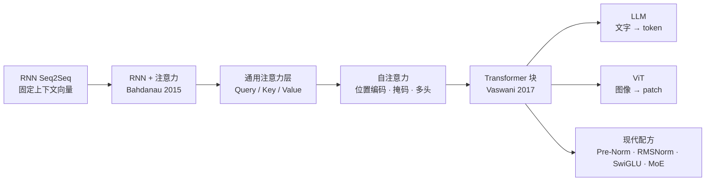

> 🔑 **本讲 6 个关键结论**
>
> 1. 注意力最初是为了解决 RNN Seq2Seq 的**信息瓶颈**：解码时每一步都能"回看"全部输入，并自己决定看哪里。
> 2. 抽象出来，注意力是作用在**向量集合**上的通用算子：Q 决定"找什么"，K 决定"凭什么被找到"，V 决定"被取走什么"。
> 3. 自注意力本身**不知道顺序**（置换等变），需要位置编码（现代主流是 RoPE）；语言模型需要**因果掩码**；多头让模型并行关注不同关系。
> 4. Transformer 块 = 自注意力（token 之间唯一的交互）+ 逐 token 的 MLP + 残差 + 归一化；主要计算只是 **6 次矩阵乘**，因此极易扩展。
> 5. 同一套架构：文字切成 token → **LLM**；图像切成 patch → **ViT**。
> 6. 2017 年至今架构主体几乎没变，只有几处改动成为标配：Pre-Norm、RMSNorm、QK-Norm、SwiGLU、MoE（外加 RoPE、GQA、FlashAttention）。

---

## 🔁 1. 从 RNN 到注意力：为什么需要 Attention

### 1.1 回顾：用 RNN 做序列到序列（Seq2Seq）

**序列到序列（Sequence-to-Sequence, Seq2Seq）** 任务：输入序列 $x_1,\dots,x_T$，输出序列 $y_1,\dots,y_{T'}$，两者长度可以不同。最典型的例子是机器翻译，例如英文 "we see the sky" → 意大利文 "vediamo il cielo"。

经典做法是用两个 RNN 组成 **编码器-解码器（Encoder-Decoder）**。**编码器（Encoder）** 逐词读入输入，并更新隐藏状态：

$$
h_t = f_W(x_t,\ h_{t-1})
$$

读完整句后，用最终隐藏状态得到解码器的初始状态 $s_0$ 和 **上下文向量（context vector）** $c$（常直接取 $c=h_T$）。**解码器（Decoder）** 从 [START] 开始逐词生成，直到输出 [STOP]；注意它每一步都使用**同一个** $c$：

$$
s_t = g_U(y_{t-1},\ s_{t-1},\ c)
$$

### 1.2 问题：固定长度的上下文向量是信息瓶颈

> ⚠️ **瓶颈（bottleneck）**：无论输入多长，整句话的信息都必须被压缩进**一个固定维度**的向量 $c$。4 个词还好，如果 $T=1000$ 呢？越早读入的信息越容易被"冲淡"。

解决思路：**不要只给解码器一个 $c$，而是让解码器在每一步都能回头查看编码器的全部隐藏状态 $h_1,\dots,h_T$，并自己决定此刻该关注哪里。** 这就是注意力机制（Bahdanau et al., ICLR 2015）。

### 1.3 Bahdanau 注意力：四步走

在解码的第 $t$ 步：

**① 计算对齐分数（alignment scores）**：用一个小网络 $f_{att}$（通常是 MLP）衡量"解码器当前状态"与"每个编码器状态"的匹配程度。Bahdanau 使用的是加性形式 $e_{t,i}=v_a^\top\tanh(W_a s_{t-1}+U_a h_i)$：

$$
e_{t,i} = f_{att}(s_{t-1},\ h_i)
$$

**② 用 softmax 归一化得到注意力权重（attention weights）**，每个权重都在 0 和 1 之间，且对 $i$ 求和为 1：

$$
a_{t,i} = \frac{\exp(e_{t,i})}{\sum_{j=1}^{T}\exp(e_{t,j})}
$$

**③ 加权求和，得到这一步专属的上下文向量**：

$$
c_t = \sum_{i=1}^{T} a_{t,i}\,h_i
$$

**④ 用 $c_t$ 更新解码器状态并输出下一个词**：

$$
s_t = g_U(y_{t-1},\ s_{t-1},\ c_t)
$$

> 💡 **直觉**：输出 "vediamo"（= "we see"）时，模型可能给出 $a_{1,1}=a_{1,2}=0.45$、$a_{1,3}=a_{1,4}=0.05$，注意力集中在 "we" 和 "see"；输出 "il"（= "the"）时，$a_{2,3}=0.8$，注意力集中在 "the"。每个时间步都使用**不同的**上下文向量，按需取用输入信息。

> ✅ **关键点：全程可微（differentiable）**。我们从不告诉模型该关注哪个词——没有任何针对注意力权重的监督信号。对齐关系完全是在降低翻译损失的过程中，通过反向传播**自己学出来的**。

### 1.4 可视化：模型自己学会了"对齐"

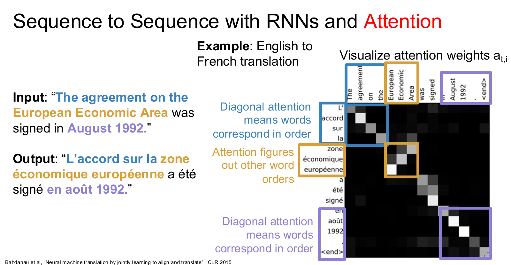

*▲ 图 1　英→法翻译的注意力权重热力图（课件 P27，来自 Bahdanau et al., 2015）*

- 横轴是英文输入词，纵轴是法文输出词，每个格子的亮度就是 $a_{t,i}$。
- **对角线**（蓝框、紫框）：两种语言词序一致，逐词对应，如 "The agreement on the" ↔ "L'accord sur la"、"August 1992" ↔ "août 1992"。
- **反对角**（黄框）："European Economic Area" ↔ "zone économique européenne"。法语形容词后置、词序相反，注意力自动"拐弯"。
- 这种 **软对齐（soft alignment）** 还能自然处理一对多、多对一，例如 "was signed" ↔ "a été signé"。

### 1.5 拓展：常见的打分函数

$f_{att}$ 有多种设计（整理自 Lil'Log）：

| 名称 | 打分函数 score(s, h) | 代表工作 | 2026 年的地位 |
|---|---|---|---|
| 加性注意力（Additive / Concat） | $v_a^\top\tanh(W_a[s;h])$ | Bahdanau 2015 | 主要是历史意义 |
| 点积注意力（Dot-Product） | $s^\top h$ | Luong 2015 | 被缩放点积取代 |
| 通用 / 双线性（General） | $s^\top W_a h$ | Luong 2015 | 相当于"先投影再点积"，是 Q/K 投影的前身 |
| **缩放点积（Scaled Dot-Product）** | $s^\top h/\sqrt{n}$ | Vaswani 2017 | ✅ 当今绝对主流 |

早期还有基于位置的注意力、hard / local attention 等变体，如今已基本不用，知道名字即可。

### 1.6 抽象一步：注意力是一个通用算子

把 Bahdanau 注意力里的角色抽出来看：

| 角色 | 在 RNN 翻译中 | 抽象后的含义 |
|---|---|---|
| 查询向量（Query） | 解码器状态 $s_{t-1}$ | "我现在想找什么" |
| 数据向量（Data） | 编码器状态 $h_i$ | "可供检索的内容" |
| 输出向量（Output） | 上下文向量 $c_t$ | 数据向量的加权平均 |

> 🧩 这个运算**根本不关心**数据向量是否来自 RNN、是否有顺序——它只需要"一个查询 + 一组向量"。把它单独拿出来，就得到了 Transformer 的核心积木：**注意力层**。

---
## 🎛️ 2. 通用注意力层：Query · Key · Value

### 2.1 从"一个查询"开始，逐步改进

最朴素的版本：输入一个**查询向量** $q$（维度 $D_Q$）和一组**数据向量** $X$（形状 $[N_X\times D_X]$），先算相似度 $e_i=f_{att}(q,X_i)$，再算权重 $a=\mathrm{softmax}(e)$，最后输出 $y=\sum_i a_i X_i$。课件在此基础上做了 4 步改进：

**改进 1：用点积当相似度。** $e_i=q\cdot X_i$，简单、快速，天然适合矩阵运算（此时要求 $D_Q=D_X$）。

**改进 2：缩放点积。** $e_i=q\cdot X_i/\sqrt{D_Q}$。

> 🤔 **为什么要除以 $\sqrt{D_Q}$？**
>
> - 设 $q$、$k$ 的各分量相互独立、均值为 0、方差为 1，则 $q\cdot k=\sum_{i=1}^{D}q_ik_i$ 的方差为 $D$、标准差为 $\sqrt{D}$。$D=64$ 时标准差约为 8，$D=512$ 时约为 22.6（数值模拟可以验证）。
> - 点积太大 → softmax 的输入差距悬殊 → 输出几乎是 one-hot，即 **饱和（saturation）** → 梯度接近 0，训练困难。例如 softmax([8, 0, −8]) ≈ [0.9997, 0.0003, 0.0000]。
> - 除以 $\sqrt{D}$ 把点积的方差拉回 1，让 softmax 工作在"温和"区间。

**改进 3：一次处理多个查询。** 把 $N_Q$ 个查询堆成矩阵 $Q\ [N_Q\times D_Q]$，所有相似度用一次矩阵乘算完：

$$
E=\frac{QX^\top}{\sqrt{D_Q}}\ \ [N_Q\times N_X],\qquad A=\mathrm{softmax}(E,\ \mathrm{dim}=1),\qquad Y=AX\ \ [N_Q\times D_X]
$$

其中 dim=1 表示**对每一行（即每个查询）在所有数据向量上归一化**。

**改进 4：把"键"和"值"分开。** 原来数据向量身兼两职——既用来被比较，又用来被取用。用两个可学习矩阵把它们拆开，更加灵活（也不再要求 $D_Q=D_X$）：

$$
K=XW_K\ \ [N_X\times D_Q],\qquad V=XW_V\ \ [N_X\times D_V]
$$

$$
E=\frac{QK^\top}{\sqrt{D_Q}},\qquad A=\mathrm{softmax}(E,\ \mathrm{dim}=1),\qquad Y=AV\ \ [N_Q\times D_V]
$$

写成分量形式：$E_{ij}=Q_i\cdot K_j/\sqrt{D_Q}$，$Y_i=\sum_j A_{ij}V_j$。**每个输出都是所有值向量的线性组合，组合权重就是注意力权重。**

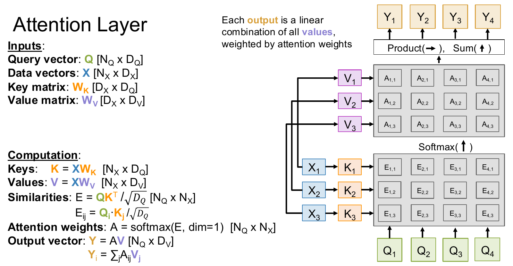

*▲ 图 2　通用注意力层（课件 P45）：查询与键比较得到相似度 E，按列 softmax 得到权重 A，再对值向量加权求和*

**形状速查表**

| 符号 | 含义 | 形状 |
|---|---|---|
| $Q$ | 查询（Query） | $N_Q\times D_Q$ |
| $X$ | 数据向量（Data） | $N_X\times D_X$ |
| $W_K$ / $W_V$ | 键 / 值投影矩阵（可学习） | $D_X\times D_Q$ / $D_X\times D_V$ |
| $K=XW_K$ | 键（Key） | $N_X\times D_Q$ |
| $V=XW_V$ | 值（Value） | $N_X\times D_V$ |
| $E=QK^\top/\sqrt{D_Q}$ | 相似度（Similarities） | $N_Q\times N_X$ |
| $A=\mathrm{softmax}(E,\ \mathrm{dim}=1)$ | 注意力权重（Attention weights） | $N_Q\times N_X$ |
| $Y=AV$ | 输出（Output） | $N_Q\times D_V$ |

### 2.2 Q、K、V 的直觉：一次"软检索"

> 🔍 **类比：在图书馆里检索资料**
>
> - **Query（查询）**：你写在检索框里的问题——"我想找什么"。
> - **Key（键）**：每本书的标题和标签——"我能被什么样的问题找到"。
> - **Value（值）**：书的实际内容——"被找到之后提供什么信息"。
>
> 与真实检索不同，注意力是 **软检索（soft retrieval）**：它不是只返回最匹配的那一本，而是按相似度给每本书一个权重（总和为 1），返回所有内容的加权平均。把 K 和 V 分开的好处是："按什么匹配"和"取走什么内容"可以不同，比如按标题匹配、取走正文。

### 2.3 交叉注意力（Cross-Attention）

当 **Q 来自一组向量，而 K、V 来自另一组向量** 时，称为交叉注意力：

$$
Q=X_{\text{query}}W_Q,\qquad K=X_{\text{context}}W_K,\qquad V=X_{\text{context}}W_V
$$

它是"让一种信息去读取另一种信息"的标准做法：

- **原始 Transformer 的解码器**：其中的"编码器-解码器注意力"以解码器状态作 Q，以编码器输出作 K/V——正是第 1 节 Bahdanau 注意力的"Transformer 版"。
- **编码器-解码器模型**：如 T5、Whisper（语音识别）。
- **文生图扩散模型**：如 Stable Diffusion，图像特征作 Q，去"读取"文本编码（K/V），实现文字对生成内容的控制。
- **多模态模型**：用一组可学习的查询向量从图像特征中"提取"信息（Perceiver、Q-Former 一类设计）。

---

## 🪞 3. 自注意力：位置编码、掩码与多头

### 3.1 定义：每个输入产生一个输出

**自注意力（Self-Attention）** 是注意力层的特例：**Q、K、V 全部来自同一组输入向量 $X$**。每个输入产生一个输出，而每个输出都融合了**所有输入**的信息。

$$
Q=XW_Q,\qquad K=XW_K,\qquad V=XW_V,\qquad W_Q,W_K,W_V\in\mathbb{R}^{D_{in}\times D_{out}}
$$

$$
Y=\mathrm{softmax}\!\left(\frac{QK^\top}{\sqrt{D_Q}}\right)V\ \in\mathbb{R}^{N\times D_{out}}
$$

这里 $D_Q=D_{out}$：输入 $X$ 的形状为 $[N\times D_{in}]$，Q、K、V 的形状都是 $[N\times D_{out}]$，相似度矩阵与注意力权重都是 $[N\times N]$。

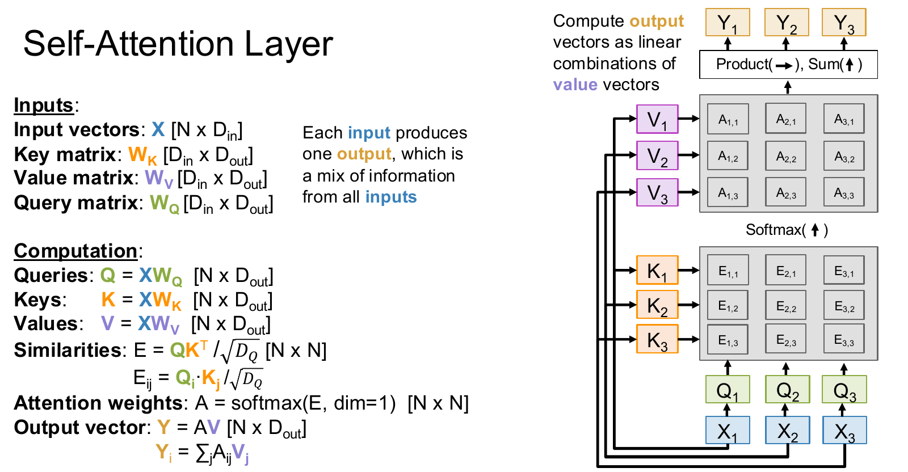

*▲ 图 3　自注意力层（课件 P51）：每个输入向量同时生成查询、键、值，输出是值向量的线性组合*

> 🛠️ **工程技巧：融合 QKV 投影**。三个投影可以拼成一个大矩阵、一次矩阵乘完成：$[Q\ K\ V]=X\,[W_Q\ W_K\ W_V]$，形状 $[N\times D_{in}]\times[D_{in}\times 3D_{out}]\to[N\times 3D_{out}]$，再切成三份。GPU 上一次大矩阵乘比三次小矩阵乘更高效，几乎所有实现都这么做。

### 3.2 手算一个小例子

取 3 个二维 token：$x_1=[1,0]$、$x_2=[0,1]$、$x_3=[1,1]$。为便于手算，令 $W_Q=W_K=W_V=I$（单位矩阵），即 $Q=K=V=X$。

**① 相似度与缩放**（$\sqrt{2}\approx1.414$）：

$$
QK^\top=\begin{bmatrix}1&0&1\\0&1&1\\1&1&2\end{bmatrix},\qquad E=\frac{QK^\top}{\sqrt{2}}\approx\begin{bmatrix}0.707&0&0.707\\0&0.707&0.707\\0.707&0.707&1.414\end{bmatrix}
$$

**② 逐行 softmax**（每行之和为 1）：

$$
A\approx\begin{bmatrix}0.401&0.198&0.401\\0.198&0.401&0.401\\0.248&0.248&0.503\end{bmatrix}
$$

**③ 对值向量加权求和**：

$$
Y=AV\approx\begin{bmatrix}0.802&0.599\\0.599&0.802\\0.752&0.752\end{bmatrix}
$$

**解读**：$x_1$ 与自己、与 $x_3$ 的点积都是 1，与 $x_2$ 正交（点积为 0），所以第一行权重是 0.401 / 0.198 / 0.401；$x_3$ 与自己的点积最大（为 2），所以它最关注自己（0.503）。每个输出都是全部输入的"软混合"。

### 3.3 向量视角：Illustrated Transformer 的"六步法"

Jay Alammar 用单个词的视角把自注意力拆成 6 步：

1. **生成 q、k、v**：每个词的嵌入 $x_i$ 分别乘以 $W_Q$、$W_K$、$W_V$（原论文中 512 维嵌入 → 64 维的 q、k、v）。
2. **打分**：当前词的查询与每个词的键做点积，$\mathrm{score}_{ij}=q_i\cdot k_j$。
3. **缩放**：除以 $\sqrt{d_k}=\sqrt{64}=8$，让梯度更稳定。
4. **softmax**：把分数变成和为 1 的权重。
5. **加权**：用权重乘以每个值向量——保留想关注的词，"淹没"无关的词。
6. **求和**：$z_i=\sum_j \mathrm{softmax}(\mathrm{score}_{ij})\,v_j$，得到该位置的输出。

> 💡 **例子**："The animal didn't cross the street because it was too tired." 处理 "it" 时，自注意力会把较大的权重分给 "The animal"，把"它指代谁"的信息直接融入 "it" 的表示。在 RNN 里，这类信息要靠隐藏状态一步步长距离传递才能做到。

### 3.4 自注意力不知道顺序：置换等变与位置编码

**置换等变（Permutation Equivariance）**：若把输入顺序打乱（置换 $\sigma$），输出会以完全相同的方式被打乱：

$$
F(\sigma(X))=\sigma(F(X))
$$

原因是每个输出都只是"自己的查询"与"所有键"的比较，而求和 $\sum_j$ 与顺序无关。因此自注意力本质上作用于 **向量集合（set）**，而不是序列。

> ⚠️ **问题**："狗咬人"和"人咬狗"包含相同的三个 token。如果不加位置信息，自注意力给每个 token 算出的表示完全一样，只是排列不同——模型无法区分"谁咬谁"。

**方案 A：绝对位置编码（Absolute Positional Encoding）**。给每个输入加上一个只依赖位置下标的向量 $E(i)$：$x_i'=x_i+E(i)$。原始 Transformer 使用固定的**正弦位置编码**：

$$
PE_{(pos,\,2i)}=\sin\!\left(\frac{pos}{10000^{2i/d}}\right),\qquad PE_{(pos,\,2i+1)}=\cos\!\left(\frac{pos}{10000^{2i/d}}\right)
$$

也可以直接学习一张位置嵌入表（BERT、GPT-2、原始 ViT 都这么做）；原论文发现两种做法效果几乎一样。

**方案 B：旋转位置编码（Rotary Position Embedding, RoPE）**——2026 年 LLM 的默认选择（Su et al., 2021）。思路是把位置映射成**角度**，在计算相似度之前把 $q$、$k$ **旋转**相应的角度。以二维为例，旋转矩阵为：

$$
R(\theta)=\begin{bmatrix}\cos\theta&-\sin\theta\\ \sin\theta&\cos\theta\end{bmatrix}
$$

第 $i$ 个查询旋转 $\theta_i$、第 $j$ 个键旋转 $\phi_j$。由于 $R(a)^\top R(b)=R(b-a)$：

$$
\big(R(\theta_i)\,q_i\big)^\top\big(R(\phi_j)\,k_j\big)=q_i^\top R(\phi_j-\theta_i)\,k_j
$$

当角度与位置成正比（$\theta_i=i\theta$，$\phi_j=j\theta$）时，相似度只取决于 **相对位置** $j-i$，与绝对位置无关。

- **高维情况**：把 $D$ 维向量两两分组，共 $D/2$ 组，每组用不同的频率 $\theta_k=10000^{-2k/D}$ 旋转（与正弦编码的频率设计一脉相承）。
- **特点**：只作用于 Q、K，不作用于 V；没有可学习参数；在每一层的注意力里都会施加。
- **长上下文扩展**：Position Interpolation、NTK-aware、YaRN 等方法本质上都是在调整旋转频率，让模型适应比训练时更长的序列。
- **应用**：LLaMA、Qwen、DeepSeek、Gemma 等几乎所有主流 LLM；视觉领域的 DINOv3、Qwen2-VL 视觉编码器则使用 **2D RoPE**（对行、列坐标分别旋转）。

### 3.5 掩码自注意力（Masked / Causal Self-Attention）

语言模型要"根据前文预测下一个词"，训练时不能让第 $i$ 个位置偷看后面的词。做法是在 softmax **之前**，把不允许看的位置的相似度改成 $-\infty$，softmax 之后这些位置的权重就是 0：

$$
E_{ij}=\begin{cases}Q_i\cdot K_j/\sqrt{D_Q}, & j\le i\\ -\infty, & j>i\end{cases}\qquad\Longrightarrow\qquad A_{ij}=0\ \ (j>i)
$$

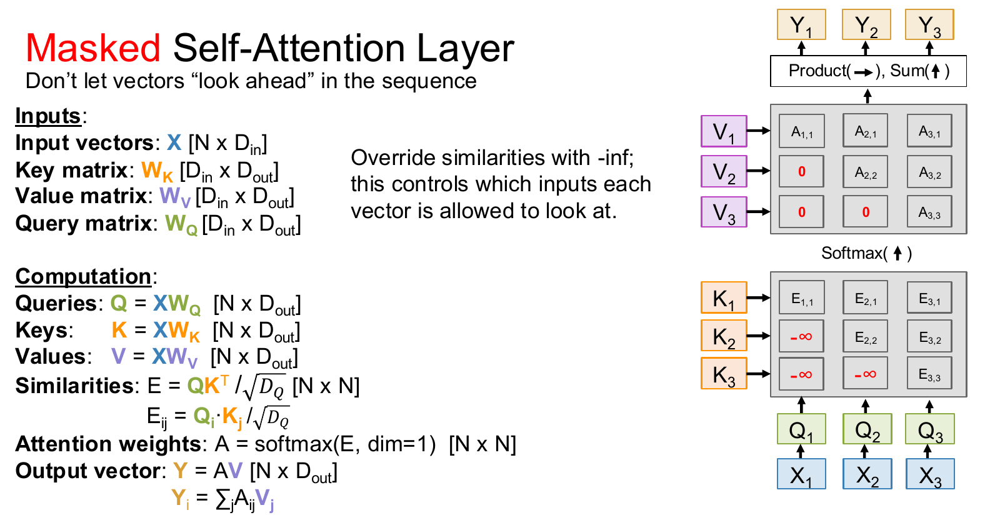

*▲ 图 4　掩码自注意力（课件 P61）：用 −∞ 覆盖"未来"位置的相似度，从而控制每个向量能看到哪些输入*

**例子**：输入 "Attention is very"，三个输出位置分别预测 "is very cool"：第 1 个位置只能看到 "Attention"，第 2 个位置能看到 "Attention is"，依此类推。对 3.2 节的小例子加上因果掩码，第 1 行只剩自己，第 2 行在前两个位置之间重新归一化：

$$
A_{\text{causal}}\approx\begin{bmatrix}1&0&0\\0.330&0.670&0\\0.248&0.248&0.503\end{bmatrix}
$$

> 🛠️ **实现要点**：通常用一个下三角布尔矩阵（`torch.tril`）作因果掩码；批量训练变长序列时，还会用 **填充掩码（padding mask）** 屏蔽补齐的位置。编码器类模型（BERT、ViT）不加因果掩码，每个 token 能看到所有 token，称为 **双向注意力**。

### 3.6 多头自注意力（Multi-Head Self-Attention）

一组 Q/K/V 只能学到一种"关注方式"。**多头** 的做法是：并行运行 $H$ 个独立的自注意力（每个称为一个**头（head）**，各有自己的权重），把 $H$ 个输出拼接起来，再用一个 **输出投影** $W_O$ 融合：

$$
\mathrm{head}_h=\mathrm{softmax}\!\left(\frac{(XW_Q^{h})(XW_K^{h})^\top}{\sqrt{D_H}}\right)XW_V^{h},\qquad \mathrm{MHSA}(X)=\big[\mathrm{head}_1;\dots;\mathrm{head}_H\big]\,W_O
$$

- 通常令每个头的维度 $D_H=D/H$，所以多头的总计算量与一个 $D$ 维的单头相当。原论文取 $D=512$、$H=8$、$D_H=64$。
- 不同的头会自发学到不同的关系：有的关注相邻词，有的关注句法依存，有的负责指代消解。在 Illustrated Transformer 的例子里，编码 "it" 时一个头关注 "the animal"，另一个头关注 "tired"。
- 拼接后的输出投影 $W_O$（形状 $[HD_H\times D]$）负责把各头的信息"融合"回模型维度。

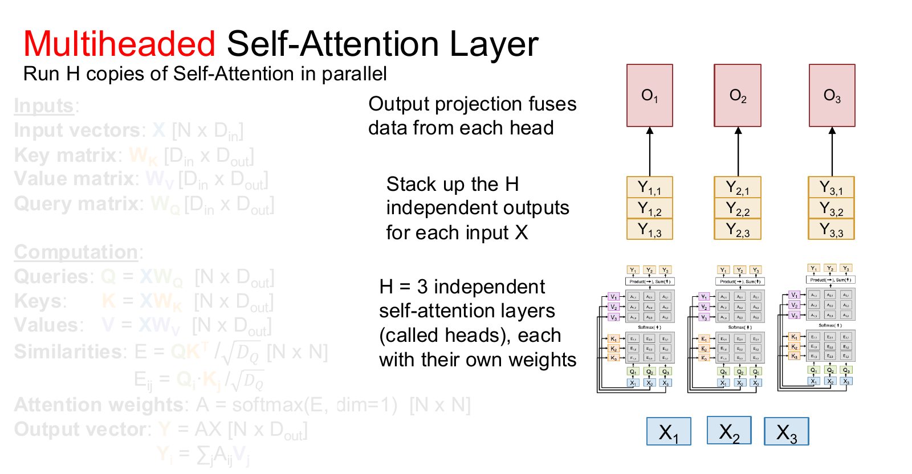

*▲ 图 5　多头自注意力（课件 P66）：H 个头并行计算，堆叠输出后由输出投影融合*

### 3.7 自注意力 = 4 次矩阵乘

| 步骤 | 运算 | 形状变化 |
|---|---|---|
| ① QKV 投影 | $[Q\ K\ V]=X\,[W_Q\ W_K\ W_V]$ | $[N\times D]\times[D\times 3HD_H]\to[N\times 3HD_H]$，切分并 reshape 为 3 个 $[H\times N\times D_H]$ |
| ② QK 相似度 | $E=QK^\top/\sqrt{D_H}$ | $[H\times N\times D_H]\times[H\times D_H\times N]\to[H\times N\times N]$ |
| ③ V 加权 | $Y=\mathrm{softmax}(E)\,V$ | $[H\times N\times N]\times[H\times N\times D_H]\to[H\times N\times D_H]$，reshape 为 $[N\times HD_H]$ |
| ④ 输出投影 | $O=YW_O$ | $[N\times HD_H]\times[HD_H\times D]\to[N\times D]$ |

多头时课件把 softmax 写成 dim=2：$E$ 的形状是 $[H\times N\times N]$，dim=2 就是最后一维（键的维度），含义与单头时的 dim=1 完全相同。

### 3.8 复杂度瓶颈与 FlashAttention

> 🧨 **显存随 $N$ 平方增长**：第 ② 步会产生 $H\times N\times N$ 的注意力矩阵。若 $N=100\text{K}$、$H=64$，仅一层的注意力权重（fp16，每个数 2 字节）就需要 $64\times10^{10}\times2$ 字节，约 1.2 TB（课件给出 1.192 TB）——没有任何 GPU 放得下。

**FlashAttention**（Dao et al., 2022）把第 ②③ 步**融合进一个 GPU kernel** 中按块计算，**从不把完整的 $N\times N$ 矩阵写入显存**：

- **分块（Tiling）**：把 Q、K、V 切成能放进片上 SRAM 的小块，逐块计算。
- **在线 softmax（Online Softmax）**：softmax 需要整行的最大值和指数和。FlashAttention 边算边维护"当前最大值 $m$"和"当前指数和 $\ell$"，新块到来时把旧结果乘以 $e^{m_{\text{old}}-m_{\text{new}}}$ 重新缩放，最终结果与标准 softmax **完全相同**。
- **IO 感知（IO-aware）**：GPU 的 HBM（显存）容量大但慢，SRAM 小但快；注意力的瓶颈往往是显存读写而不是算力，减少 HBM 读写就能明显提速。
- **反向时重算（Recomputation）**：不保存注意力矩阵，反向传播时按块重新计算，用少量额外计算换取大量显存。

> ✅ **效果**：显存从 $O(N^2)$ 降到 $O(N)$，速度显著提升，而且是**精确计算，不是近似**。但要注意：**计算量仍然是 $O(N^2)$**。

| 版本 | 年份 | 主要改进 |
|---|---|---|
| FlashAttention | 2022 | 分块 + 在线 softmax，IO 感知，显存 $O(N)$ |
| FlashAttention-2 | 2023 | 更好的并行与工作划分（沿序列长度并行），比第一代快约 2 倍 |
| FlashAttention-3 | 2024 | 面向 Hopper（H100）：warp 专用化与异步执行、支持 FP8；FP16 达 740 TFLOPs/s（约 75% 利用率），FP8 接近 1.2 PFLOPs/s |
| FlashAttention-4 | 2026 | 面向 Blackwell（B200 等）重新设计异步流水线 |

日常使用无需手写：PyTorch 2.x 的 `F.scaled_dot_product_attention` 会根据硬件和输入自动选择 FlashAttention 或其他高效内核（见第 9 节代码）。

---
## ⚖️ 4. 三种处理序列的方式：RNN vs 卷积 vs 自注意力

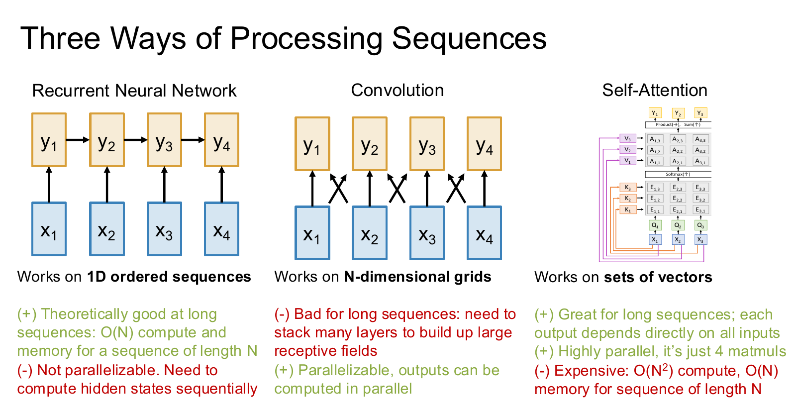

*▲ 图 6　三种处理序列的方式（课件 P83）*

| 维度 | 循环神经网络（RNN） | 卷积（Convolution） | 自注意力（Self-Attention） |
|---|---|---|---|
| 适用结构 | 1D 有序序列 | N 维网格（图像、音频等） | 向量集合 |
| 长距离依赖 | ✅ 理论上擅长：长度为 N 的序列只需 O(N) 计算与显存 | ❌ 不擅长：需堆叠很多层才能扩大感受野 | ✅ 擅长：每个输出直接依赖所有输入 |
| 并行性 | ❌ 隐藏状态必须按顺序计算 | ✅ 各位置的输出可并行计算 | ✅ 只是 4 次矩阵乘，高度并行 |
| 主要代价 | 训练慢、信息逐步衰减 | 感受野受限 | ❌ O(N²) 计算；借助 FlashAttention 显存为 O(N) |

原论文从三个角度做了更细的对比（$n$ 为序列长度，$d$ 为表示维度，$k$ 为卷积核大小，$r$ 为局部窗口大小）：

| 层类型 | 每层计算复杂度 | 顺序操作数 | 最大路径长度 |
|---|---|---|---|
| 自注意力 | $O(n^2\cdot d)$ | $O(1)$ | $O(1)$ |
| 循环层 | $O(n\cdot d^2)$ | $O(n)$ | $O(n)$ |
| 卷积层 | $O(k\cdot n\cdot d^2)$ | $O(1)$ | $O(\log_k n)$ |
| 受限自注意力（窗口 r） | $O(r\cdot n\cdot d)$ | $O(1)$ | $O(n/r)$ |

- **顺序操作数**：必须串行执行的步骤数，越少越好并行。
- **最大路径长度**：任意两个位置之间的信号最多要经过多少步才能相互影响——越短，越容易学到长距离依赖。
- 当 $n\lt d$ 时（2017 年翻译任务中很常见），自注意力每层的计算量甚至比 RNN 更小。

> 📌 **论文标题的含义——Attention Is All You Need**：只用注意力 + MLP，完全抛弃 RNN 和卷积，也能构建强大的序列模型。

> 🔭 **2025–2026 视角**：$O(N^2)$ 仍是超长上下文的主要瓶颈，主流应对方式有两类：
>
> - **局部 + 全局交替**：大部分层只做 **滑动窗口注意力（Sliding Window Attention）**，即每个 token 只看最近 W 个 token；少数层保留全局注意力（如 Gemma 3、Gemma 4）。
> - **线性注意力混合架构**：大部分层使用线性复杂度的模块（线性注意力 / 状态空间模型），只保留少量全注意力层。例如 Qwen3-Next 以 3:1 的比例混合 Gated DeltaNet 与门控注意力层，原生支持 262K 上下文；Kimi Linear 也采用类似思路。

---

## 🧱 5. Transformer：把自注意力堆起来

### 5.1 Transformer 块（Transformer Block）

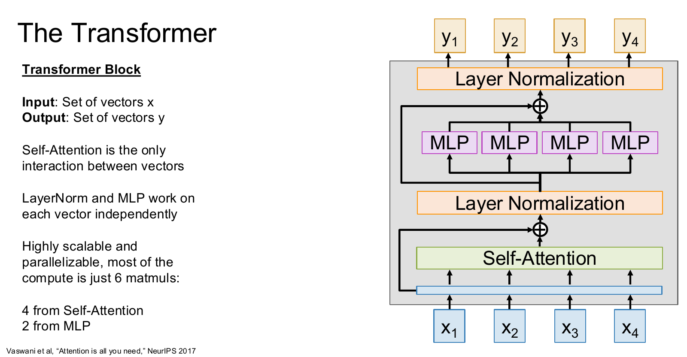

*▲ 图 7　Transformer 块（课件 P92，Vaswani et al., 2017 的原始 Post-Norm 结构）*

一个 Transformer 块的输入和输出都是 **一组向量**（形状均为 $[N\times D]$），内部依次是：

1. **自注意力**：向量之间唯一的交互途径；
2. **残差连接（Residual Connection）**：把输入直接加到输出上，让梯度可以畅通回传（与 ResNet 同理）；
3. **层归一化（Layer Normalization, LN）**：对每个向量**自身的 D 个特征**做归一化；
4. **MLP（又称 FFN，前馈网络）**：对每个向量**独立地**做两层全连接变换；
5. 再做一次残差连接 + 层归一化。

原始论文的写法（归一化放在残差之后，称为 Post-Norm）：

$$
h=\mathrm{LN}\big(x+\mathrm{MHSA}(x)\big),\qquad y=\mathrm{LN}\big(h+\mathrm{MLP}(h)\big)
$$

**层归一化** 对单个向量 $x\in\mathbb{R}^D$ 计算均值和方差，再用可学习的缩放 $\gamma$ 与偏移 $\beta$ 恢复表达能力（Ba et al., 2016）：

$$
\mathrm{LN}(x)=\gamma\odot\frac{x-\mu}{\sqrt{\sigma^2+\varepsilon}}+\beta,\qquad \mu=\frac{1}{D}\sum_{i=1}^{D}x_i,\qquad \sigma^2=\frac{1}{D}\sum_{i=1}^{D}(x_i-\mu)^2
$$

与 BatchNorm 在 batch 维度上统计不同，LayerNorm 只在每个 token 的特征维度上统计，**与 batch 大小、序列长度都无关**，适合变长序列，训练和推理时行为一致。

**MLP** 通常先把维度放大 4 倍再缩回，激活函数 $\sigma$ 在原论文中是 ReLU，在 BERT、GPT、ViT 中是 GELU：

$$
\mathrm{MLP}(x)=\sigma(xW_1+b_1)\,W_2+b_2,\qquad W_1\in\mathbb{R}^{D\times4D},\quad W_2\in\mathbb{R}^{4D\times D}
$$

> 🔑 **Transformer 块的三个关键性质**
>
> - 自注意力是向量之间**唯一**的交互；LayerNorm 和 MLP 都是**逐向量独立**进行的。
> - 高度可扩展、可并行：主要计算只有 **6 次矩阵乘**——自注意力 4 次（QKV 投影、$QK^\top$、$AV$、输出投影）+ MLP 2 次。
> - **一个 Transformer 就是若干个结构相同的块堆叠而成。**

### 5.2 参数量速算：每块约 12D²

- 自注意力：$W_Q$、$W_K$、$W_V$、$W_O$ 各为 $D\times D$ → $4D^2$
- MLP：$D\times4D+4D\times D$ → $8D^2$
- 合计每块约 $12D^2$（忽略偏置与 LN 参数）；整个模型约为 $12LD^2$，再加上词嵌入 $V\times D$。

| 模型 | 年份 | 块数 L | 维度 D | 头数 H | 上下文 N | 参数量 | 按 12LD² 估算 |
|---|---|---|---|---|---|---|---|
| Transformer（Vaswani et al.） | 2017 | 12 | 1024 | 16 | 512 | 213M | 约 151M，另加词嵌入与解码器的交叉注意力 |
| GPT-2 | 2019 | 48 | 1600 | 25 | 1024 | 1.5B | 约 1.47B |
| GPT-3 | 2020 | 96 | 12288 | 96 | 2048 | 175B | 约 174B |

估算与真实值非常接近——**模型规模几乎完全由层数 L 和宽度 D 决定**。

### 5.3 三种架构形态

| 形态 | 结构 | 注意力类型 | 代表模型 | 典型用途 |
|---|---|---|---|---|
| 编码器-解码器（Encoder-Decoder） | 编码器堆 + 解码器堆；解码器通过交叉注意力读取编码器输出 | 编码器双向；解码器因果 + 交叉 | 原始 Transformer、T5、Whisper | 翻译、语音识别等"输入 → 输出"转换 |
| 仅编码器（Encoder-only） | 只有编码器 | 双向（无掩码） | BERT、ViT | 理解、分类、提取特征 |
| 仅解码器（Decoder-only） | 只有带因果掩码的块 | 因果（单向） | GPT 系列、LLaMA、Qwen、DeepSeek、Gemma | 文本生成；2026 年 LLM 的绝对主流 |

<details>
<summary>📄 展开：《Attention Is All You Need》的实验结果与训练细节</summary>

- **结构**：编码器、解码器各 6 层。base 模型 $d_{model}=512$、$d_{ff}=2048$、$h=8$；big 模型 $d_{model}=1024$、$d_{ff}=4096$、$h=16$。
- **结果**：WMT 2014 英→德 **28.4 BLEU**，比此前最佳结果（包括集成模型）高出 2 BLEU 以上；英→法 **41.8 BLEU**，刷新单模型纪录。
- **训练成本**：big 模型在 8 张 P100 GPU 上训练 3.5 天，base 模型仅约 12 小时，远低于当时的 RNN / CNN 模型。
- **训练技巧**：Adam 优化器 + 学习率预热（warmup 4000 步，之后按步数的 −0.5 次方衰减）、dropout 0.1、标签平滑（label smoothing）0.1；英德任务使用约 37000 个 token 的 BPE 共享词表。
- **BLEU**：机器翻译常用的自动评测指标，衡量译文与参考译文的 n-gram 重合程度，范围 0–100，越高越好。

学习率公式（至今仍常见的 warmup + 衰减思路）：

$$
lr=d_{model}^{-0.5}\cdot\min\big(step^{-0.5},\ step\cdot warmup^{-1.5}\big)
$$

</details>

---

## 💬 6. Transformer 做语言模型（LLM）

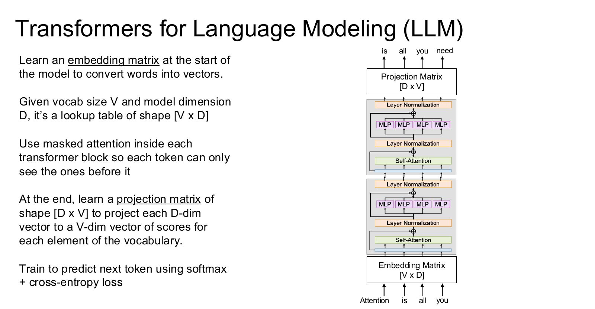

*▲ 图 8　用 Transformer 做语言建模（课件 P100）：嵌入矩阵 → 带掩码的 Transformer 块 → 投影矩阵 → 预测下一个 token*

### 6.1 完整流程

1. **分词（Tokenization）**：把文本切成 **token（词元）**。主流使用 **BPE（Byte-Pair Encoding，字节对编码）** 等子词算法：从字符或字节出发，反复合并最常见的相邻片段，在词表大小与覆盖率之间取得平衡。词表大小 V：GPT-2 约 5 万，LLaMA 3 约 12.8 万，Gemma 3 / 4 约 26.2 万。
2. **嵌入矩阵（Embedding Matrix）**：形状 $[V\times D]$ 的查找表，把每个 token id 映射为 $D$ 维向量。
3. **堆叠的 Transformer 块**：每个块的自注意力都使用 **因果掩码**，每个 token 只能看到它之前的 token。
4. **投影矩阵（Projection Matrix）**：形状 $[D\times V]$，把每个位置的 $D$ 维输出映射为 $V$ 维的 **logits**，即对词表中每个 token 的打分。很多模型让它与嵌入矩阵共享权重（weight tying）。
5. **训练目标**：softmax + 交叉熵，预测下一个 token：

$$
\mathcal{L}=-\frac{1}{N}\sum_{t=1}^{N}\log p_\theta\big(x_{t+1}\mid x_1,\dots,x_t\big)
$$

以课件为例：输入 "Attention is all you"，各位置的目标依次是 "is all you need"。

### 6.2 训练是并行的，推理是串行的

**🏋️ 训练**

输入完整序列，因果掩码保证每个位置只看前文，所以**一次前向传播**就能同时得到所有位置的预测和损失。这种"用真实前文作条件"的训练方式叫 **教师强制（teacher forcing）**，也是 Transformer 训练比 RNN 快得多的原因。

**💬 推理**

**自回归（autoregressive）** 生成：每次只预测一个 token，把它拼回输入，再预测下一个。每一步从预测分布中选词的方式包括贪心解码、温度（temperature）采样、top-p 采样等。

### 6.3 拓展：KV Cache 与 GQA / MQA / MLA

自回归生成的第 $t$ 步，新 token 要与之前所有 token 的 K、V 做注意力。由于因果掩码，之前 token 的 K、V 永远不会改变，所以可以把它们 **缓存** 起来——这就是 **KV Cache**：每步只需为新 token 计算一次 q、k、v。

- **为什么不缓存 Q？** 每一步只有**当前 token 的查询**需要与历史比较；过去 token 的查询在它们自己那一步用完后就再也不会用到。
- **显存估算**：KV Cache ≈ 2 × 层数 L × 序列长度 N × KV 头数 × $D_H$ × 每个数的字节数（"2"代表 K 和 V 各一份）。例如 32 层、32 个 KV 头、$D_H=128$、fp16，在 N = 4096 时，每条序列约需 **2 GiB**；长上下文、多并发时，KV Cache 往往比模型权重还占显存。

为此出现了让多个查询头 **共享 K/V** 的注意力变体：

| 变体 | 做法 | KV 头数 | 代表模型 |
|---|---|---|---|
| MHA（多头注意力） | 每个查询头有自己的一组 K/V | H | 原始 Transformer、GPT-3、OLMo 2 |
| MQA（多查询注意力） | 所有查询头共享一组 K/V（Shazeer, 2019） | 1 | PaLM、Falcon |
| GQA（分组查询注意力） | 查询头分成 G 组，每组共享一组 K/V（Ainslie et al., 2023） | G（$1\lt G\lt H$） | LLaMA 2-70B / LLaMA 3、Qwen、Gemma、Mistral |
| MLA（多头潜在注意力） | 把 K/V 压缩成低秩的潜在向量再缓存 | — | DeepSeek-V2 / V3 |

上面的例子若改用 8 个 KV 头的 GQA，KV Cache 就从 2 GiB 降到 0.5 GiB。

---
## 🖼️ 7. Vision Transformer（ViT）

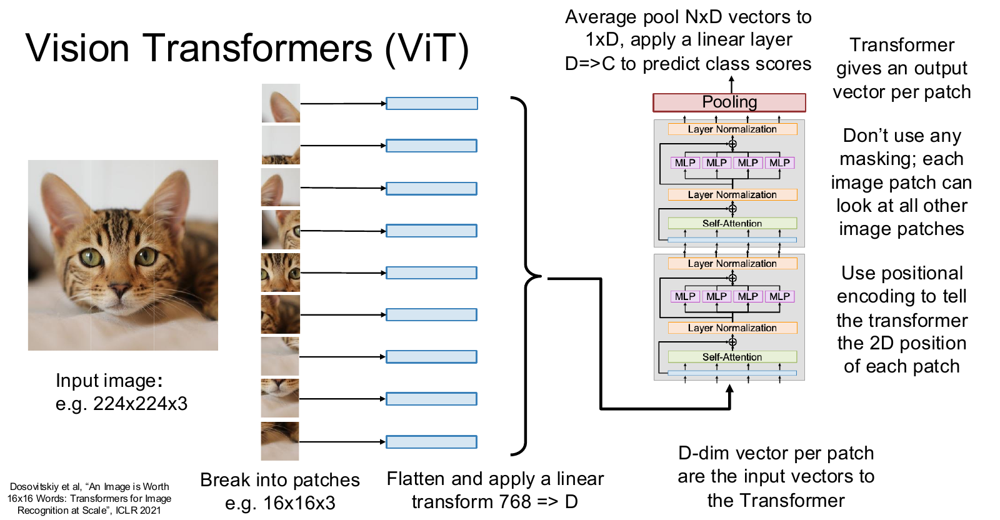

*▲ 图 9　Vision Transformer（课件 P110，Dosovitskiy et al., ICLR 2021）*

### 7.1 把图像变成 token 序列

1. 输入图像，例如 $224\times224\times3$。
2. 切成 $16\times16\times3$ 的 **图像块（patch）**：每边 $224/16=14$ 块，共 $14\times14=196$ 个 patch。
3. 每个 patch 展平成 $16\times16\times3=768$ 维向量，再经过 **线性层** $768\to D$，得到 patch 嵌入。
4. 加上 **位置编码**，告诉 Transformer 每个 patch 在图中的二维位置。
5. 送入 Transformer，**不使用任何掩码**：每个 patch 都能看到所有其他 patch。
6. Transformer 为每个 patch 输出一个向量；**平均池化** $N\times D\to1\times D$，再接线性层 $D\to C$，输出 $C$ 个类别的分数。

> 🛠️ **"切块 + 线性层"其实就是一个卷积**：它等价于 `Conv2d(in_channels=3, out_channels=D, kernel_size=16, stride=16)`——卷积核大小 = 步长 = patch 大小，各 patch 互不重叠。实际代码几乎都这么写（见第 9 节）。

> 📝 **课件版本与原论文的差异**：课件用平均池化做分类读出。原论文借鉴 BERT，在序列最前面拼接一个可学习的 **[CLS] token**（于是 N = 197），用它的最终输出做分类；位置编码使用可学习的 1D 位置嵌入（论文发现显式的 2D 位置编码并没有明显提升）；在更高分辨率上微调时，对预训练的位置嵌入做 2D 插值。论文附录显示，[CLS] 与平均池化在调好学习率后效果相近。

**ViT 的标准规格**（命名如 "ViT-L/16" = Large 模型、patch 大小 16×16）：

| 模型 | 层数 | 隐藏维度 D | MLP 维度 | 头数 | 参数量 |
|---|---|---|---|---|---|
| ViT-Base | 12 | 768 | 3072 | 12 | 86M |
| ViT-Large | 24 | 1024 | 4096 | 16 | 307M |
| ViT-Huge | 32 | 1280 | 5120 | 16 | 632M |

**patch 大小的权衡**：patch 越小 → token 越多 → 细节越丰富，但注意力代价按 $O(N^2)$ 增长。224 × 224 的图像，patch 为 16 时有 196 个 token；patch 为 8 时有 784 个 token，注意力矩阵扩大到 16 倍。

### 7.2 归纳偏置与数据规模

**归纳偏置（Inductive Bias）**：模型结构中预先"写死"的假设，相当于先验知识。

| 归纳偏置 | CNN | ViT |
|---|---|---|
| 局部性（locality） | ✅ 卷积核只看邻域 | ❌ 自注意力是全局的，只有 MLP 是逐 patch 的局部操作 |
| 二维邻域结构 | ✅ 内建于每一层 | ❌ 只在切 patch 和位置嵌入插值时用到 |
| 平移等变（translation equivariance） | ✅ 每一层都满足 | ⚠️ 仅逐 patch 共享的 MLP 等少数部分满足 |
| 空间关系 | 由结构给定 | 必须从数据中学习 |

- 只在 ImageNet（约 130 万张图）上从头训练时，ViT 比同等规模的 ResNet **略差**——缺少归纳偏置，需要更多数据。
- 在 ImageNet-21k（约 1400 万张）或 JFT-300M（约 3 亿张）上预训练后再迁移，ViT 追平并超过最强的 CNN：最佳模型 ImageNet top-1 达到 **88.55%**，且所需预训练算力明显更少。
- 论文的结论：**大规模训练胜过归纳偏置**（large scale training trumps inductive bias）。
- 有趣的观察：即使在最底层，也有一些注意力头会关注整张图（"注意力距离"很大）——这是 CNN 浅层做不到的。

> 🔭 **2025–2026 视角：ViT 已经是视觉基础模型的标准骨干**
>
> - **自监督学习**：DINOv3（Meta，2025）把自监督 ViT 扩展到 70 亿参数、在约 17 亿张图像上训练，再蒸馏出 ViT-S/B/L 等小模型；冻结骨干就能在 COCO 检测上达到 66.1 mAP、在 ADE20k 分割上达到 63.0 mIoU，并采用 2D RoPE。
> - **图文对比学习**：CLIP、SigLIP 2 等用海量图文对训练 ViT 图像编码器，是多模态大模型（VLM）最常用的"眼睛"。
> - **分割与检测**：SAM 系列的图像编码器同样基于 ViT（或其层次化变体）；下一讲的检测、分割任务也会大量用到 ViT 骨干。

---

## 🚀 8. 现代 Transformer：2017 → 2026 的主流改进

课件原话："Transformer 架构自 2017 年以来没怎么变，但有几处改动已经成为标配。"

### 8.1 Pre-Norm：把归一化移进残差支路

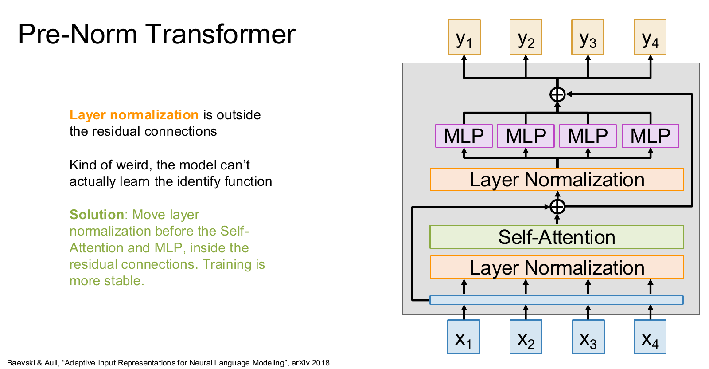

*▲ 图 10　Pre-Norm Transformer（课件 P113，Baevski & Auli, 2018）*

**Post-Norm（2017 原版）**

$$
x_{l+1}=\mathrm{LN}\big(x_l+F(x_l)\big)
$$

LN 位于残差连接**之外**，主干上的信号每层都要被 LN"改写"，模型甚至很难学到 **恒等映射（identity function）**；层数一深，梯度就不稳定，通常需要精心设计学习率预热。

**Pre-Norm（现代主流）**

$$
x_{l+1}=x_l+F\big(\mathrm{LN}(x_l)\big)
$$

LN 放在自注意力 / MLP **之前**、残差支路**之内**：主干上保留一条"干净"的恒等通路，训练更稳定。GPT-2 起被普遍采用，通常还会在最后一层之后再加一个 LN。

一些新模型在此基础上做了变体：Gemma 3 在子层前后都加归一化，OLMo 2 把归一化放在子层的输出处（仍在残差支路之内）。核心原则不变：**残差主路保持干净**。

### 8.2 RMSNorm：更简单的归一化

$$
y_i=\frac{x_i}{\mathrm{RMS}(x)}\,\gamma_i,\qquad \mathrm{RMS}(x)=\sqrt{\varepsilon+\frac{1}{D}\sum_{i=1}^{D}x_i^2}
$$

- 与 LayerNorm 相比：**不减均值、没有偏置 β**，只按 **均方根（Root Mean Square）** 缩放，再乘以可学习的 $\gamma$。
- 计算更省，训练也略微更稳定（Zhang & Sennrich, NeurIPS 2019）。LLaMA、Qwen、DeepSeek、Gemma 等主流模型基本都使用 RMSNorm。

### 8.3 QK-Norm：给查询和键也做归一化

$$
Q=\mathrm{RMSNorm}(XW_Q),\qquad K=\mathrm{RMSNorm}(XW_K),\qquad V=XW_V
$$

- 在计算相似度之前对 Q、K 做归一化，防止注意力 logits 在训练中越变越大、导致 softmax 饱和和 **梯度尖峰（gradient spikes）**，让大模型训练更稳定。
- 由 ViT-22B（Dehghani et al., 2023）等大规模训练推广开来，OLMo 2、Gemma 3、Qwen3 等模型采用；与 RoPE 同时使用时，通常先做 QK-Norm 再旋转。

### 8.4 SwiGLU：带门控的 MLP

**经典 MLP**

$$
Y=\sigma(XW_1)\,W_2
$$

$W_1:[D\times4D]$，$W_2:[4D\times D]$，参数量 $8D^2$。

**SwiGLU**

$$
Y=\big(\mathrm{Swish}(XW_1)\odot XW_2\big)\,W_3
$$

$W_1, W_2:[D\times H]$，$W_3:[H\times D]$，参数量 $3DH$。取 $H=\tfrac{8}{3}D$ 时 $3DH=8D^2$，与经典 MLP 相同。

- $\mathrm{Swish}(x)=x\cdot\mathrm{sigmoid}(x)$（又称 SiLU），可以看作平滑版的 ReLU。
- **门控（Gating）**：$XW_2$ 这一路提供"内容"，$\mathrm{Swish}(XW_1)$ 这一路逐元素决定"放行多少"。这种乘法交互让 MLP 的表达能力更强。
- 实际维度会取整到硬件友好的倍数：例如 LLaMA-7B 中 $D=4096$，$\tfrac{8}{3}D\approx10923$，实际取 11008。
- Gemma 系列使用的 GeGLU 是同类做法，只是把门控激活换成了 GELU。
- 作者 Shazeer（2020）在论文结尾坦言：我们无法解释这些架构为什么有效，只能把它们的成功"和其他一切一样，归功于 **神的仁慈**（divine benevolence）"——深度学习中有不少设计是 **经验驱动** 的。

### 8.5 混合专家（Mixture of Experts, MoE）

在每个块里学习 $E$ 套独立的 MLP 权重，每套 MLP 称为一个 **专家（expert）**：

$$
W_1:[D\times4D]\Rightarrow[E\times D\times4D],\qquad W_2:[4D\times D]\Rightarrow[E\times4D\times D]
$$

每个 token 由 **路由器（router）** 选出 $A$ 个（$A\lt E$）**激活专家（active experts）** 来处理，输出是这些专家结果的加权和（$g_e$ 为路由器给出的门控权重）：

$$
y=\sum_{e\in\mathrm{TopA}(xW_r)}g_e(x)\cdot\mathrm{Expert}_e(x)
$$

> ✅ **核心收益**：参数量放大 $E$ 倍，每个 token 的计算量却只放大 $A$ 倍——用较低的计算成本换取巨大的模型容量。

> ⚠️ **注意**：MoE **省计算，不省显存**——所有专家都必须加载进显存。训练时还要处理 **负载均衡（load balancing）**，避免 token 都挤到少数几个专家上，常用辅助损失，或像 DeepSeek-V3 那样用无辅助损失的偏置调整策略。

| 模型 | 发布时间 | 总参数 | 每 token 激活参数 | 专家配置 |
|---|---|---|---|---|
| Gemma 4 26B-A4B | 2026 | 约 25.2B（"26B"） | 约 3.8B（"A4B"） | 128 个路由专家选 8 个 + 1 个共享专家 |
| DeepSeek-V3 | 2024 年 12 月 | 671B | 37B | 256 个路由专家选 8 个 + 1 个共享专家 |
| Qwen3-235B-A22B | 2025 | 235B | 22B | 128 个专家选 8 个 |
| Mixtral 8×7B | 2023 | 约 47B | 约 13B | 8 个专家选 2 个 |

- 命名规则："26B-A4B" 表示总参数 26B、每个 token **激活（Active）** 约 4B 参数（课件标注的日期为 2026-04-02）。
- **共享专家（shared expert）**：处理所有 token，承担通用知识；**路由专家（routed experts）** 则各有所长。

### 8.6 一张表看懂：2017 原版 vs 2026 主流

| 组件 | 2017 原版 Transformer | 2026 年主流 LLM |
|---|---|---|
| 整体结构 | 编码器-解码器 | 仅解码器（Decoder-only） |
| 归一化位置 | Post-Norm | Pre-Norm（部分模型在子层前后都加） |
| 归一化方法 | LayerNorm | RMSNorm |
| 位置编码 | 正弦绝对位置编码，加在输入上 | RoPE，在每一层旋转 Q / K |
| 注意力头 | MHA | GQA / MLA，并常配合 QK-Norm |
| 注意力范围 | 全局 | 全局与滑动窗口交替，或与线性注意力混合 |
| FFN | ReLU MLP（4D） | SwiGLU / GeGLU（约 8D/3），大模型多用 MoE |
| 注意力实现 | 朴素实现 | FlashAttention 系列融合内核 |
| 上下文长度 | 512 | 128K 到 1M 量级 |
| 偏置项 | 线性层带 bias | 多数去掉 bias |

---
## 💻 9. PyTorch 代码实战

以下代码基于 PyTorch 2.x，重在把公式"翻译"成代码，可直接复制运行。

### 9.1 从零实现缩放点积注意力（含掩码）

```python
import math
import torch
import torch.nn as nn
import torch.nn.functional as F

def attention(q, k, v, mask=None):
    """q: [..., N_q, d]   k: [..., N_k, d]   v: [..., N_k, d_v]
    mask: 可广播到 [..., N_q, N_k] 的布尔张量，True 表示“允许看”"""
    d = q.size(-1)
    scores = q @ k.transpose(-2, -1) / math.sqrt(d)        # [..., N_q, N_k]
    if mask is not None:
        scores = scores.masked_fill(~mask, float("-inf"))   # 必须在 softmax 之前
    attn = scores.softmax(dim=-1)                           # 对 key 维归一化
    return attn @ v, attn                                   # [..., N_q, d_v]

# 用 3.2 节的小例子验证
X = torch.tensor([[1., 0.], [0., 1.], [1., 1.]])
Y, A = attention(X, X, X)
print(A)   # ≈ [[0.401, 0.198, 0.401], [0.198, 0.401, 0.401], [0.248, 0.248, 0.503]]
causal = torch.ones(3, 3, dtype=torch.bool).tril()          # 下三角 = 因果掩码
print(attention(X, X, X, mask=causal)[1])                   # 第 1 行变为 [1, 0, 0]
```

### 9.2 多头自注意力（融合 QKV + FlashAttention 内核）

```python
class MultiHeadSelfAttention(nn.Module):
    def __init__(self, dim, num_heads, causal=False):
        super().__init__()
        assert dim % num_heads == 0, "dim 必须能被 num_heads 整除"
        self.h, self.dh, self.causal = num_heads, dim // num_heads, causal
        self.qkv = nn.Linear(dim, 3 * dim, bias=False)     # ① 融合的 QKV 投影
        self.proj = nn.Linear(dim, dim, bias=False)        # ④ 输出投影 W_O

    def forward(self, x):                                  # x: [B, N, D]
        B, N, D = x.shape
        qkv = self.qkv(x).view(B, N, 3, self.h, self.dh)   # [B, N, 3, H, Dh]
        q, k, v = qkv.permute(2, 0, 3, 1, 4)               # 各自为 [B, H, N, Dh]
        # ②③ QK 相似度 + softmax + V 加权：PyTorch 会自动选用 FlashAttention 等高效内核
        y = F.scaled_dot_product_attention(q, k, v, is_causal=self.causal)
        y = y.transpose(1, 2).reshape(B, N, D)             # 拼接各头 -> [B, N, D]
        return self.proj(y)
```

### 9.3 现代 Pre-Norm 块（RMSNorm + SwiGLU）

```python
class RMSNorm(nn.Module):
    def __init__(self, dim, eps=1e-6):
        super().__init__()
        self.eps = eps
        self.weight = nn.Parameter(torch.ones(dim))        # γ（没有 β）

    def forward(self, x):
        rms = torch.sqrt(x.pow(2).mean(dim=-1, keepdim=True) + self.eps)
        return x / rms * self.weight


class SwiGLU(nn.Module):
    def __init__(self, dim, hidden=None):
        super().__init__()
        hidden = hidden or int(8 * dim / 3)                # 与 4D 的经典 MLP 参数量相同
        self.w1 = nn.Linear(dim, hidden, bias=False)
        self.w2 = nn.Linear(dim, hidden, bias=False)
        self.w3 = nn.Linear(hidden, dim, bias=False)

    def forward(self, x):
        return self.w3(F.silu(self.w1(x)) * self.w2(x))    # (Swish(xW1) ⊙ xW2) W3


class Block(nn.Module):
    """现代 Pre-Norm Transformer 块：RMSNorm + 多头自注意力 + SwiGLU"""
    def __init__(self, dim, num_heads, causal=True):
        super().__init__()
        self.norm1, self.norm2 = RMSNorm(dim), RMSNorm(dim)
        self.attn = MultiHeadSelfAttention(dim, num_heads, causal)
        self.mlp = SwiGLU(dim)

    def forward(self, x):
        x = x + self.attn(self.norm1(x))                   # 归一化在残差支路之内
        x = x + self.mlp(self.norm2(x))                    # 残差主路保持“干净”
        return x
```

### 9.4 迷你 ViT（patch 嵌入 = 卷积）

```python
class TinyViT(nn.Module):
    def __init__(self, img=224, patch=16, dim=384, depth=6, heads=6, num_classes=1000):
        super().__init__()
        self.patch_embed = nn.Conv2d(3, dim, kernel_size=patch, stride=patch)  # 切块 + 线性层
        n = (img // patch) ** 2                                                 # 196 个 token
        self.pos = nn.Parameter(torch.zeros(1, n, dim))                         # 可学习位置编码
        nn.init.trunc_normal_(self.pos, std=0.02)
        self.blocks = nn.Sequential(*[Block(dim, heads, causal=False) for _ in range(depth)])
        self.norm = RMSNorm(dim)
        self.head = nn.Linear(dim, num_classes)

    def forward(self, img):                                # img: [B, 3, 224, 224]
        x = self.patch_embed(img)                          # [B, D, 14, 14]
        x = x.flatten(2).transpose(1, 2) + self.pos        # [B, 196, D]
        x = self.blocks(x)                                 # 无掩码：每个 patch 看所有 patch
        return self.head(self.norm(x).mean(dim=1))         # 平均池化 -> [B, num_classes]


x = torch.randn(2, 196, 384)
print(Block(384, 6, causal=False)(x).shape)                         # torch.Size([2, 196, 384])
print(TinyViT(num_classes=10)(torch.randn(2, 3, 224, 224)).shape)   # torch.Size([2, 10])
```

为简洁起见，迷你 ViT 直接复用了 9.3 节的现代 Block；原版 ViT 使用 LayerNorm + GELU MLP，并带有 [CLS] token。

---

## 🚧 10. 常见误区

| ❌ 常见误区 | ✅ 正确理解 |
|---|---|
| softmax 对哪一维做都行 | 必须对**键的维度**归一化（单头 dim=1，多头为最后一维），保证每个查询的权重之和为 1，输出是值向量的凸组合 |
| 缩放因子 √d 可有可无 | 不缩放时点积方差随维度线性增长，softmax 饱和、梯度消失，维度越大越明显 |
| 掩码就是把注意力权重乘以 0 | 应在 softmax **之前**把 logits 置为 −∞；softmax 之后再置 0 会破坏归一化，每行之和不再为 1 |
| 自注意力天生懂语序 | 自注意力是置换等变的，语序信息完全来自位置编码（绝对编码或 RoPE） |
| 多头会让参数量和计算量翻 H 倍 | 通常 $D_H=D/H$，多头的总参数量与计算量和单头基本相同 |
| FlashAttention 是近似算法，把复杂度降到了 O(N) | 它是**精确**计算；降低的是显存（O(N²) → O(N)）和显存读写，计算量仍是 O(N²) |
| 26B-A4B 的 MoE 模型只需 4B 模型的显存 | 显存按总参数算，所有专家都要加载；只有每个 token 的计算量才按激活参数算 |
| 注意力权重就是模型决策的解释 | 注意力图可作直观参考，但不等于因果解释——信息还会经过残差、MLP 和多层混合 |
| LLM 训练也必须逐词计算 | 训练时借助因果掩码并行计算所有位置；只有推理生成才逐 token 进行 |
| ViT 一定比 CNN 强 | 小数据、从头训练时，CNN 的归纳偏置更有优势；ViT 的优势来自大规模（预）训练 |

---

## 📝 11. 自测题

点击展开查看答案。建议先自己作答，再对照。

<details>
<summary><b>Q1. RNN Seq2Seq 的瓶颈是什么？注意力如何解决？</b></summary>

整句输入被压缩进一个固定维度的上下文向量 $c$，输入越长，信息损失越严重。注意力让解码器在每一步都对所有编码器隐藏状态计算权重 $a_{t,i}$，得到随时间步变化的上下文向量 $c_t=\sum_i a_{t,i}h_i$，按需取用信息；而且全程可微，不需要任何对齐标注。

</details>

<details>
<summary><b>Q2. 在 Bahdanau 注意力中，查询、数据和输出分别对应什么？</b></summary>

查询 = 解码器状态 $s_{t-1}$；数据 = 编码器隐藏状态 $h_i$；输出 = 上下文向量 $c_t$。

</details>

<details>
<summary><b>Q3. 为什么要除以 √D_Q？若 D_Q=64，未缩放点积的标准差大约是多少？</b></summary>

若 q、k 的分量独立、均值 0、方差 1，点积方差为 $D_Q$，标准差为 $\sqrt{64}=8$。数值过大会让 softmax 饱和、梯度消失；除以 $\sqrt{D_Q}$ 后方差回到 1。

</details>

<details>
<summary><b>Q4. E 的形状为 [N_Q× N_X]，A=softmax(E, dim=1) 中的 dim=1 是什么意思？误写成 dim=0 会怎样？</b></summary>

dim=1 表示对每个查询（每一行）在全部 $N_X$ 个键上归一化，使每个输出都是值向量的加权平均。若写成 dim=0，就变成每个键在所有查询上归一化：某个查询的权重之和不再为 1，输出不再是值向量的凸组合。代码照样能运行，但语义已经错了。

</details>

<details>
<summary><b>Q5. 交叉注意力与自注意力有什么区别？举两个交叉注意力的例子。</b></summary>

自注意力的 Q、K、V 来自同一组向量；交叉注意力的 Q 来自一组向量，K、V 来自另一组。例子：原始 Transformer 解码器读取编码器输出；Stable Diffusion 中图像特征读取文本编码；Whisper 的解码器读取音频编码。

</details>

<details>
<summary><b>Q6. 自注意力是置换等变的，这对语言建模意味着什么？如何解决？</b></summary>

不加位置信息时，模型无法区分词序（"狗咬人"与"人咬狗"的 token 表示完全相同，只是排列不同）。解决办法是位置编码：绝对位置编码（正弦或可学习，加在输入上），或 RoPE（旋转 Q、K，让相似度只依赖相对位置）。

</details>

<details>
<summary><b>Q7. 为什么说 RoPE 编码的是相对位置？</b></summary>

旋转矩阵满足 $R(a)^\top R(b)=R(b-a)$，所以

$$
\big(R(i\theta)\,q\big)^\top\big(R(j\theta)\,k\big)=q^\top R\big((j-i)\theta\big)\,k
$$

相似度只取决于位置差 $j-i$，与绝对位置无关。

</details>

<details>
<summary><b>Q8. ViT-B/16 处理 224×224×3 的图像（不使用 [CLS]）：token 数、patch 展平维度、每个头的维度、单层注意力矩阵的形状分别是多少？若 patch 改为 8 呢？</b></summary>

- token 数 $N=(224/16)^2=196$；每个 patch 展平后为 $16\times16\times3=768$ 维。
- ViT-B 的 $D=768$、$H=12$，所以 $D_H=64$；单层注意力矩阵为 $[12\times196\times196]$，约 46 万个元素。
- patch 为 8 时 $N=784$，注意力矩阵为 $[12\times784\times784]$，是原来的 16 倍。

</details>

<details>
<summary><b>Q9. D = 1024 时，一个 Transformer 块的 MHSA 和 MLP 各有多少参数（忽略 bias）？用 12LD² 估算 GPT-3 的参数量。</b></summary>

MHSA：$4D^2\approx4.19\text{M}$；MLP：$8D^2\approx8.39\text{M}$；每块约 12.6M。GPT-3：$12\times96\times12288^2\approx1.74\times10^{11}$，约 174B，与官方的 175B 非常接近。

</details>

<details>
<summary><b>Q10. SwiGLU 为什么取 H = 8D/3？</b></summary>

SwiGLU 有三个矩阵（$W_1$、$W_2$ 为 $D\times H$，$W_3$ 为 $H\times D$），参数量 $3DH$；经典 4D MLP 的参数量是 $8D^2$。令 $3DH=8D^2$，得 $H=8D/3$，这样才能在参数量相同的前提下公平比较。

</details>

<details>
<summary><b>Q11. "Gemma 4 26B-A4B" 中的 26B 和 A4B 各指什么？部署时显存主要看哪个？每个 token 的计算量看哪个？</b></summary>

26B 是总参数（约 25.2B），A4B 是每个 token 激活的参数（约 3.8B）。显存看总参数（所有专家都要加载），每个 token 的计算量看激活参数。

</details>

<details>
<summary><b>Q12. KV Cache 为什么只缓存 K、V，而不缓存 Q？若 L=32、KV 头数为 8、D_H=128、fp16、N=4096，KV Cache 有多大？</b></summary>

每一步只需要当前 token 的查询去和所有历史 token 的键、值做注意力；过去 token 的查询之后再也不会被用到，而历史的 K、V 每一步都要用。大小：$2\times32\times4096\times8\times128\times2$ 字节 $=536{,}870{,}912$ 字节，即 0.5 GiB（每条序列）。

</details>

<details>
<summary><b>Q13. Post-Norm 与 Pre-Norm 有什么区别？为什么 Pre-Norm 更稳定？</b></summary>

Post-Norm 是 $\mathrm{LN}(x+F(x))$，LN 位于残差主路上，每层都会改写主干信号，深层时梯度不稳定，需要仔细预热。Pre-Norm 是 $x+F(\mathrm{LN}(x))$，主干保留一条恒等通路，梯度可以直接穿过各层回传，因此训练更稳定。

</details>

<details>
<summary><b>Q14. FlashAttention 把注意力的计算复杂度从 O(N²) 降到 O(N) 了吗？它为什么更快？</b></summary>

没有。计算量仍是 $O(N^2)$（反向传播时的重算还会略增计算量）；降低的是显存，从 $O(N^2)$ 降到 $O(N)$。它更快是因为通过分块与内核融合大幅减少了 HBM 读写（IO 感知），而结果与标准注意力完全一致。

</details>

<details>
<summary><b>Q15. 为什么 LLM 训练时一次前向就能算出所有位置的损失，推理时却要逐个 token 生成？</b></summary>

训练时完整的真实序列已知，因果掩码保证每个位置只看到自己的前缀，所以所有位置可以并行计算（教师强制）。推理时未来的 token 未知，每个新 token 都依赖之前生成的结果，只能自回归、逐个生成（KV Cache 可以减少重复计算）。

</details>

---

## 📖 12. 术语表

| 中文 | English | 一句话解释 |
|---|---|---|
| 序列到序列 | Sequence-to-Sequence (Seq2Seq) | 输入一个序列、输出另一个序列的任务，如机器翻译 |
| 编码器 / 解码器 | Encoder / Decoder | 前者把输入编码成表示，后者据此逐步生成输出 |
| 上下文向量 | Context vector | 提供给解码器的输入摘要；注意力让它随时间步变化 |
| 注意力 | Attention | 按相似度对一组向量加权平均的可微"软检索"运算 |
| 对齐分数 | Alignment score | 查询与每个数据向量的匹配程度，softmax 之前的分数 |
| 注意力权重 | Attention weights | 对齐分数经 softmax 后的权重，非负且和为 1 |
| 查询 / 键 / 值 | Query / Key / Value | 分别表示"找什么""凭什么被找到""被取走什么" |
| 缩放点积注意力 | Scaled Dot-Product Attention | softmax(QKᵀ/√d)V，Transformer 的核心运算 |
| 自注意力 | Self-Attention | Q、K、V 都来自同一组输入的注意力 |
| 交叉注意力 | Cross-Attention | Q 来自一组向量，K、V 来自另一组向量的注意力 |
| 掩码 / 因果注意力 | Masked / Causal Attention | 用 −∞ 屏蔽未来位置，使每个 token 只能看前文 |
| 多头注意力 | Multi-Head Attention (MHA) | 并行运行多组注意力，再拼接并投影融合 |
| 置换等变 | Permutation Equivariance | 输入打乱后输出以同样方式打乱，即不感知顺序 |
| 位置编码 | Positional Encoding | 向模型注入位置信息的向量或变换 |
| 旋转位置编码 | Rotary Position Embedding (RoPE) | 按位置旋转 Q、K，使相似度只依赖相对位置 |
| 残差连接 | Residual Connection | 输出 = 输入 + 子层(输入)，便于梯度回传 |
| 层归一化 | Layer Normalization (LN) | 对每个 token 的特征维度做标准化 |
| 均方根归一化 | RMSNorm | 只按均方根缩放、不减均值、无 β 的简化 LN |
| 前置 / 后置归一化 | Pre-Norm / Post-Norm | 归一化放在子层之前（残差支路内）或残差相加之后 |
| QK 归一化 | QK-Norm | 计算相似度前对 Q、K 归一化，防止 logits 爆炸 |
| 前馈网络 | Feed-Forward Network (FFN / MLP) | 对每个 token 独立施加的两层全连接网络 |
| 门控线性单元 | Gated Linear Unit (GLU) / SwiGLU | 用一路激活去逐元素"门控"另一路的 MLP 变体 |
| 混合专家 | Mixture of Experts (MoE) | 多套 MLP 专家，每个 token 只激活其中少数几个 |
| 路由器 / 共享专家 | Router / Shared expert | 前者为 token 选择专家，后者处理所有 token |
| 词元 / 分词 | Token / Tokenization | 文本被切分成的基本单位 / 切分的过程 |
| 字节对编码 | Byte-Pair Encoding (BPE) | 反复合并高频相邻片段来构建子词表的分词算法 |
| 嵌入矩阵 | Embedding matrix | [V × D] 查找表，把 token id 映射为向量 |
| 逻辑值 | Logits | softmax 之前的未归一化分数 |
| 自回归 | Autoregressive | 每次生成一个 token，并以已生成内容为条件 |
| 教师强制 | Teacher forcing | 训练时用真实前文而非模型输出作为条件 |
| KV 缓存 | KV Cache | 推理时缓存历史 token 的 K、V，避免重复计算 |
| 分组 / 多查询注意力 | GQA / MQA | 多个查询头共享 K/V，以减小 KV Cache |
| 多头潜在注意力 | Multi-head Latent Attention (MLA) | 把 K/V 压缩为低秩潜在向量再缓存（DeepSeek） |
| 闪电注意力 | FlashAttention | 分块 + 在线 softmax 的 IO 感知精确注意力内核 |
| 滑动窗口注意力 | Sliding Window Attention | 每个 token 只关注最近 W 个 token 的局部注意力 |
| 线性注意力 | Linear Attention | 复杂度随序列长度线性增长的注意力近似或替代 |
| 视觉 Transformer | Vision Transformer (ViT) | 把图像切成 patch 序列后直接用 Transformer 处理 |
| 图像块 | Patch | ViT 中切出的小图像块，如 16×16×3 |
| 分类 token | [CLS] token | 拼接在序列前、用于汇总全局信息的可学习向量 |
| 归纳偏置 | Inductive bias | 模型结构内建的先验假设，如 CNN 的局部性 |
| 感受野 | Receptive field | 一个输出能"看到"的输入范围 |
| BLEU | Bilingual Evaluation Understudy | 基于 n-gram 重合度的机器翻译评测指标 |

---

## 🔗 13. 参考资料与延伸阅读

**本讲资料**

- CS231n 2026 Spring, Lecture 8: Attention and Transformers（课件 PDF，124 页）
- Vaswani et al., [Attention Is All You Need](https://arxiv.org/abs/1706.03762), NeurIPS 2017
- Lilian Weng, [Attention? Attention!](https://lilianweng.github.io/posts/2018-06-24-attention/), Lil'Log 2018
- Jay Alammar, [The Illustrated Transformer](http://jalammar.github.io/illustrated-transformer/)
- Dosovitskiy et al., [An Image is Worth 16x16 Words: Transformers for Image Recognition at Scale](https://arxiv.org/abs/2010.11929), ICLR 2021

**延伸阅读（按章节）**

- 注意力起源：Bahdanau et al., [Neural Machine Translation by Jointly Learning to Align and Translate](https://arxiv.org/abs/1409.0473), ICLR 2015
- 位置编码：Su et al., [RoFormer: Enhanced Transformer with Rotary Position Embedding](https://arxiv.org/abs/2104.09864), 2021
- 高效注意力：[FlashAttention](https://arxiv.org/abs/2205.14135)（2022）· [FlashAttention-2](https://arxiv.org/abs/2307.08691)（2023）· [FlashAttention-3](https://arxiv.org/abs/2407.08608)（2024）· [FlashAttention-4](https://arxiv.org/abs/2603.05451)（2026）
- KV Cache 优化：Shazeer, [Fast Transformer Decoding: One Write-Head is All You Need](https://arxiv.org/abs/1911.02150)（MQA, 2019）· Ainslie et al., [GQA](https://arxiv.org/abs/2305.13245)（2023）
- 现代改进：Baevski & Auli, [Adaptive Input Representations for Neural Language Modeling](https://arxiv.org/abs/1809.10853)（Pre-Norm, 2018）· Zhang & Sennrich, [Root Mean Square Layer Normalization](https://arxiv.org/abs/1910.07467)（2019）· Dehghani et al., [Scaling Vision Transformers to 22 Billion Parameters](https://arxiv.org/abs/2302.05442)（QK-Norm, 2023）· Shazeer, [GLU Variants Improve Transformer](https://arxiv.org/abs/2002.05202)（2020）· Shazeer et al., [Outrageously Large Neural Networks: The Sparsely-Gated Mixture-of-Experts Layer](https://arxiv.org/abs/1701.06538)（2017）
- 视觉基础模型：Siméoni et al., [DINOv3](https://arxiv.org/abs/2508.10104)（2025）
- 2025–2026 架构综述：Sebastian Raschka, [The Big LLM Architecture Comparison](https://magazine.sebastianraschka.com/p/the-big-llm-architecture-comparison) · Google, [Gemma 4 Model Card](https://ai.google.dev/gemma/docs/core/model_card_4)
