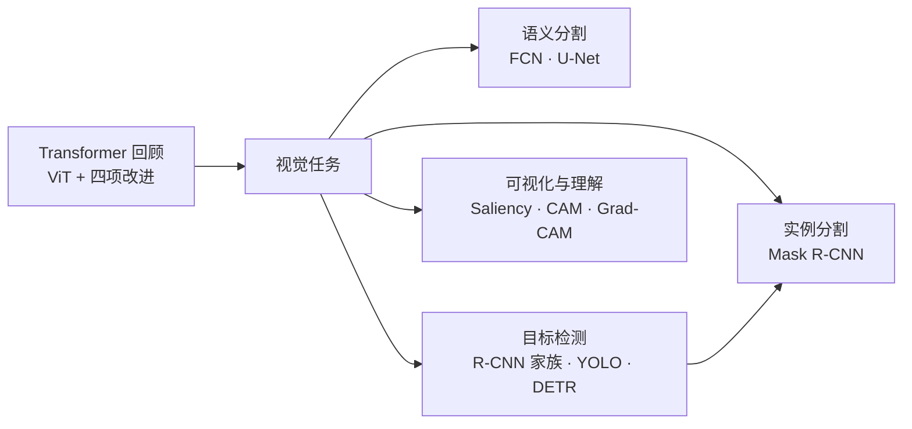
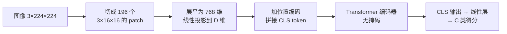
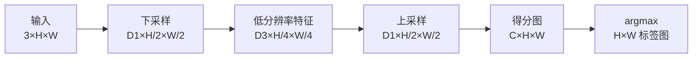
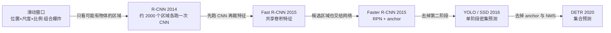
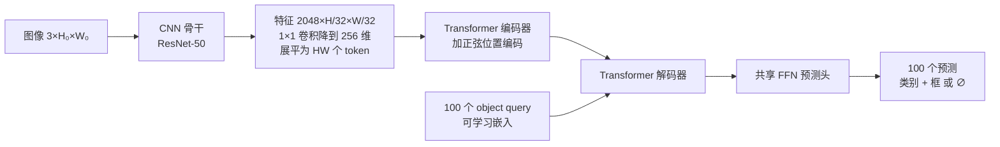
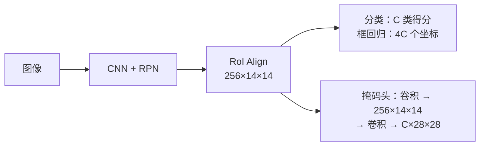

# 🎯 从 R-CNN 到 DETR：检测、分割与可视化学习文档（2026 版）

> - **课程**：Stanford CS231n（2026 春）第 9 讲 *Detection, Segmentation, Visualization, and Understanding*[^slides]
> - **精读论文**：*End-to-End Object Detection with Transformers*（DETR，arXiv:2005.12872）[^detr]
> - **扩展资料**：联网检索的 2025–2026 年进展（RF-DETR、DEIMv2、YOLO26、SAM 3、DINOv3 等）
> - **前置知识**：CNN、反向传播、Transformer 自注意力｜**建议用时**：3–4 小时

---

## 📖 阅读指南

**重要度标记**（以 2026 年的眼光判断）：

- ⭐⭐⭐ **核心必会**：至今仍是主流或面试高频，建议精读、推导、动手实现
- ⭐⭐ **理解思想**：现代方法的“祖先”，理解动机与局限即可
- ⭐ **历史了解**：已基本被淘汰，知道“为什么被淘汰”就够了

**提示框**：💡 **直觉**——用类比建立直观理解；🔭 **2026 视角**——该知识点今天的位置与最新进展；⚠️ **易错点**——常见误解与面试陷阱。

## 🗺️ 知识地图



## 🎯 先看结论：六个核心收获

1. **ViT** 把图像切成 16×16 的 patch 当作“单词”，直接套用 NLP 的 Transformer。架构主体自 2017 年以来变化不大，但 **Pre-Norm、RMSNorm、SwiGLU、MoE** 已成为标配。
2. **语义分割**的核心矛盾是“既要大感受野（懂语义），又要高分辨率（抠细节）”，经典解法是**编码器-解码器 + 跳跃连接**（U-Net）。
3. **目标检测**的演化主线是不断**去掉手工设计、走向端到端**：滑动窗口 → 候选区域（R-CNN）→ 共享特征（Fast R-CNN）→ 学习候选区域（Faster R-CNN）→ 单阶段（YOLO）→ 集合预测（DETR）。
4. **DETR** 把检测看作**集合预测**：一次并行输出 N 个预测，用**匈牙利算法**做一对一匹配来训练，从而去掉 anchor 和 NMS。到 2026 年，实时检测的 SOTA（RF-DETR、DEIMv2）几乎都是 DETR 的后代，YOLO26 也提供了免 NMS 的端到端推理。
5. **Mask R-CNN** = Faster R-CNN + 每个候选区域一个小掩码头；**RoI Align** 消除了量化带来的错位。
6. **可视化**三件套：显著图（输入梯度）、CAM（GAP 权重加权）、Grad-CAM（梯度加权任意层）。它们能显示模型“在看哪里”，但可靠性需要警惕。

---

## 1️⃣ Transformer 与 ViT 回顾 ⭐⭐⭐

> **学习目标**：① 说清三种序列处理方式的优劣；② 会推算 ViT 的张量形状；③ 理解 2026 年 Transformer 的“标准配置”及其原因。

### 1.1 编码器与解码器

**Transformer**（Vaswani et al., 2017）由两类模块堆叠而成：

- **编码器块**：输入加位置编码 → **多头自注意力**（Multi-Head Self-Attention，MHSA：每个 token 按相关性从所有 token 汇总信息；“多头”指并行做多组注意力，各自捕捉不同关系）→ 残差连接 → **层归一化**（LayerNorm：对每个 token 的特征向量做标准化）→ **MLP**（逐 token 的两层全连接）→ 残差 → LayerNorm。
- **解码器块**：**掩码自注意力**（只能看到之前的 token，保证逐词生成）→ **交叉注意力**（Cross-Attention：query 来自解码器，key/value 来自编码器输出）→ MLP。

以图像描述（Image Captioning）为例：编码器读入图像特征，解码器从 `[START]` 开始逐词生成 “person wearing hat `[END]`”。

> 💡 **直觉**：自注意力是“组内讨论”，交叉注意力是“带着问题查资料”。DETR 的解码器正是用交叉注意力，让每个 object query 去图像特征中“找”属于自己的物体。

### 1.2 处理序列的三种方式

| 方式 | 适用数据 | 优点 | 缺点 |
|---|---|---|---|
| **RNN**（循环神经网络） | 一维有序序列 | 计算与内存均为 $O(N)$ | 必须逐步计算，无法并行 |
| **卷积** | N 维网格（如图像） | 高度并行 | 要堆很多层才能获得大**感受野**（Receptive Field：一个输出能“看到”的输入范围） |
| **自注意力** | 向量的**集合** | 每个输出直接依赖全部输入；高度并行（核心只是 4 次矩阵乘法） | 计算量 $O(N^2)$ |

> ⚠️ **易错点**：自注意力是**置换等变**（Permutation Equivariant）的——打乱输入顺序，输出也被同样打乱。它天然处理“集合”而非“序列”，所以必须额外加入**位置编码**（Positional Encoding）才能知道“谁在哪”。这一性质正是 DETR 做“集合预测”的根基。

### 1.3 ViT：一张图像值 16×16 个词

**Vision Transformer**（ViT，Dosovitskiy et al., ICLR 2021）的做法朴素得惊人：把图像切块当作单词，然后使用与 NLP **完全相同**的 Transformer。



**形状推算（以 ViT-B/16 为例，必会）**：

1. $224 / 16 = 14$，共 $14 \times 14 = 196$ 个 patch，每个展平为 $3 \times 16 \times 16 = 768$ 维；
2. 线性投影到 $D = 768$，再拼上 1 个 `[CLS]` token，输入序列为 $197 \times 768$；
3. 经过 12 层 Transformer，取 `[CLS]` 位置的输出（或对 196 个 patch 输出做平均池化）→ 线性层 → 1000 类。ViT-B 约 86M 参数。

- **不加掩码**：图像没有“未来”，每个 patch 都能看到所有 patch；
- **位置编码**：每个位置一个可学习的 D 维向量，提供 patch 的二维位置信息；
- **`[CLS]` token**：额外加入的可学习向量，像“班长”一样汇总全图信息，用于分类。

```python
import torch.nn as nn

class PatchEmbed(nn.Module):
    """切块 + 线性投影，等价于 kernel_size = stride = 16 的卷积"""
    def __init__(self, patch=16, in_ch=3, dim=768):
        super().__init__()
        self.proj = nn.Conv2d(in_ch, dim, kernel_size=patch, stride=patch)

    def forward(self, x):                      # x: [B, 3, 224, 224]
        x = self.proj(x)                       # [B, 768, 14, 14]
        return x.flatten(2).transpose(1, 2)    # [B, 196, 768]
```

> 💡 **算一算**：注意力的计算量与 token 数的平方成正比。patch 从 16×16 改为 8×8，token 数从 196 变为 784（×4），注意力计算量变为 16 倍。这也解释了 DETR 为什么难以直接使用高分辨率特征（见 4.6 节）。

> 🔭 **2026 视角**：ViT 已是视觉骨干网络的绝对主流。自监督的 DINOv2/DINOv3、图文对比学习的 SigLIP 2 等 ViT 骨干，支撑着今天的检测、分割与多模态大模型。Meta 于 2025 年 8 月发布的 **DINOv3** 把自监督训练扩展到 7B 参数、17 亿张图像，提出 Gram anchoring 解决长时间训练中密集特征退化的问题，并首次让**单个冻结骨干**在目标检测、语义分割等密集任务上超越专用方案。[^dinov3]

### 1.4 2017 年至今的四项关键改进

课件的判断是：“Transformer 架构自 2017 年以来变化不大”，但下面四个“小改动”已几乎成为标配。

#### ① Pre-Norm：把 LayerNorm 移进残差分支

| | Post-Norm（原版） | Pre-Norm（现代） |
|---|---|---|
| 公式 | $x \leftarrow \mathrm{LN}(x + \mathrm{Attn}(x))$ | $x \leftarrow x + \mathrm{Attn}(\mathrm{LN}(x))$ |
| 特点 | LN 位于残差之外，模型难以学到**恒等映射** | 残差通路畅通，梯度可直达底层，训练更稳定 |

> 💡 **直觉**：残差连接像一条高速公路。Post-Norm 在主路上每隔一段设一个收费站，Pre-Norm 把收费站挪到匝道上，主路一路畅通。

#### ② RMSNorm：更简洁的归一化

$$
y_i = \frac{x_i}{\mathrm{RMS}(x)} \cdot \gamma_i, \qquad \mathrm{RMS}(x) = \sqrt{\varepsilon + \frac{1}{N}\sum_{i=1}^{N} x_i^2}
$$

与 LayerNorm 相比，RMSNorm **不减均值、没有偏置 β**，只按均方根缩放，计算更省，训练也略更稳定（Zhang & Sennrich, NeurIPS 2019）。

#### ③ SwiGLU：带门控的 MLP

- 经典 MLP：$Y = \sigma(XW_1)W_2$，$W_1 \in \mathbb{R}^{D \times 4D}$，$W_2 \in \mathbb{R}^{4D \times D}$，参数量 $8D^2$；
- SwiGLU：$Y = \big(\sigma(XW_1) \odot XW_2\big)W_3$，其中 $\sigma$ 取 SiLU/Swish，$\odot$ 为逐元素相乘；
- 隐藏维度取 $H = \frac{8}{3}D$，则参数量 $3DH = 8D^2$，**与经典 MLP 相同**，效果却更好（Shazeer, 2020）。

> 💡 **直觉**：门控（Gating）= 一路算“内容”，另一路算“阀门”，相乘决定每个特征放行多少。有趣的是，Shazeer 在论文中坦言无法解释它为何有效，只好“归功于神的仁慈”（divine benevolence）。

#### ④ MoE：混合专家

**混合专家**（Mixture of Experts，MoE）：每个 Transformer 块中放 $E$ 套 MLP（称为“专家”），由**路由器**（Router，一个小线性层）为每个 token 挑选 $A$ 个专家（$A < E$）。

- 参数量变为 $E$ 倍，但每个 token 的计算量只变为 $A$ 倍——**参数多、算得少**；
- 常见路由：$g = \mathrm{softmax}(\mathrm{TopK}(xW_r))$，并配合**负载均衡**机制，防止 token 扎堆到少数专家。

```python
import torch, torch.nn as nn, torch.nn.functional as F

class RMSNorm(nn.Module):
    def __init__(self, d, eps=1e-6):
        super().__init__()
        self.eps, self.g = eps, nn.Parameter(torch.ones(d))

    def forward(self, x):
        return x * torch.rsqrt(x.pow(2).mean(-1, keepdim=True) + self.eps) * self.g

class SwiGLU(nn.Module):
    def __init__(self, d):
        super().__init__()
        h = int(8 * d / 3)
        self.w1 = nn.Linear(d, h, bias=False)
        self.w2 = nn.Linear(d, h, bias=False)
        self.w3 = nn.Linear(h, d, bias=False)

    def forward(self, x):
        return self.w3(F.silu(self.w1(x)) * self.w2(x))
```

> 🔭 **2026 视角**：
> - MoE 已是前沿大模型的默认选择。课件认为 GPT-4o、Claude 3.7、Gemini 2.5 Pro 等闭源模型“几乎肯定”是参数超万亿的 MoE（细节未公开）；开源阵营则有 DeepSeek-V3（671B 总参数 / 37B 激活）、Qwen3-235B-A22B、Kimi K2（1T / 32B 激活）、gpt-oss-120b 等。
> - 一个典型的现代 Transformer 块 ≈ **Pre-Norm + RMSNorm + SwiGLU + RoPE（旋转位置编码）+ GQA/MLA（节省 KV 缓存的注意力变体）+ MoE**，视觉 Transformer 也在逐步吸收这些改进。

---

## 2️⃣ 四大视觉任务总览 ⭐⭐⭐

| 任务 | 输出 | 区分个体？ | 课件示例 |
|---|---|---|---|
| **图像分类**（Classification） | 整张图一个标签 | 无空间信息 | CAT |
| **语义分割**（Semantic Segmentation） | 每个像素一个类别 | ❌ 只管像素，不分个体 | GRASS、CAT、TREE、SKY |
| **目标检测**（Object Detection） | 多个“类别 + 边界框” | ✅ | DOG、DOG、CAT |
| **实例分割**（Instance Segmentation） | 多个“类别 + 像素掩码” | ✅ | DOG、DOG、CAT |

> 💡 **补充**：**全景分割**（Panoptic Segmentation）= 语义分割 + 实例分割：对可数的物体（things，如人、车）区分个体，对不可数的背景（stuff，如天空、草地）只分类别。DETR 论文就演示了全景分割的扩展。

### 2.1 评价指标速览（课件未展开，但必须掌握）

**IoU**（交并比，Intersection over Union）衡量两个框或掩码的重合程度：

$$
\mathrm{IoU}(A, B) = \frac{|A \cap B|}{|A \cup B|}
$$

经验上，IoU > 0.5 算“还行”，> 0.7 算“不错”，> 0.9 几乎完美。

| 指标 | 用于 | 含义 |
|---|---|---|
| **mIoU** | 语义分割 | 每个类别分别算 IoU，再取平均 |
| **AP**（平均精度） | 检测、实例分割 | 某一类别的精确率-召回率（P-R）曲线下面积 |
| **mAP** | 检测 | 所有类别 AP 的平均 |
| **COCO AP** | 检测 | 在 IoU 阈值 0.50、0.55……0.95 共 10 档上再平均，记作 AP@[.5:.95] |
| **AP₅₀ / AP₇₅** | 检测 | IoU 阈值固定为 0.5 / 0.75 时的 AP |
| **AP_S / AP_M / AP_L** | 检测 | 小目标（面积 < 32²）/ 中目标 / 大目标（> 96²）的 AP |
| **PQ**（全景质量） | 全景分割 | $\mathrm{PQ} = \mathrm{SQ} \times \mathrm{RQ}$，即分割质量 × 识别质量 |

> ⚠️ **易错点**：COCO 论文中的 “AP” 已经对类别和 IoU 阈值做了双重平均，比 PASCAL VOC 的 mAP@0.5 严格得多。读论文时先确认报告的是哪一种。

---

## 3️⃣ 语义分割（Semantic Segmentation）⭐⭐⭐

> **学习目标**：① 理解“全卷积 + 下采样/上采样”的设计动机；② 会手算转置卷积；③ 理解 U-Net 跳跃连接为何有效。

**问题定义**：训练时每个像素都有类别标签，测试时要为每个像素分类。注意它**不区分实例**——两头挨在一起的牛会被涂成同一块“牛”。

### 3.1 演化思路：从低效到高效

| 方案 | 做法 | 问题 |
|---|---|---|
| 滑动窗口 ⭐ | 以每个像素为中心裁一个 patch，用 CNN 分类中心像素 | 单个像素缺乏上下文；重叠 patch 之间不共享计算，极其低效 |
| 全卷积、不降采样 ⭐ | 一串保持 H×W 的卷积，直接输出 C×H×W | 全分辨率卷积太贵，感受野增长也慢 |
| **编码器-解码器** ✅ | 先下采样提取语义，再上采样恢复分辨率 | 现代分割网络的基本骨架 |

**全卷积网络**（Fully Convolutional Network，FCN；Long et al., CVPR 2015）：网络中**没有全连接层**，因此能接受任意尺寸的输入，输出同尺寸的得分图 C×H×W；逐像素取 argmax 得到 H×W 的标签图，训练时对每个像素计算交叉熵损失。



- **下采样**：池化（Pooling）或带步长的卷积（Strided Convolution）；
- **上采样**：反池化（Unpooling）或转置卷积（Transposed Convolution）。

### 3.2 不可学习的上采样：反池化 ⭐⭐

以 2×2 输入 `[[1,2],[3,4]]` 上采样到 4×4 为例：

| 方法 | 做法 | 输出左上角 2×2 块 |
|---|---|---|
| 最近邻（Nearest Neighbor） | 每个值复制填满对应的块 | `[[1,1],[1,1]]` |
| 钉床（Bed of Nails） | 值放在块的左上角，其余补 0 | `[[1,0],[0,0]]` |
| **最大反池化**（Max Unpooling） | 记住下采样时最大值的位置，上采样时放回原位，其余补 0 | 取决于记录的位置 |

例：4×4 输入 `[[1,2,6,3],[3,5,2,1],[1,2,2,1],[7,3,4,8]]` 经 2×2 最大池化得到 `[[5,6],[7,8]]`，同时记下 5、6、7、8 的原始位置；对应的反池化层再把经过网络处理的值放回这些位置。因此最大反池化要求下采样层与上采样层**成对出现**（如 SegNet），好处是能把边缘细节还原到正确的位置。

### 3.3 转置卷积：可学习的上采样 ⭐⭐⭐

先换个角度看普通卷积：

- 3×3 卷积、步长 1、padding 1：4×4 → 4×4；
- 3×3 卷积、**步长 2**、padding 1：4×4 → 2×2。输出每移动 1 格，滤波器在输入上移动 2 格，所以**带步长的卷积 = 可学习的下采样**。

**转置卷积**反过来：输入每移动 1 格，滤波器在**输出**上移动 2 格。每个输入值作为权重乘以整个滤波器，“盖章”到输出上，**重叠处相加**。2×2 输入经 3×3、步长 2、padding 1 的转置卷积得到 4×4 输出。

**一维示例（建议手算一遍）**：输入 $[a, b]$，滤波器 $[x, y, z]$，步长 2：

$$
[a,\ b] \;\longrightarrow\; [\,ax,\ ay,\ az + bx,\ by,\ bz\,]
$$

第 3 个位置是两次“盖章”的重叠，所以等于 $az + bx$。

> 💡 **为什么叫“转置”**：卷积可以写成矩阵乘法 $y = Cx$。步长为 2 的卷积矩阵 $C$ 把长向量压短，而 $C^\top$ 把短向量拉长——转置卷积就是乘以 $C^\top$。它恰好也是普通卷积反向传播时对输入求梯度的运算。

> ⚠️ **易错点**：
> - 转置卷积常被叫作“反卷积”（Deconvolution），这是**误称**，它并不是卷积的逆运算。
> - 当卷积核尺寸不能被步长整除时，“盖章”重叠不均，会产生**棋盘格伪影**（Checkerboard Artifacts，Odena et al., Distill 2016）。实践中常改用“双线性插值上采样 + 普通卷积”。

### 3.4 U-Net：跳跃连接的胜利 ⭐⭐⭐

**U-Net**（Ronneberger et al., MICCAI 2015）最初为生物医学图像分割而设计，结构呈 U 形：

- **左半边（收缩路径）**：反复执行“两次 3×3 卷积 + ReLU → 2×2 最大池化”，通道数 64 → 128 → 256 → 512 → 1024。视野变大、语义增强，但**丢失空间细节**；
- **右半边（扩张路径）**：反复执行“2×2 上卷积 → 拼接 → 两次 3×3 卷积”，逐步恢复分辨率，最后用 1×1 卷积输出每个像素的类别；
- **跳跃连接**（Skip Connection，图中的 copy and crop）：把左侧同层的高分辨率特征**拼接**到右侧，帮助解码器找回边缘、轮廓等细节。原论文输入 572×572、输出 388×388——因为卷积不加 padding，拼接前需要先裁剪对齐。

> 💡 **直觉**：编码器像“缩小地图看全局”（知道这是一只猫），解码器像“放大地图找细节”（知道猫的边缘在哪）。跳跃连接就是把原始高清地图直接递给负责描边的人。

> 🔭 **2026 视角**：
> - **U-Net 的生命力远超分割**：它曾是 Stable Diffusion 等扩散模型的去噪主干，直到 DiT（Diffusion Transformer）兴起才在大模型中逐步被取代；在医学影像等领域至今仍是首选基线。
> - **分割范式已几经迁移**：DeepLab（空洞卷积，扩大感受野而不降低分辨率）→ SegFormer 等 Transformer 分割网络 → **Mask2Former**（DETR 式的“掩码查询”，统一语义、实例、全景分割）→ **SAM 系列可提示分割**。2025 年 11 月发布的 **SAM 3** 能根据短语（如“黄色校车”）或示例图片，一次性分割并跟踪图像和视频中该概念的**所有实例**。[^sam3]

---

## 4️⃣ 目标检测（Object Detection）⭐⭐⭐

> **学习目标**：① 理清 R-CNN → Fast → Faster → YOLO → DETR 的演化逻辑；② 掌握 anchor、RPN、IoU、NMS 等核心概念；③ 吃透 DETR 的集合预测思想。



### 4.1 单目标：分类 + 定位 ⭐⭐

如果图中只有一个物体，可以把**定位当作回归问题**：

- 骨干网络（如 AlexNet）提取 4096 维特征后，接两个“头”：
  - **分类头**：全连接 → 1000 类得分，使用 Softmax 交叉熵损失；
  - **定位头**：全连接 → 4 个数 $(x, y, w, h)$，使用 L2 回归损失。
- 两个损失加权求和，称为**多任务损失**（Multitask Loss）。

**多目标的难题**：每张图需要输出的数字个数不同——一只猫 4 个数，“狗、狗、猫”12 个数，一群鸭子则有很多个。输出维度固定的网络无法直接处理。

### 4.2 R-CNN 家族：两阶段检测 ⭐⭐

**思路**：在所有位置、尺度、长宽比上做滑动窗口分类，组合数量爆炸 ⭐。于是先用**候选区域**（Region Proposals）筛出“可能有物体”的区域：经典的 **Selective Search** 按颜色、纹理合并图像块，在 CPU 上几秒内生成约 2000 个候选框 ⭐。

| 模型 | 核心改进 | 流程 | 瓶颈 |
|---|---|---|---|
| **R-CNN**（Girshick et al., CVPR 2014） | 候选区域 + CNN 特征 | 约 2000 个 RoI 各自缩放到 224×224 → 各跑一次 CNN → SVM 分类 + 框修正 | 每张图约 2000 次前向传播，测试约 47 秒/张（VGG16） |
| **Fast R-CNN**（Girshick, ICCV 2015） | **先跑 CNN，再裁特征** | 整图过骨干网络 → 在特征图上按 RoI 裁剪并缩放（**RoI Pooling**）→ 每个区域过小网络 → 分类 + 框偏移 | 网络只需约 0.3 秒，候选区域生成（约 2 秒）反成瓶颈 |
| **Faster R-CNN**（Ren et al., NeurIPS 2015） | **用 RPN 学习候选区域** | 骨干 → RPN 生成候选 → RoI Pooling → 分类 + 框回归 | 约 0.2 秒/张，但两阶段流程复杂 |

> **RoI**（Region of Interest，感兴趣区域）：候选框在图像或特征图上对应的区域。

**框回归**（Bounding Box Regression）：不直接预测坐标，而是预测相对候选框（或 anchor）$(x_a, y_a, w_a, h_a)$ 的**修正量**：

$$
t_x = \frac{x - x_a}{w_a},\quad t_y = \frac{y - y_a}{h_a},\quad t_w = \log\frac{w}{w_a},\quad t_h = \log\frac{h}{h_a}
$$

> 💡 **为什么这样参数化**：平移量按框的宽高归一化、缩放量取对数，使修正量与物体的绝对大小无关——大框和小框“偏差程度相同”时损失也相同。

### 4.3 RPN 与 Anchor：Faster R-CNN 的灵魂 ⭐⭐⭐

**区域提议网络**（Region Proposal Network，RPN）的流程：

1. 图像 3×640×480 → CNN → 特征图 512×20×15；
2. 在特征图的**每个位置**放 K 个**锚框**（Anchor：预设的不同尺度、长宽比的参考框；原论文 K = 9，即 3 种尺度 × 3 种长宽比）；
3. 用卷积预测每个 anchor 的**物体性得分**（Objectness，是否含物体，K×20×15）和 4 个框修正量（4K×20×15）；
4. 按物体性得分排序（并做 NMS），保留前约 300 个作为候选区域。

**正负样本分配**：与某个真实框 IoU > 0.7 的 anchor 为正样本，< 0.3 的为负样本，介于两者之间的忽略。

Faster R-CNN 联合训练 **4 个损失**：RPN 分类（有无物体）、RPN 框回归、最终分类、最终框回归。

> ⚠️ **易错点**：anchor 是**手工设计的先验**——尺度、比例、数量、正负阈值都是超参数，换数据集常需重调。这正是 DETR 想要消除的东西。

### 4.4 单阶段检测：YOLO / SSD / RetinaNet ⭐⭐

**单阶段**（Single-Stage）检测器去掉“候选区域 → 再分类”的第二阶段，在网格上一次性给出所有预测，可以理解为“**直接预测具体类别的 RPN**”。

以 **YOLO**（You Only Look Once，Redmon et al., CVPR 2016）为例：

- 图像划分为 $S \times S$ 网格（如 7×7），每个格子预测 B 个框；
- 每个框输出 $(dx, dy, dh, dw, \text{confidence})$ 共 5 个数，每个格子另外输出 C 个类别得分；
- 输出张量为 $S \times S \times (5B + C)$。原版 YOLO 为 $7 \times 7 \times (5 \times 2 + 20) = 7 \times 7 \times 30$，速度约 45 FPS，首次让检测真正达到“实时”。

**RetinaNet**（Lin et al., ICCV 2017）指出单阶段检测器精度落后的主因是**前景-背景极度不平衡**（上万个 anchor 中只有极少数含物体），并提出 **Focal Loss**：

$$
\mathrm{FL}(p_t) = -\alpha_t (1 - p_t)^{\gamma} \log p_t \qquad (\gamma = 2,\ \alpha = 0.25)
$$

因子 $(1 - p_t)^\gamma$ 让已经分对的“简单负样本”损失趋近于 0，把训练注意力集中到难样本上。

> 🔭 **2026 视角**：单阶段路线随后的关键发展包括 **FPN**（特征金字塔网络，用多层特征检测不同大小的物体）、**anchor-free** 方法（FCOS、CenterNet 直接预测中心点和到四边的距离），以及持续迭代的 YOLO 系列（YOLOv8、YOLO11……直到 2026 年 1 月发布的 YOLO26）。

### 4.5 IoU 与 NMS：密集预测的“善后” ⭐⭐⭐

密集预测会对同一个物体产生大量高度重叠的框，需要**非极大值抑制**（Non-Maximum Suppression，NMS）去重：

1. 按置信度从高到低排序；
2. 取出得分最高的框并保留；
3. 删除与它 IoU 超过阈值（如 0.5–0.7）的其余框；
4. 对剩余的框重复第 2–3 步，直到没有框剩下。

```python
import torch
from torchvision.ops import box_iou, nms

boxes = torch.tensor([[0., 0, 10, 10], [1, 1, 11, 11], [20, 20, 30, 30]])
scores = torch.tensor([0.9, 0.8, 0.7])
print(box_iou(boxes[:1], boxes[1:2]))          # ≈ 0.68 = 81 / 119
print(nms(boxes, scores, iou_threshold=0.5))   # tensor([0, 2])：第 2 个框被抑制
```

> ⚠️ **NMS 的三个问题**：① 阈值是需要手调的超参数；② 拥挤场景（如人群）中，真正相邻的物体可能被误删；③ 它是串行的后处理，不可微，部署时难以加速。**这正是 DETR 的出发点。**

### 4.6 DETR：用 Transformer 做集合预测 ⭐⭐⭐（本讲重点）

#### 📄 论文概况

| 项目 | 内容 |
|---|---|
| 标题 | *End-to-End Object Detection with Transformers* |
| 作者 | Nicolas Carion、Francisco Massa（共同一作）、Gabriel Synnaeve、Nicolas Usunier、Alexander Kirillov、Sergey Zagoruyko（Facebook AI） |
| 发表 | arXiv 2020 年 5 月；ECCV 2020 |
| 代码 | github.com/facebookresearch/detr |
| 一句话 | 把检测视为**直接的集合预测**：二分匹配集合损失 + Transformer 编码器-解码器，一次并行输出所有物体，**去掉 NMS、anchor 等手工组件** |

**摘要要点**：DETR 的两大核心是**基于二分匹配、强制预测唯一的全局集合损失**，以及 **Transformer 编码器-解码器**。给定一小组固定数量的可学习 object query，模型推理物体之间的关系与全局图像上下文，**并行**输出最终预测集合。它概念简单，不需要专门的算子库；在 COCO 上的精度和速度与高度优化的 Faster R-CNN 相当，还能以统一的方式扩展到全景分割。[^detr]

#### ① 动机：检测本来就是“集合预测”

检测要输出一组“（类别，框）”，这是一个**集合**：无序、数量可变、不应重复。传统检测器却在“绕路”：

| 传统做法（间接） | 依赖的手工设计 |
|---|---|
| 在大量候选区域、anchor 或网格中心上做分类与回归等**代理任务** | anchor 的尺寸与比例、正负样本分配规则 |
| 同一物体会产生多个重复预测 | NMS 后处理去重 |

DETR 的想法很直接：**既然输出是集合，就直接预测集合，由损失函数本身保证“不重复”。**

#### ② 整体架构



| 组件 | 作用 | 关键细节 |
|---|---|---|
| **CNN 骨干** | 提取紧凑的二维特征 | 输出 $C = 2048$ 通道，分辨率为输入的 1/32 |
| **编码器** | 全局自注意力，建模像素间的关系 | 1×1 卷积降到 $d = 256$；6 层；固定的正弦位置编码加到每层注意力的输入上 |
| **解码器** | 每个 query 通过交叉注意力“查找”一个物体 | 6 层、8 头；**并行解码**，而非逐个自回归生成 |
| **FFN 预测头** | 把每个 query 的输出转成预测 | 3 层 MLP 输出归一化的中心坐标与高宽 $(c_x, c_y, h, w)$；线性层 + softmax 输出类别，额外包含 ∅（无物体）类 |

DETR（R50）共 41.3M 参数：ResNet-50 占 23.5M，Transformer 占 17.8M，与 Faster R-CNN-FPN 相当。[^detr]

论文附录给出了一个不到 50 行的演示实现。下面是精简改写版，足以体会 DETR 有多“简单”（演示用：batch = 1，位置编码改为可学习，省略辅助损失）：

```python
import torch
from torch import nn
from torchvision.models import resnet50

class MiniDETR(nn.Module):
    def __init__(self, num_classes, d=256, nheads=8, n_enc=6, n_dec=6, n_query=100):
        super().__init__()
        self.backbone = nn.Sequential(*list(resnet50(weights="IMAGENET1K_V1").children())[:-2])
        self.conv = nn.Conv2d(2048, d, 1)                         # 2048 → 256
        self.transformer = nn.Transformer(d, nheads, n_enc, n_dec)
        self.cls_head = nn.Linear(d, num_classes + 1)             # +1：∅ 类
        self.box_head = nn.Linear(d, 4)                           # 论文中为 3 层 MLP
        self.query = nn.Parameter(torch.rand(n_query, d))         # object queries
        self.row_embed = nn.Parameter(torch.rand(50, d // 2))
        self.col_embed = nn.Parameter(torch.rand(50, d // 2))

    def forward(self, img):                                       # img: [1, 3, H0, W0]
        h = self.conv(self.backbone(img))                         # [1, 256, H, W]
        H, W = h.shape[-2:]
        pos = torch.cat([self.col_embed[:W].unsqueeze(0).repeat(H, 1, 1),
                         self.row_embed[:H].unsqueeze(1).repeat(1, W, 1)],
                        dim=-1).flatten(0, 1).unsqueeze(1)         # [HW, 1, 256]
        out = self.transformer(pos + h.flatten(2).permute(2, 0, 1),  # 编码器输入 [HW, 1, 256]
                               self.query.unsqueeze(1))               # 解码器输入 [100, 1, 256]
        return self.cls_head(out), self.box_head(out).sigmoid()      # 类别 logits、归一化框
```

#### ③ Object Query：会“提问”的可学习向量

**Object Query**（物体查询）是 N 个可学习的嵌入向量（N 应远大于单张图中常见的物体数，论文取 100），作为解码器的输入：

- 每个 query 像一个“检测槽位”：通过**自注意力**与其他 query 沟通，通过**交叉注意力**到编码器特征里寻找自己负责的物体；
- 训练后，不同 query 会自发偏好不同的**图像区域和框尺寸**（论文的可视化证实了这一点）；
- 找不到物体的 query 输出 ∅ 类。

> 💡 **直觉**：传统检测器是“地毯式搜索”，每个 anchor 都要汇报；DETR 则是“派出 100 名侦探”，彼此协调、每人最多报告一个目标，没有就报“无”。侦探之间互相通气，自然不会重复报告——所以**不需要 NMS**。

#### ④ 二分图匹配：匈牙利算法 ⭐⭐⭐

训练的难点在于：模型输出 100 个预测，图中只有比如 3 个物体，**哪个预测该对哪个真实物体负责？**

DETR 把真实物体集合 $y$ 用 ∅ 补齐到 N 个，然后在所有排列 $\sigma$ 中寻找**总匹配代价最低**的一一对应：

$$
\hat{\sigma} = \underset{\sigma \in \mathfrak{S}_N}{\arg\min} \sum_{i=1}^{N} \mathcal{L}_{\text{match}}\big(y_i, \hat{y}_{\sigma(i)}\big)
$$

$$
\mathcal{L}_{\text{match}}\big(y_i, \hat{y}_{\sigma(i)}\big) = -\mathbf{1}_{\{c_i \neq \varnothing\}}\, \hat{p}_{\sigma(i)}(c_i) + \mathbf{1}_{\{c_i \neq \varnothing\}}\, \mathcal{L}_{\text{box}}\big(b_i, \hat{b}_{\sigma(i)}\big)
$$

- **匈牙利算法**（Hungarian Algorithm）：求解二分图最优一对一分配的经典算法，复杂度 $O(N^3)$，N = 100 时很快；
- 匹配代价同时考虑**类别对不对**（预测为该类的概率越高越好）和**框准不准**；
- 它取代了传统检测器中“与真实框 IoU > 0.7 的 anchor 算正样本”之类的启发式规则，关键区别在于**一对一**。

**玩具例子**：2 个真实物体（猫、狗）、3 个预测，代价矩阵如下（越小越好）：

| | 预测 1 | 预测 2 | 预测 3 |
|---|---|---|---|
| 猫 | **0.2** | 0.9 | 0.7 |
| 狗 | 0.8 | 0.6 | **0.3** |

最优匹配是“猫 → 预测 1、狗 → 预测 3”，总代价 0.5；预测 2 被分配给 ∅，训练它输出“无物体”。

```python
import numpy as np
from scipy.optimize import linear_sum_assignment

cost = np.array([[0.2, 0.9, 0.7],    # 行：真实物体（猫、狗）
                 [0.8, 0.6, 0.3]])   # 列：预测 1–3
gt_idx, pred_idx = linear_sum_assignment(cost)
print(gt_idx, pred_idx)              # [0 1] [0 2]
```

#### ⑤ 匈牙利损失

匹配确定后，对所有配对计算损失：

$$
\mathcal{L}_{\text{Hungarian}}(y, \hat{y}) = \sum_{i=1}^{N} \Big[ -\log \hat{p}_{\hat{\sigma}(i)}(c_i) + \mathbf{1}_{\{c_i \neq \varnothing\}}\, \mathcal{L}_{\text{box}}\big(b_i, \hat{b}_{\hat{\sigma}(i)}\big) \Big]
$$

$$
\mathcal{L}_{\text{box}} = \lambda_{\text{iou}}\, \mathcal{L}_{\text{GIoU}}\big(b_i, \hat{b}_{\sigma(i)}\big) + \lambda_{\text{L1}} \big\lVert b_i - \hat{b}_{\sigma(i)} \big\rVert_1
$$

| 设计细节 | 原因 |
|---|---|
| ∅ 类的分类损失**降权 10 倍** | 绝大多数 query 都匹配到 ∅，需要平衡类别（类似 Faster R-CNN 对正负样本的采样） |
| 匹配时用概率 $\hat{p}$，损失中用 $\log \hat{p}$ | 概率与框损失的量纲相当，实验效果更好 |
| L1 + **GIoU** 组合（论文取 $\lambda_{\text{iou}} = 2$，$\lambda_{\text{L1}} = 5$） | DETR 直接预测绝对坐标，L1 对大框、小框的尺度不一致；**GIoU**（广义 IoU，框不重叠时也能提供梯度）具有尺度不变性 |
| **辅助损失**（Auxiliary Loss） | 每个解码器层的输出都接预测头并计算匈牙利损失，帮助深层网络训练 |

> ⚠️ **易错点**：匹配步骤（argmin）**不参与反向传播**，它只决定“谁和谁算损失”。另外，损失对预测的排列是**不变**的，这正是 DETR 能并行输出、无需自回归的原因。

#### ⑥ 实验结果（COCO val）

| 模型 | GFLOPs / FPS | 参数量 | AP | AP_S | AP_M | AP_L |
|---|---|---|---|---|---|---|
| Faster R-CNN-FPN+（R50，加强训练版） | 180 / 26 | 42M | 42.0 | **26.6** | 45.4 | 53.4 |
| **DETR**（R50） | **86 / 28** | 41M | 42.0 | 20.5 | 45.8 | **61.1** |
| DETR-DC5-R101 | 253 / 10 | 60M | 44.9 | 23.7 | 49.5 | 62.3 |

*数据摘自 DETR 论文表 1。[^detr]*

- **总体 AP 持平**，但**大物体 +7.8 AP**（全局注意力的优势），**小物体 −5.5 AP**（只用 1/32 分辨率的单尺度特征）；
- **训练代价高**：300 epoch 需在 16 张 V100 上训练 3 天；与 Faster R-CNN 对比时训练了 500 epoch[^detr]；
- **注意力可视化**：编码器自注意力已能把不同实例区分开；解码器注意力集中在物体的**末端**（如头、腿），用于确定边界；
- **全景分割**：在解码器输出上加一个掩码头，即可统一处理 things 与 stuff，优于当时的 Panoptic FPN 等基线。

#### ⑦ 优缺点与“慢”的根源

| ✅ 优点 | ❌ 缺点 |
|---|---|
| 端到端，无 anchor、无 NMS；推理代码不到 50 行 PyTorch | **收敛极慢**：500 epoch，而论文中的 Faster R-CNN 基线只训练 36–109 epoch |
| 全局推理，大物体表现突出 | **小物体差**：特征分辨率提高 2 倍（DC5），编码器注意力开销就涨 16 倍，难以用高分辨率、多尺度特征 |
| 框架统一，易扩展到全景分割 | 早期版本实时性不足 |

> 💡 **为什么收敛慢？** 理解这三点，就能看懂几乎所有后续改进：
> 1. **注意力从“均匀”开始**：初始时每个 query 的交叉注意力平摊在全部 HW 个位置上，要花很久才学会聚焦 → 催生了**可变形注意力**；
> 2. **一对一匹配导致监督稀疏**：每个真实物体只给一个 query 提供正样本信号 → 催生了**一对多辅助监督**；
> 3. **匹配不稳定**：训练早期同一个物体在不同迭代中被分给不同 query，优化目标来回跳 → 催生了**去噪训练**。

### 4.7 DETR 之后：从“慢而优雅”到“实时 SOTA” ⭐⭐

| 方向 | 代表工作 | 核心思想 |
|---|---|---|
| **加速收敛、多尺度** | Deformable DETR（ICLR 2021） | **可变形注意力**：每个 query 只关注参考点附近少量采样点，复杂度大降，可使用多尺度特征；训练轮数减少约 10 倍，小物体明显改善 |
| **理解 query** | Conditional DETR、DAB-DETR | 把 query 显式建模为空间位置或 4D 锚框 $(x, y, w, h)$，逐层精修 |
| **稳定匹配** | DN-DETR、**DINO**（ICLR 2023） | **去噪训练**：给真实框加噪声让模型还原，绕开不稳定的匹配；DINO 首次让类 DETR 模型登顶 COCO 排行榜 |
| **增加正样本** | Group DETR、H-DETR、Co-DETR | 训练时加入“一对多”辅助监督，推理时仍保持一对一 |
| **实时化** | RT-DETR（CVPR 2024）、D-FINE（ICLR 2025）、DEIM、DEIMv2、RF-DETR（ICLR 2026） | 高效混合编码器；把框回归改为概率分布的逐层精修；更强的预训练骨干 |

**2026 年实时检测格局**（COCO val AP50:95；延迟在 NVIDIA T4 上测得）：

| 模型 | 路线 | 代表成绩 |
|---|---|---|
| **RF-DETR**（Roboflow，ICLR 2026） | DETR 系，DINOv2 骨干 | RF-DETR-L 56.5 AP / 6.8 ms；RF-DETR-2XL 60.1 AP，首个突破 60 AP 的实时模型[^rfdetr] |
| **DEIMv2**（2025） | DETR 系，DINOv3 特征 | DEIMv2-X 57.8 AP（50.3M 参数）；DEIMv2-S 以 9.71M 参数达到 50.9 AP，是首个参数不足 10M 却超过 50 AP 的模型[^deimv2] |
| **D-FINE**（ICLR 2025） | DETR 系 | D-FINE-L / X 达 54.0 / 55.8 AP，124 / 78 FPS[^dfine] |
| **YOLO26**（Ultralytics，2026 年 1 月） | YOLO 系 | YOLO26x 57.5 AP（免 NMS 端到端头 56.9 AP / 11.8 ms）；移除 DFL，提供可选的**一对一免 NMS 检测头**（`nms=False`）[^yolo26] |

> 🔭 **2026 视角：两条路线正在汇合**
> - **DETR 系补上了速度**：靠可变形注意力、轻量解码器，以及 DINOv2/DINOv3 这样的强大预训练骨干。
> - **YOLO 系学会了一对一匹配**：YOLOv10（NeurIPS 2024）用“一致双重分配”实现免 NMS；YOLO26 采用双头设计——一对多头配合 NMS、精度略高（仍是默认），一对一头可端到端部署。[^yolo26]
> - **结论**：DETR 在 2020 年提出的“端到端、一对一集合预测”已成为检测领域的共识。
> - **再往前一步**：开放词汇检测（Grounding DINO、YOLO-World、OWLv2）可以用文字描述任意类别；多模态大模型（Qwen-VL、Gemini 等）能直接以文本 token 输出框坐标；SAM 3 则把检测、分割、跟踪统一到“概念提示”之下。检测正从“固定 80 类”走向“看懂任意描述”。

### 4.8 三大范式对比 ⭐⭐⭐

| 维度 | 两阶段（Faster R-CNN） | 单阶段（YOLO / RetinaNet） | 集合预测（DETR 系） |
|---|---|---|---|
| 预测的参照物 | anchor → 候选区域 → 精修 | 网格、anchor 或中心点 | 可学习的 object query |
| 标签分配 | IoU 阈值，一对多 | IoU 或中心先验，一对多 | 匈牙利匹配，**一对一** |
| 后处理 | 需要 NMS | 需要 NMS（YOLOv10、YOLO26 起可免） | **无需 NMS** |
| 长处 | 精度高、小物体好、成熟稳定 | 快、易部署、生态成熟 | 端到端、全局推理、易扩展到分割 |
| 2026 年现状 | 教学与特定场景的基线 | YOLO26 等仍是工业主力 | 实时 SOTA 与开放词汇检测的主流 |

---

## 5️⃣ 实例分割（Instance Segmentation）⭐⭐⭐

> **学习目标**：① 理解 Mask R-CNN 如何在 Faster R-CNN 上“加一个头”；② 搞懂 RoI Align 为何优于 RoI Pooling。

实例分割 = 检测出每个物体 + 给出它的像素级掩码，可以看作“检测 + 框内语义分割”。

### 5.1 Mask R-CNN

**Mask R-CNN**（He et al., ICCV 2017）= **Faster R-CNN + 每个 RoI 上一个小型掩码网络**：



- 掩码头为**每个类别**各预测一张 28×28 的二值掩码，推理时只取分类头预测的那一类；
- 训练时只在**真实类别**那张掩码上计算逐像素 sigmoid + 二元交叉熵，实现**分类与分割解耦**，各类别的掩码互不竞争；
- 效果很好，而且同一框架**稍加修改就能做人体姿态估计**：把每个关键点表示成一张只有一个像素为前景的掩码。

### 5.2 RoI Pooling vs RoI Align ⭐⭐⭐

| | RoI Pooling（Fast R-CNN） | RoI Align（Mask R-CNN） |
|---|---|---|
| 做法 | 把 RoI 坐标**取整**到特征图格点，再分块最大池化 | **不取整**，在每个小格内取规则采样点，用**双线性插值**计算特征 |
| 后果 | 两次量化导致特征与原图错位：在步长 16 的特征图上，偏差一格就是原图 16 个像素 | 位置对齐精确，这对像素级掩码至关重要 |

> 💡 **直觉**：分类时框偏几个像素无所谓，画掩码时偏几个像素就是“描边描歪了”。RoI Align 只是一个小改动，却明显提升了掩码精度。

> 🔭 **2026 视角**：Mask R-CNN 仍是理解实例分割的最佳起点，但前沿已转向 Mask2Former 这类 DETR 式“查询 → 掩码”统一架构，以及 **SAM 系列**：SAM（2023）在 1100 万张图像、11 亿个掩码上训练，支持点、框提示；SAM 2（2024）加入记忆模块，扩展到视频；SAM 3（2025）引入“概念提示”，用一个**存在性头**（presence head）把“有没有”（识别）和“在哪里”（定位）解耦，在图像和视频的概念分割上都比已有系统提升约 2 倍。[^sam3]

---

## 6️⃣ 可视化与理解（Visualization & Understanding）⭐⭐

> **学习目标**：① 会推导 CAM 与 Grad-CAM；② 了解显著图方法的局限。

### 6.1 看权重：线性模板与第一层滤波器 ⭐

- **线性分类器**：在 CIFAR-10 上训练后，把权重矩阵 W 的每一行还原成图像，看起来像该类别的“平均模板”。例如“马”的模板常有两个头——朝左和朝右的马被平均到了一起。
- **第一层卷积滤波器**：AlexNet（64×3×11×11）、ResNet-18/101、DenseNet-121（64×3×7×7）的第一层都学到了**有方向的边缘**和**颜色斑块**，与哺乳动物初级视觉皮层（V1）的发现惊人地相似。
- **局限**：更深层的滤波器无法直接解读，因此需要下面这些基于“输入-输出关系”的方法。

### 6.2 显著图：基于梯度 ⭐⭐

**显著图**（Saliency Map，Simonyan et al., 2014）回答“**哪些像素对这个分类结果最重要？**”：

1. 前向传播，得到类别 c 的**未归一化得分** $S_c$（softmax 之前）；
2. 反向传播求 $\partial S_c / \partial I$，即得分对输入像素的梯度；
3. 取绝对值，并在 RGB 三个通道上取最大值，得到一张 H×W 的显著图。

> ⚠️ **易错点**：要用 softmax **之前**的得分。softmax 后的概率可以靠“压低其他类别的得分”来提高，梯度会混入与类别 c 无关的信息。

### 6.3 CAM：类激活映射 ⭐⭐⭐

**CAM**（Class Activation Mapping，Zhou et al., CVPR 2016）适用于“最后一层卷积 → **全局平均池化**（Global Average Pooling，GAP）→ 全连接”结构的网络。

设最后一层卷积特征为 $f \in \mathbb{R}^{H \times W \times K}$，GAP 后 $F_k = \frac{1}{HW}\sum_{h,w} f_{h,w,k}$，全连接权重为 $w \in \mathbb{R}^{K \times C}$，则类别 c 的得分为：

$$
S_c = \sum_{k} w_{k,c} F_k = \frac{1}{HW} \sum_{h,w} \underbrace{\sum_{k} w_{k,c}\, f_{h,w,k}}_{M_{c,h,w}}
$$

**关键一步**：GAP 和全连接都是线性运算，可以**交换求和顺序**。于是

$$
M_{c,h,w} = \sum_k w_{k,c}\, f_{h,w,k}
$$

就是每个空间位置对类别 c 得分的“贡献”，即**类激活图**。上采样到原图尺寸后，叠加显示为热力图。

> 💡 **直觉**：K 个通道各是一个“特征探测器”（如“圆顶探测器”“立柱探测器”），$w_{k,c}$ 是类别 c 对每个探测器的“信任度”。加权叠加后，就得到“哪里像宫殿”的热力图。

**局限**：只能用于最后一层卷积，而且要求网络是“GAP + 单层全连接”的结构。

### 6.4 Grad-CAM：用梯度推广 CAM ⭐⭐⭐

**Grad-CAM**（Selvaraju et al., ICCV 2017；课件误标为 CVPR 2017）用梯度代替 CAM 中的权重，适用于**任意层、任意结构**：

1. 选择任意一层的激活 $A \in \mathbb{R}^{H \times W \times K}$；
2. 计算类别得分对它的梯度 $\partial S_c / \partial A$；
3. 对梯度做全局平均池化，得到通道权重 $\alpha_k = \frac{1}{HW}\sum_{h,w} \frac{\partial S_c}{\partial A_{h,w,k}}$；
4. 加权求和后取 ReLU：$M^c_{h,w} = \mathrm{ReLU}\big(\sum_k \alpha_k A_{h,w,k}\big)$。

- **ReLU** 只保留对类别 c 有**正向贡献**的区域；
- 对 GAP + 全连接结构，$\alpha_k$ 与 $w_{k,c}$ 成正比，所以 **CAM 是 Grad-CAM 的特例**；
- Grad-CAM 的分辨率较粗（取决于所选的层），常与像素级的 Guided Backprop 逐元素相乘，得到 **Guided Grad-CAM**，兼顾类别判别性与细节。

```python
import torch

def grad_cam(model, layer, x, cls):
    """x: [1, 3, H, W]；layer 如 resnet.layer4。注意 PyTorch 张量排布为 [B, K, H, W]"""
    store = {}
    def fwd_hook(module, inp, out):
        store["a"] = out
        out.register_hook(lambda g: store.update(g=g))   # 记录 ∂S_c/∂A
    handle = layer.register_forward_hook(fwd_hook)
    score = model(x)[0, cls]                  # 未归一化得分 S_c
    model.zero_grad(); score.backward(); handle.remove()
    a, g = store["a"], store["g"]             # [1, K, h, w]
    alpha = g.mean(dim=(2, 3), keepdim=True)  # α_k：梯度的全局平均
    cam = torch.relu((alpha * a).sum(dim=1))  # [1, h, w]
    return (cam / (cam.max() + 1e-8)).detach()
```

### 6.5 ViT 可视化与可解释性的局限 ⭐⭐

- ViT 可以直接可视化**注意力图**（如 `[CLS]` 对各 patch 的注意力），也有专门研究 ViT 特征的工作（Chen et al., ICLR 2022；Paul & Chen, AAAI 2022）；
- 自监督 ViT（DINO 系列）的注意力图几乎能**无监督地分割出物体**；
- **Registers**（Darcet et al., ICLR 2024）发现，大型 ViT 会把全局信息“藏”在少数背景 patch 中，导致注意力图出现高亮伪影；额外加入几个“寄存器 token”即可消除。

> ⚠️ **警惕“好看但不可靠”**：Adebayo et al. 的 *Sanity Checks for Saliency Maps*（NeurIPS 2018）发现，Guided Backprop 和 Guided Grad-CAM 在**模型权重被随机化后仍生成几乎相同的图**——它们更像边缘检测器，而不是在解释模型；原始梯度和 Grad-CAM 则通过了检验。常见的改进方法有 SmoothGrad（加噪声后取平均）、Integrated Gradients（积分梯度）、Attention Rollout 等。

> 🔭 **2026 视角**：热力图类方法仍是调试视觉模型的实用工具（常用库：`pytorch-grad-cam`、Captum）。但可解释性研究的前沿已转向**机制可解释性**（Mechanistic Interpretability）：用稀疏自编码器（SAE）等工具拆解模型内部的“特征”与“回路”，在大语言模型和视觉模型上都十分活跃。

---

## 7️⃣ 总结与自测

### 7.1 一张表串起本讲

| 年份 | 里程碑 | 解决了什么 | 2026 年地位 |
|---|---|---|---|
| 2014 | R-CNN | CNN 首次用于检测 | ⭐ 历史 |
| 2015 | FCN / U-Net | 端到端像素级预测 | ⭐⭐⭐ U-Net 仍广泛使用 |
| 2015 | Fast / Faster R-CNN | 共享特征；RPN + anchor | ⭐⭐ 思想仍在 |
| 2016 | YOLO / SSD | 单阶段实时检测 | ⭐⭐⭐ YOLO 持续迭代至 YOLO26 |
| 2016–17 | CAM / Grad-CAM | 可视化模型的关注区域 | ⭐⭐ 实用调试工具 |
| 2017 | Mask R-CNN / Focal Loss | 实例分割；类别不平衡 | ⭐⭐ 经典基线 |
| 2020 | **DETR** | 集合预测，去掉 anchor 与 NMS | ⭐⭐⭐ 现代检测范式之源 |
| 2021 | ViT | 纯 Transformer 视觉骨干 | ⭐⭐⭐ 绝对主流 |
| 2023–25 | SAM 系列 / DINOv2–v3 | 可提示分割；通用视觉特征 | ⭐⭐⭐ 视觉基础模型 |

### 7.2 公式速查

| 概念 | 公式 |
|---|---|
| IoU | $\lvert A \cap B \rvert \,/\, \lvert A \cup B \rvert$ |
| 框回归 | $t_x = (x - x_a)/w_a$，$t_w = \log(w / w_a)$ |
| Focal Loss | $-\alpha_t (1 - p_t)^\gamma \log p_t$ |
| DETR 匹配 | $\hat\sigma = \arg\min_\sigma \sum_i \mathcal{L}_{\text{match}}(y_i, \hat y_{\sigma(i)})$ |
| DETR 框损失 | $\lambda_{\text{iou}} \mathcal{L}_{\text{GIoU}} + \lambda_{\text{L1}} \lVert b - \hat b \rVert_1$ |
| CAM | $M_{c,h,w} = \sum_k w_{k,c} f_{h,w,k}$ |
| Grad-CAM | $\alpha_k = \frac{1}{HW}\sum_{h,w} \partial S_c / \partial A_{h,w,k}$，$M^c = \mathrm{ReLU}(\sum_k \alpha_k A_k)$ |
| RMSNorm | $y_i = \gamma_i\, x_i \,/\, \sqrt{\varepsilon + \frac{1}{N}\sum_j x_j^2}$ |
| SwiGLU | $Y = (\mathrm{SiLU}(XW_1) \odot XW_2)W_3$，$H = 8D/3$ |

### 7.3 自测题（先想再看答案）

**Q1. ViT-B/16 输入 224×224 的图像，Transformer 的输入序列长度是多少？**

> 答：$(224/16)^2 = 196$ 个 patch，加 1 个 `[CLS]`，共 197。

**Q2. 为什么 Pre-Norm 比 Post-Norm 训练更稳定？**

> 答：Pre-Norm 的残差通路是纯恒等映射，梯度能无阻碍地传到底层；Post-Norm 每层都对“残差和”做归一化，模型难以学到恒等映射，网络加深后容易不稳定。

**Q3. 步长为 2 的转置卷积，输入 [1, 2]，滤波器 [1, 1, 1]，输出是什么？**

> 答：$[1,\ 1,\ 1+2,\ 2,\ 2] = [1, 1, 3, 2, 2]$。

**Q4. U-Net 的跳跃连接解决了什么问题？**

> 答：下采样造成的空间细节丢失。把编码器的高分辨率特征直接拼接给解码器，分割边界会更精细。

**Q5. Fast R-CNN 相比 R-CNN 的核心改进是什么？Faster R-CNN 又改进了什么？**

> 答：Fast R-CNN 整图只跑一次 CNN，再在特征图上裁剪 RoI，实现计算共享；Faster R-CNN 用 RPN 取代 Selective Search，让候选区域也由网络学习。

**Q6. DETR 为什么不需要 NMS？**

> 答：① 一对一的匈牙利匹配使每个物体只有一个预测受到正样本监督，其余预测被训练成 ∅；② 解码器中 query 之间的自注意力让它们能“协商分工”，避免重复。

**Q7. DETR 的两大缺陷是什么？后续工作如何解决？**

> 答：收敛慢、小物体差。Deformable DETR 用稀疏的可变形注意力和多尺度特征同时改善两者；DN-DETR、DINO 用去噪训练稳定匹配、加速收敛；Group DETR、Co-DETR 等用一对多辅助监督增加正样本。

**Q8. RoI Align 相比 RoI Pooling 改进了什么？为什么对 Mask R-CNN 很重要？**

> 答：去掉坐标取整，改用双线性插值采样，消除特征错位；像素级掩码对位置偏差极其敏感。

**Q9. CAM 和 Grad-CAM 是什么关系？**

> 答：CAM 用全连接权重 $w_{k,c}$ 加权特征图，只适用于 GAP + 全连接结构的最后一层；Grad-CAM 用梯度的全局平均 $\alpha_k$ 作为权重，适用于任意层。在 GAP + 全连接结构下，两者只相差一个常数倍。

**Q10. 2026 年“YOLO 与 DETR 走向汇合”指的是什么？**

> 答：DETR 系借助可变形注意力和强预训练骨干实现了实时化（RF-DETR、DEIMv2）；YOLO 系引入一对一匹配实现免 NMS 推理（YOLOv10、YOLO26）。两条路线都收敛到“端到端、一对一集合预测”。

### 7.4 延伸阅读

| 主题 | 推荐 |
|---|---|
| DETR 原文 | [arXiv:2005.12872](https://arxiv.org/abs/2005.12872)；代码 [facebookresearch/detr](https://github.com/facebookresearch/detr) |
| DETR 后继 | Deformable DETR（arXiv:2010.04159）、DINO（arXiv:2203.03605）、RT-DETR（arXiv:2304.08069） |
| 实时检测 | [RF-DETR](https://github.com/roboflow/rf-detr)、[DEIMv2](https://arxiv.org/abs/2509.20787)、[D-FINE](https://arxiv.org/abs/2410.13842)、[YOLO26 文档](https://docs.ultralytics.com/models/yolo26) |
| 分割 | U-Net（arXiv:1505.04597）、Mask2Former（arXiv:2112.01527）、[SAM 3](https://ai.meta.com/research/publications/sam-3-segment-anything-with-concepts/) |
| 骨干网络 | ViT（arXiv:2010.11929）、[DINOv3](https://ai.meta.com/research/publications/dinov3/) |
| 可解释性 | Grad-CAM（arXiv:1610.02391）、Sanity Checks for Saliency Maps（arXiv:1810.03292） |

### 7.5 动手实践（2026 推荐工具）

| 想做的事 | 推荐工具 |
|---|---|
| 跑经典两阶段检测、实例分割 | torchvision 的 `fasterrcnn_resnet50_fpn_v2`、`maskrcnn_resnet50_fpn_v2` |
| 读懂并调试 DETR | 官方仓库 facebookresearch/detr；Hugging Face 模型 `facebook/detr-resnet-50` |
| 在自己的数据上训练实时检测器 | `pip install rfdetr`（RF-DETR）或 `pip install ultralytics`（YOLO26） |
| 可提示、开放词汇分割 | SAM 3 官方权重与 Segment Anything Playground |
| 可视化模型关注区域 | `pip install grad-cam`（pytorch-grad-cam）、Captum |

> 💡 **建议的学习顺序**：先手推 IoU、NMS、转置卷积和匈牙利匹配 → 精读 DETR 论文第 3 节与附录代码 → 用 Grad-CAM 可视化一个分类模型 → 在小数据集上分别微调 RF-DETR 和 YOLO26，对比两者的精度与速度。

---

## 📚 附录：术语表

| 术语 | 英文 | 一句话解释 |
|---|---|---|
| 感受野 | Receptive Field | 一个输出单元能“看到”的输入区域 |
| 自注意力 | Self-Attention | 每个元素按相关性加权汇总所有元素的信息 |
| 交叉注意力 | Cross-Attention | query 来自一方、key/value 来自另一方的注意力 |
| 位置编码 | Positional Encoding | 为 token 注入位置信息的向量 |
| 残差连接 | Residual Connection | 输出 = 输入 + 变换（输入），缓解深层网络退化 |
| 层归一化 | LayerNorm | 对单个样本的特征维度做标准化 |
| 混合专家 | Mixture of Experts (MoE) | 多个子网络由路由器按 token 稀疏激活 |
| 全卷积网络 | Fully Convolutional Network (FCN) | 不含全连接层、可输出空间图的卷积网络 |
| 转置卷积 | Transposed Convolution | 可学习的上采样，等价于乘以卷积矩阵的转置 |
| 跳跃连接 | Skip Connection | 把浅层特征直接送到深层（U-Net 中为拼接） |
| 候选区域 | Region Proposal | 可能包含物体的候选框 |
| 感兴趣区域 | Region of Interest (RoI) | 候选框在特征图上对应的区域 |
| 锚框 | Anchor | 预设的不同尺度、比例的参考框 |
| 区域提议网络 | Region Proposal Network (RPN) | 预测 anchor 是否含物体及其修正量的小网络 |
| 交并比 | Intersection over Union (IoU) | 交集面积 / 并集面积 |
| 非极大值抑制 | Non-Maximum Suppression (NMS) | 删除重叠重复框的后处理 |
| 平均精度 | Average Precision (AP) | P-R 曲线下面积；mAP 为各类别的平均 |
| 焦点损失 | Focal Loss | 降低易分样本权重的交叉熵 |
| 二分图匹配 | Bipartite Matching | 两组元素之间的一一最优配对 |
| 匈牙利算法 | Hungarian Algorithm | 求解最优二分匹配的多项式时间算法 |
| 物体查询 | Object Query | DETR 解码器中可学习的“检测槽位”向量 |
| 广义 IoU | Generalized IoU (GIoU) | 框不重叠时仍能提供梯度的 IoU 损失 |
| 可变形注意力 | Deformable Attention | 只在少量学习到的采样点上计算的稀疏注意力 |
| 全局平均池化 | Global Average Pooling (GAP) | 对每个通道在空间维度上求平均 |
| 显著图 | Saliency Map | 输入像素对输出得分的梯度幅值图 |
| 类激活图 | Class Activation Map (CAM) | 显示各位置对某类得分贡献的热力图 |
| 全景分割 | Panoptic Segmentation | 语义分割与实例分割的统一任务 |
| 开放词汇检测 | Open-Vocabulary Detection | 用文本描述检测任意类别，不限于训练类别 |

## 🔗 参考资料

[^slides]: Stanford CS231n, *Lecture 9: Detection, Segmentation, Visualization, and Understanding*（2026-04-28，课件 PDF）。
[^detr]: Carion et al., *End-to-End Object Detection with Transformers*, ECCV 2020. https://arxiv.org/abs/2005.12872
[^dinov3]: Meta AI, *DINOv3*（2025-08-14）. https://ai.meta.com/research/publications/dinov3/
[^sam3]: Meta AI, *SAM 3: Segment Anything with Concepts*（2025-11-19，ICLR 2026）. https://ai.meta.com/research/publications/sam-3-segment-anything-with-concepts/
[^rfdetr]: Roboflow, *RF-DETR: Real-Time Detection Transformer*（ICLR 2026）. https://rfdetr.roboflow.com/
[^deimv2]: Huang et al., *Real-Time Object Detection Meets DINOv3*（DEIMv2）. https://arxiv.org/abs/2509.20787
[^dfine]: Peng et al., *D-FINE: Redefine Regression Task in DETRs as Fine-grained Distribution Refinement*, ICLR 2025. https://arxiv.org/abs/2410.13842
[^yolo26]: Ultralytics, *YOLO26* 官方文档（2026 年 1 月发布）. https://docs.ultralytics.com/models/yolo26
